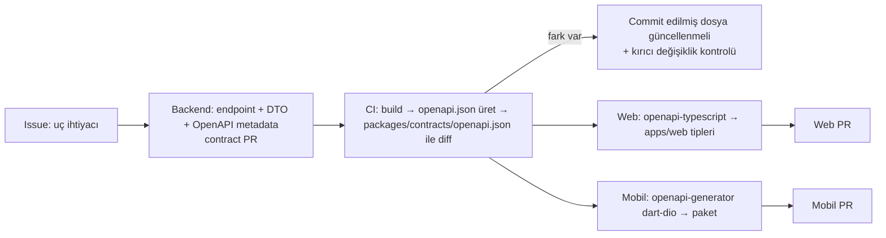

# API Stratejisi

> Sahip: Principal Software Architect · Durum: Taslak v1 · Tarih: 2026-11-04
> İlgili: [ADR 0007 OpenAPI contract-first](../adr/0007-openapi-contract-first.md) · [system-architecture.md §6](system-architecture.md#6-istek-yaşam-döngüsü)

## 1. Genel ilkeler

- REST, JSON (UTF-8), taban yol **`/api/v1`**. Tek API hem web hem mobil içindir (BFF yok).
- Minimal API, modül başına endpoint grubu (`MapGroup`). OpenAPI belgesi `Microsoft.AspNetCore.OpenApi` ile üretilir.
- Tüm uçlar varsayılan olarak kimlik doğrulama ister; anonim uçlar açıkça işaretlenir (`/health/*`).
- **Alan düzeyi yetki:** `prices.read.sell` / `prices.read.cost` izni olmayan rol için fiyat/maliyet alanları yanıttan çıkarılır (ör. `warehouse_staff` sipariş detayında fiyat yok — US-SEC-002); OpenAPI'de bu alanlar opsiyoneldir.
- İstemci verisi asla güvenilir değildir: `tenant_id`, `created_by`, fiyat (override izni yoksa), durum gibi alanlar gövdeden **alınmaz**.

## 2. Kaynak adlandırma

| Kural | Örnek |
|---|---|
| Çoğul, kebab-case isimler | `/api/v1/products`, `/api/v1/price-lists`, `/api/v1/picking-tasks` |
| Alt kaynak yalnızca gerçek sahiplikte | `/products/{id}/variants`, `/orders/{id}/lines`, `/customers/{id}/addresses` |
| Durum geçişleri = eylem alt yolu, `POST` | `/orders/{id}/approve`, `/orders/{id}/cancel`, `/shipments/{id}/confirm` |
| ID'ler | UUID (string); insan-dostu numaralar (`SIP-2026-000123`) ayrı alan, arama filtresi olarak |
| JSON alanları | `camelCase`; enum'lar `snake_case` string (`pending_approval`) |
| Tarih/saat | ISO 8601 UTC (`2026-11-04T09:30:00Z`); yalnızca tarih alanları `YYYY-MM-DD` |
| Para | `{ "amount": "1250.5000", "currency": "TRY" }` — `amount` **string** (ondalık kaybı olmasın) |
| Miktar | string ondalık (`"12.500"`) |

## 3. Sürümleme

- URL'de ana sürüm: `/api/v1`. Kırıcı değişiklik → `/api/v2` (aynı süreçte paralel; v1 en az 6 ay desteklenir, mobil sürüm dağılımına göre).
- v1 içinde yalnızca **geriye uyumlu** değişiklikler: yeni opsiyonel alan, yeni uç, yeni enum değeri (istemciler bilinmeyen enum'u tolere etmek zorunda — sözleşme kuralı).
- Kırıcı değişiklik tespiti CI'da OpenAPI diff ile yapılır ([ADR 0007](../adr/0007-openapi-contract-first.md)).
- Mobil uygulama `X-Client-Version` gönderir; desteklenmeyen sürüme `426`-benzeri Problem (`type: client-upgrade-required`).

## 4. Standart başlıklar

| Başlık | Yön | Açıklama |
|---|---|---|
| `Authorization: Bearer <jwt>` | İstek | Supabase access token |
| `X-Tenant-Id: <uuid>` | İstek | Tenant bağımsız uçlar hariç zorunlu |
| `Idempotency-Key: <uuid>` | İstek | Tüm `POST` oluşturma ve durum geçişi uçlarında zorunlu |
| `If-Match: "<etag>"` | İstek | Düzenlenebilir kaynaklarda `PATCH/PUT/DELETE` ve onay gibi geçişlerde zorunlu |
| `X-Correlation-Id` | İki yön | GUID ise normalize edilip (`N` biçimi) kullanılır; yoksa veya GUID değilse sunucu üretir; yanıtta döner |
| `X-Client-Version`, `X-Client-Platform` | İstek | `web`, `android`, `ios` |
| `Accept-Language` | İstek | `tr-TR` varsayılan (yalnızca sunucu tarafı metinler için) |
| `ETag` | Yanıt | `W/"<row_version>"` |
| `Location` | Yanıt | `201` oluşturmada |
| `Retry-After` | Yanıt | `429`, `409 inventory.busy` / `order.busy` / `picking.busy` / `idempotency.in_progress`, `503`; CORS ile tarayıcıya açılır (OpenAPI'de ilgili 409 yanıtlarında belgeli) |
| `RateLimit-*` | Yanıt | Kalan kota bilgisi |
| `Idempotent-Replayed: true` | Yanıt | Kayıtlı yanıt tekrar döndüyse |

## 5. Sayfalama, filtreleme, sıralama

### 5.1 Sayfalama
- **Keyset (cursor) pagination** varsayılandır: `?limit=50&cursor=<opaque>`. `limit` varsayılan 50, maks 200.
- Cursor: sıralama anahtarı + `id`'nin base64url JSON'ı (istemci içeriğini yorumlamaz). Sorgu: `WHERE (created_at, id) < (:c_created_at, :c_id) ORDER BY created_at DESC, id DESC LIMIT :limit + 1`.
- Yanıt zarfı:
```json
{
  "items": [ ... ],
  "page": { "nextCursor": "eyJ...", "hasMore": true, "limit": 50 }
}
```
- Toplam sayı varsayılan olarak döndürülmez (pahalı); gerekiyorsa `?includeTotal=true` (yalnızca küçük koleksiyonlarda izinli) veya ayrı `/count` ucu.
- Küçük referans listeleri (birimler, markalar, depolar) sayfasız tam liste döner (üst sınır 1000).

### 5.2 Filtreleme
- Basit alan filtreleri query param: `?status=approved&customerId=…&warehouseId=…`.
- Çoklu değer: virgülle `?status=approved,picking`.
- Aralık: `?createdFrom=2026-11-01&createdTo=2026-11-30`, `?minAvailable=1`.
- Serbest arama: `?q=` (ad/SKU/barkod; trigram + tam eşleşme önceliği).
- Özel alan: `?attr.renk=kirmizi` → `attributes @> '{"renk":"kirmizi"}'` (yalnızca `filterable` tanımlı alanlar).
- Her uç izin verilen filtreleri OpenAPI'de açıkça listeler; bilinmeyen filtre `400`.

### 5.3 Sıralama
- `?sort=-createdAt` (eksi = azalan), çoklu: `?sort=name,-createdAt`. Uç başına izin listesi; keyset ile uyumlu olmayan sıralamalar desteklenmez veya offset'e düşmez — izin listesinde yoksa `400`.

## 6. Hata modeli (RFC 9457)

```json
{
  "type": "https://bayios.app/problems/inventory.insufficient_stock",
  "title": "Yetersiz stok",
  "status": 409,
  "detail": "2 satır için kullanılabilir stok yetersiz.",
  "instance": "/api/v1/orders/0193.../approve",
  "code": "inventory.insufficient_stock",
  "correlationId": "c-7f3a...",
  "errors": null,
  "shortages": [ { "variantId": "...", "sku": "ABC-1", "requested": "10.000", "available": "4.000" } ]
}
```

| HTTP | Kullanım | Örnek `code` |
|---|---|---|
| 400 | Biçim/şema hatası, bilinmeyen filtre | `request.malformed` |
| 401 | Token yok/geçersiz/süresi dolmuş | `auth.invalid_token` |
| 403 | İzin yok, üyelik yok, tenant aktif değil (`suspended`/`closed`), entitlement yok | `auth.forbidden`, `tenant.access_denied`, `tenant.inactive`, `entitlement.required`, `entitlement.limit_exceeded` |
| 404 | Kaynak yok (tenant içinde) | `resource.not_found` |
| 409 | İş kuralı / durum çakışması | `order.invalid_transition`, `inventory.insufficient_stock`, `inventory.busy`, `idempotency.in_progress` |
| 412 | `If-Match` uyuşmazlığı | `concurrency.version_mismatch` |
| 422 | Alan doğrulama hataları (`errors` sözlüğü) | `validation.failed`, `idempotency.key_reused` |
| 428 | Zorunlu `If-Match` / `Idempotency-Key` eksik | `precondition.required` |
| 429 | Hız sınırı | `rate_limit.exceeded` |
| 500/503 | Beklenmeyen / bakım | `server.error` (detay sızdırılmaz) |

`code` alanı istemcilerin yerelleştirme anahtarıdır; `title/detail` yalnızca geliştirici yardımıdır.

Uzantılar (OpenAPI şemaları, #86): `StockProblemDetails` — `shortages[]` (variantId, sku, warehouseId, locationId, requested, available) ve `confirmationRequired` (negatif stok politikası `warn`: aynı isteği onay bayrağıyla tekrarla); `CodeConflictProblemDetails` — `409 catalog.sku_taken` / `catalog.barcode_taken` için `conflict` {field: sku | barcode, value, variantId, productId, sku} (yalnızca eşzamanlı bir yazımı veritabanı indeksi yakaladığında yoktur). Para alanları şimdilik JSON sayısı (`number`) olarak yayınlanır; istemci para hesabı yapmaz, toplamlar API'den gelir (karar #86).

**Koşullu (K) / kendi kayıtları (O) izinleri (#69):** uç izin(ler)ini bildirir (`x-permission`; birden çoğu yeterliyse `x-permission-any-of`). Koşulsuz izin olduğu gibi geçer; tenant kuralına bağlı K (dipnot 2, 3, 6, 9) kural açıksa koşulsuz, kapalıysa `403 auth.disabled_by_tenant_rule` (#111); kayıt düzeyi K/O (dipnot 1, 4, 5, 7, 8, 10, 11, 12, O) kapıdan geçer ve uygulama servisi `IAuthorizationContext` ile koşulu uygular. Hiçbir servis koşulu değerlendirmezse başarılı yanıt `403 auth.forbidden`'a çevrilir ve transaction geri alınır (fail-closed; bu güvenlik ağı bilerek genel kodda kalır). Görünürlük koşulunun dışındaki kayıt `404`, görünür ama işleme kapalı kayıt `403` döner.

**403 kod kataloğu (#111).** Hepsi `403`; istemci `code`'a göre mesaj seçer, `title` geliştirici yardımıdır (#111 öncesi başlıklar değişmedi — eski istemciler başlığı ayrıştırmaya devam edebilir).

| `code` | Ne zaman | Uzantılar |
|---|---|---|
| `auth.forbidden` | Rolde izin hiç yok (matris "–"); alan düzeyi izin eksik; fail-closed güvenlik ağı | — |
| `auth.disabled_by_tenant_rule` | Rol izni K olarak taşıyor ama bağlı tenant kuralı kapalı: uç kapısında (ör. sales `approve`/`reject`/`close-remaining`, "Satış personeli sipariş onaylayabilir" kapalı — dipnot 9; depo personeli barkod/mal kabul onayı — dipnot 2, 6) ve alan düzeyinde (sales iskonto sınırı %0 iken manuel fiyat/iskonto — dipnot 10). Başlık eskisiyle aynı (`Not allowed` / `Missing permission: …`) | `permission`, `condition` (koşul kodu) |
| `orders.not_owner` | sales başkasının taslağını düzenler (O) veya başkasının siparişini iptal eder (dipnot 11) | `permission` |
| `orders.cancel_not_allowed_in_status` | sales kendi siparişini Taslak / Onay bekliyor dışındaki bir durumda iptal eder (dipnot 11) | `permission`, `orderStatus` |
| `orders.discount_limit_exceeded` | Satır iskontosu satış iskonto sınırını aşıyor (dipnot 10) | `permission`, `limitPercent` |
| `orders.manual_price_not_allowed` | İskonto sınırı altındaki sales manuel birim fiyat giriyor (dipnot 10) | `permission`, `limitPercent` |
| `entitlement.required` | Tenant'ın paketi / ek modülleri / override'ları özelliği vermiyor (#51). İzin kapısı önce değerlendirilir: izni olmayan çağıran `auth.forbidden` alır, paket bilgisi öğrenmez | `feature`, `suggestedPlan`, `suggestedModule` (kataloğun önerisi; yoksa `null`) |
| `entitlement.limit_exceeded` | Bir tane daha eklemek paket limitini aşar (#51; ör. Temel'de 2. aktif depo, aylık AI ayrıştırma kotası). Transaction geri alınır, mevcut veri okunur kalır | `feature` (limit kodu), `limit`, `current`, `suggestedPlan`, `suggestedModule` |

OpenAPI: ilgili sipariş uçlarının `description` alanı bu kodları listeler. Entitlement uçları `x-entitlement` (gereken özellik) ve `x-entitlement-limit` (zorlanan limit kodları) uzantılarını ve 403 için `EntitlementProblemDetails` şemasını taşır.

## 7. Idempotency

- `Idempotency-Key` zorunlu: tüm oluşturma `POST`'ları ve durum geçişleri. Eksikse `428`; 100 karakterden uzun veya birden çok değer → `400 request.malformed`.
- **Uygulama (#68):** uç tanımında tek çağrı — `.RequireIdempotencyKey()` (`BayiOS.SharedKernel`, `WithUnitOfWork` ile birlikte). Filtre istek UnitOfWork transaction'ı **içinde** çalışır (ilk taslaktaki "ayrı kısa transaction" yerine): anahtar kaydı ile iş yazımı birlikte commit olur ya da birlikte geri alınır; çökme sonrası `in_progress`'te takılı anahtar kalmaz.
- Akış:
  1. `INSERT INTO platform.idempotency_keys (…, status='in_progress') ON CONFLICT (kapsam, key) DO UPDATE … WHERE expires_at <= now` — süresi dolmuş anahtar yeni sayılır. Aynı anahtarla eşzamanlı ikinci istek unique index üzerinde ilk transaction bitene kadar bekler (`lock_timeout` 5 sn), sonra kayıtlı yanıtı alır; süre aşılırsa `409 idempotency.in_progress` + `Retry-After`.
  2. Canlı kayıt varsa: farklı kullanıcı veya farklı hash (metot + gerçek yol + bağlanmış JSON gövde, SHA-256) → `422 idempotency.key_reused`; aynı → kayıtlı yanıt birebir (durum, `Content-Type`/`Location`/`ETag`, gövde baytları) + `Idempotent-Replayed: true`.
  3. Handler 2xx dönerse yanıt aynı transaction'da kaydedilir (`status='completed'`). 4xx/5xx sonuçlarda transaction (anahtar dahil) geri alınır: hata yanıtları **saklanmaz**, aynı anahtarla düzeltilmiş istek yeniden çalışır (iş yazımı da geri alındığından çift etki olmaz).
- Saklama: 24 saat (`expires_at`); temizlik job'ı henüz yok (job altyapısı gelince `ix_idempotency_keys_expires_at` ile silinecek).
- Anahtar kapsamı: tenant'lı uçlarda (tenant_id, key); tenant'sız uçlarda (ör. `POST /tenants`) (user_id, key). Aynı anahtarın farklı kullanıcı/uç ile kullanımı `422`.

## 8. Optimistic concurrency (ETag / If-Match)

- Düzenlenebilir aggregate'ler (`products`, `product_variants`, `price_lists`, `customers`, `warehouses`, `orders` (taslak düzenleme ve geçişler), `tenant_settings`) `row_version` taşır.
- `GET` yanıtı `ETag: W/"17"`; `PATCH/PUT/DELETE` ve `approve` gibi geçişler `If-Match` ister. Uyuşmazlık → `412`; eksik → `428`.
- Güncelleme: `UPDATE … SET …, row_version = row_version + 1 WHERE id = :id AND row_version = :expected` (EF Core concurrency token). Etkilenen satır 0 → 412.
- Kısmi güncelleme `PATCH` + JSON Merge Patch (`application/merge-patch+json`).

## 9. Hız sınırlama

- ASP.NET Core yerleşik `RateLimiter` middleware'i.
- Bölümleme: `tenant_id + user_id` (kimlikli), IP (kimliksiz/başarısız auth).
- Başlangıç politikaları (yapılandırılabilir) için **tek kaynak `docs/security/threat-model.md` §6.5**: okuma 300/dk, yazma 60/dk (kullanıcı + tenant); AI ayrıştırma 30/saat/tenant + aylık entitlement kotası; import 10/saat/tenant; export 10/saat/tenant; auth hataları 30/dk/IP.
- Not: MVP'de sayaçlar süreç içi (instance başına). Çoklu instance'ta dağıtık limit gerekirse ADR.

## 10. Diğer konvansiyonlar

- **Oluşturma:** `201 Created` + `Location` + kaynak gövdesi.
- **Durum geçişleri:** `200 OK` + güncel kaynak (istemci ayrıca GET yapmasın).
- **Uzun işlemler** (import, AI ayrıştırma): `202 Accepted` + `Location: /api/v1/import-jobs/{id}`; istemci polling (sonra SignalR/FCM).
- **Dosya yükleme:** `multipart/form-data` API'ye (boyut ≤ 10 MB, `.xlsx/.csv`, içerik imzası kontrolü — PRD IMP-01'deki 20 MB / `.xls` ile fark ürün sahibi kararı bekliyor, bkz. `docs/operations/phase0-gate.md`) → API Storage'a yazar. İndirme: API `GET …/download-url` ile kısa ömürlü (ör. 5 dk) imzalı URL döner.
- **Toplu işlemler:** `POST /products/bulk` gibi uçlar en fazla 500 öğe, satır bazında sonuç (`207` değil, `200` + `results[]`).
- **Silme:** iş kaynaklarında `DELETE` = arşivleme (`archived_at`); `204`.
- **Genişletme:** `?include=lines,customer` yalnızca dokümante edilmiş ilişkiler.
- **Gerçek zamanlı (Hafta 8+):** SignalR hub `/hubs/tenant`; olay adları outbox tipleriyle aynı (`order_status_changed`); istemci olay aldığında ilgili sorguyu yeniden çeker (olay = invalidation sinyali, veri taşıyıcı değil).

## 11. Contract-first iş akışı



1. **Sözleşme önce:** Yeni/değişen uç önce backend'de iskelet (DTO, route, status kodları, örnekler; handler `501` dönebilir) olarak tanımlanır ve `packages/contracts/openapi.json` güncellenmiş hâliyle "contract PR" açılır. Principal Architect sözleşme review'u yapar.
2. **Tek doğruluk kaynağı:** Commit edilmiş `openapi.json`. CI, API'yi derleyip belgeyi build sırasında üretir (`Microsoft.Extensions.ApiDescription.Server` ile build-time üretim veya test host'tan `/openapi/v1.json` çekme) ve commit'li dosyayla **byte-düzeyinde** karşılaştırır; fark varsa CI kırmızı.
3. **Kırıcı değişiklik kontrolü:** CI'da `preview` dalındaki sözleşme ile OpenAPI diff aracı (ör. oasdiff) çalışır; kırıcı değişiklik `v1` altında bloklanır.
4. **İstemci üretimi:**
   - Web: `openapi-typescript` → `apps/web/src/lib/api/schema.d.ts` (üretilmiş, commit'li veya build'de üretilir — web ekibi kararı; CI drift kontrolü aynı mantıkla).
   - Mobil: `openapi-generator` (`dart-dio`) → `apps/mobile/packages/bayios_api` (ileride; o zamana kadar elle yazılmış ince dio katmanı, yalnızca sözleşmedeki tiplerle).
5. **Mock:** Ön yüz, backend hazır olmadan sözleşmeden mock (MSW) ile ilerleyebilir.
6. OpenAPI'de her uç: `operationId` (`Orders_Approve`), `tags` (modül), güvenlik şeması, tüm hata yanıtları (`application/problem+json`), örnekler, `x-permission` ve `x-entitlement` uzantıları, gerekli başlık parametreleri (`X-Tenant-Id`, `Idempotency-Key`, `If-Match`).

## 12. MVP uç listesi (ilk sürüm)

`{id}` = UUID. Tüm uçlar `/api/v1` altında. **İ** = Idempotency-Key, **M** = If-Match.

> **İzin sütunu** taslak grup adlarını kullanır. Kanonik izin kimlikleri `docs/product/roles-permissions.md` §3'tedir; eşleme [data-model §3](data-model.md#3-roller-ve-izinler-karar). W3 Gün 12 sözleşme PR'ında kanonik kimliklere geçilir (Phase 0 kapısı koşulu).

### 12.1 Identity & Tenancy
| Metot | Yol | İzin | Not |
|---|---|---|---|
| GET | `/me` | (kimlik) | Profil + üyelikler (tenant listesi; her üyelikte `status` = üyelik durumu, `tenantStatus` = tenant durumu `active`/`suspended`/`closed` — #111, seçici askıdaki/kapalı işletmeyi pasif gösterir); `X-Tenant-Id` gerekmez. Başlık aktif tenant'taki aktif bir üyeliği gösterirse `activeTenant`: rol + etkin izinler (`scope`: `all` / `conditional` / `own`, `condition` kodu, `parameters` — koşulun tenant değeri, şimdilik yalnızca `orders.discount_within_limit` için `maxDiscountPercent`; diğerlerinde `null`; §4 tenant kuralları uygulanmış). Aksi hâlde `activeTenant: null` (hata değil) |
| GET | `/me/permissions` | (üyelik) | Etkin rol, izinler, entitlement'lar |
| PATCH | `/me` | (kimlik) | Profil |
| POST | `/tenants` | (kimlik) | Yeni tenant (İ); çağıran owner olur, deneme planı |
| GET/PATCH | `/tenant` | `tenant.manage` (PATCH, M) | Aktif tenant bilgisi |
| GET/PATCH | `/tenant/settings` | `tenant.manage` (M) | Uygulanan izin `tenant.settings.manage` (owner/admin), ETag/If-Match. #92 ile `requireOrderApproval` (varsayılan `true`) ve `orderNumberPrefix` (varsayılan `SIP`; 1–10 karakter A–Z/0–9, harfle başlar, küçük harf büyütülür) |
| GET | `/members` (role, status, permission, limit, cursor) | `members.read` | Uygulandı (#86): aktif tenant üyeleri (userId, displayName, fullName, email, role, status), membership id keyset; personel seçici. Okuma matristeki `members.read` ile (owner/admin/manager = `tasks.assign` sahipleriyle aynı küme). `permission` (#111, virgüllü = hepsi): rolü bu izinleri aktif tenant kurallarıyla taşıyan üyeler (kayıt düzeyi K/O sayılır, kuralı kapalı K sayılmaz); `role` ile kesişir; bilinmeyen izin kimliği `400 request.malformed` |
| GET | `/members/invitations` (status) | `members.read` | Uygulandı (#129): en yeni 200 davet; `status` = pending, accepted, revoked, expired (süresi geçmiş pending `expired` görünür). Token hiç dönmez |
| POST | `/members/invitations` | `members.invite` | Uygulandı (#129): `{email, role}` → 201 `{invitation, token}`. Token bir kez gösterilir, yalnızca SHA-256 saklanır; yanıt idempotency deposuna yazılmasın diye **Idempotency-Key almaz** (doğal idempotent: e-posta başına tek bekleyen davet → 409 `invitation.already_pending` + `invitationId`). 403 `members.role_not_grantable`, 409 `members.already_member`, 403 `entitlement.limit_exceeded` (`max_users`) |
| POST | `/members/invitations/{id}/resend` | `members.invite` | Uygulandı (#129): yeni token + yeni 7 gün; eski token geçersiz. Idempotency-Key almaz (aynı gerekçe). 409 `invitation.not_pending` |
| POST | `/members/invitations/{id}/revoke` | `members.invite` (İ) | Uygulandı (#129): bekleyen daveti iptal (silmez) |
| PUT | `/members/{userId}/role` | `members.manage` (İ) | Uygulandı (#129): `{role}`; owner verilemez (devir), 403 `members.not_manageable` / `members.role_not_grantable`, 409 `members.last_owner` |
| POST | `/members/{userId}/disable`, `/members/{userId}/enable` | `members.manage` (İ) | Uygulandı (#129): erişim bir sonraki istekte kesilir/açılır; 409 `members.cannot_disable_self`, `members.last_owner`; enable `max_users`'a tabi |
| POST | `/members/ownership-transfer` | `ownership.transfer` (İ) | Uygulandı (#129): `{userId}` aktif üye owner, çağıran admin olur |
| POST | `/invitations/accept` | (kimlik) (İ) | Uygulandı (#129): `{token}`, `X-Tenant-Id` yok. E-posta ve doğrulama yalnızca token claim'lerinden (`email`; `email_verified` veya Supabase `user_metadata.email_verified`; `is_anonymous` değil). 404 `invitation.not_found` (bilinmeyen/kullanılmış/iptal/yenilenmiş — tek yanıt), 403 `invitation.email_mismatch`, 403 `invitation.email_not_verified`, 410 `invitation.expired`, 409 `invitation.already_member`, 403 `tenant.inactive`, 403 `entitlement.limit_exceeded`. Davetlinin tenant'ı `identity.find_invitation_tenant` (SECURITY DEFINER) ile bulunur, gerisi o tenant bağlamında RLS ile (system-architecture §10 açık noktası, phase0-gate C-5) |

### 12.2 Billing & Entitlements
| GET | `/billing/plans` | (kimlik) | |
| GET | `/billing/subscription` | `billing.manage` | |
| GET | `/billing/usage` | `billing.manage` | Sayaçlar |

> **Uygulanan durum (#51/#52, JOB 14):** ödeme yok, ücret alınmaz. `GET /billing/plans` (yalnızca kimlik; tenant ve DB yok):
> sürümlü katalog (`catalogVersion`, `trialPlan` = professional, `fallbackPlan` = basic, `trialDays`, `moduleTrialDays`,
> planlar ve ek modüller; özellik/limit kodlarıyla, fiyatsız). Okumalar `billing.read` (owner, admin — matris §3.1):
> `GET /billing/subscription` (etkin paket, durum `trialing|active|expired|cancelled`, `trialEndsAt`, özellikler,
> limitler, modüller), `GET /billing/modules` (modül mağazası: `included_in_trial|trialing|active|cancelled|expired|available|unavailable`,
> `canActivate`, `canDeactivate`), `GET /billing/usage` (limit başına `limit` / `current` / `remaining`; `ai_parses_per_month`
> için `period = month`). Değişiklikler `billing.manage` (owner) + Idempotency-Key, denetim kaydıyla:
> `POST /billing/modules/{code}/activate` (ücretsiz, süreli etkinleştirme — modül ve tenant başına bir kez; tenant
> denemesi sırasında başlatılırsa süre deneme bitiminde başlar; kapatılan modül süre bitene kadar yeniden açılabilir) ve
> `POST /billing/modules/{code}/deactivate` (veri silinmez). Kodlar: `409 billing.module_unavailable` (henüz yapılmadı),
> `billing.module_already_active`, `billing.trial_used`, `billing.module_not_active`; bilinmeyen modül `404`. Paket
> değişikliği (Temel ↔ Profesyonel) API'de yok: ödeme entegrasyonu ürün sahibi onayı gerektirir; pilot/operatör
> değişiklikleri `billing.tenant_entitlements` override'ı ile yapılır (SUB-08).
>
> `GET /me` aktif tenant için `activeTenant.entitlements` döner (plan, status, trialEndsAt, catalogVersion, features,
> limits — `null` = sınırsız); her rol görür (fiyat/ödeme bilgisi yok). Ayrı `/me/permissions` yok.
>
> Uç kuralı: `.RequireEntitlement("feature")` (SharedKernel) izin kapısıyla aynı yetkilendirme adımında çalışır, fail-closed
> (tenant yok / entitlement servisi yok / özellik yok → red); limitler servislerde `IEntitlements.EnsureCapacityAsync`
> ile, sayım tenant başına transaction kilidiyle kontrol edilir. Okuma uçları ve dışa aktarmalar asla kapılanmaz (SUB-06, REP-08).
> Uygulanan kapılar: `POST /warehouses/{id}/locations`, `PATCH /locations/{id}` (`warehouse_locations`); `POST /warehouses`
> ve `PATCH /warehouses/{id}` (aktif depo sayısı `max_warehouses`; `usesLocations = true` → `warehouse_locations`);
> `POST /ai/order-parses` (`ai_order_parsing` + aylık `ai_parses_per_month`).

### 12.3 Catalog
| Metot | Yol | İzin |
|---|---|---|
| GET | `/products` (q, categoryId, brandId, status, attr.*) | `catalog.read` |
| POST | `/products` (İ) | `catalog.write` |
| GET | `/products/{id}` | `catalog.read` |
| PATCH | `/products/{id}` (M) | `catalog.write` |
| DELETE | `/products/{id}` (arşiv, M) | `catalog.write` |
| POST | `/products/{id}/variants` (İ) | `catalog.write` |
| PATCH/DELETE | `/variants/{id}` (M) | `catalog.write` |
| GET | `/variants` (q, sku, barcode, productId, status) | `catalog.read` |
| GET | `/variants/batch?ids=` | `catalog.read` | Toplu görüntüleme okuması: 1–100 id (virgülle; tekrarlar tekilleşir) → id, productId, sku, name, productName, barcode, status (SKU sırasıyla). Bulunmayan / başka tenant'a ait id'ler sonuçta yer almaz (404 yok, ipucu yok); sayfasız ayrı yanıt şekli olduğu için listeye `ids` parametresi yerine ayrı uç |
| GET | `/variants/lookup?barcode=` | `catalog.read` | Mobil okutma; tek sonuç veya 404 |
| POST/DELETE | `/variants/{id}/barcodes` · `/variants/{id}/barcodes/{barcodeId}` | `catalog.write` |
| POST/DELETE | `/variants/{id}/aliases` · `/variants/{id}/aliases/{aliasId}` | `catalog.write` |
| GET/POST/PATCH/DELETE | `/categories`, `/brands`, `/units`, `/suppliers` | read / write |
| GET/POST/PATCH/DELETE | `/custom-fields` (entityType) | `catalog.read` / `tenant.manage` |

### 12.4 Pricing
| GET/POST | `/price-lists` | `pricing.read` / `pricing.write` (İ) |
| GET/PATCH/DELETE | `/price-lists/{id}` | (M) |
| GET | `/price-lists/{id}/items` | `pricing.read` |
| PUT | `/price-lists/{id}/items` (toplu upsert ≤ 500, İ) | `pricing.write` |
| DELETE | `/price-lists/{id}/items/{itemId}` | `pricing.write` |
| POST | `/pricing/quote` | `orders.write` | Müşteri + satırlar → çözümlenmiş fiyatlar (yan etkisiz; İ gerekmez) |

### 12.5 Customers
| GET/POST | `/customers` (q, dealerGroupId, status) | `customers.read` / `customers.write` (İ) |
| GET/PATCH/DELETE | `/customers/{id}` (M) | |
| GET/POST | `/customers/{id}/addresses` | |
| PATCH/DELETE | `/customers/{id}/addresses/{addressId}` | |
| GET/POST/PATCH/DELETE | `/dealer-groups` | `customers.read` / `customers.write` |

### 12.6 Warehouse & Inventory
| Metot | Yol | İzin | Not |
|---|---|---|---|
| GET/POST | `/warehouses` | `inventory.read` / `tenant.manage` (İ) | |
| GET/PATCH | `/warehouses/{id}` (M) | | |
| GET/POST | `/warehouses/{id}/locations` | | |
| PATCH | `/locations/{id}` (M) | `tenant.manage` | |
| GET | `/inventory/balances` (variantId, warehouseId, locationId, q, belowThreshold) | `inventory.read` | on_hand, reserved, available. `q` uygulandı (#86, inventory-and-orders §6). #137: her satırda `minQuantity` (satırın deposundaki etkin minimum: depo istisnası, yoksa genel eşik; yoksa null) ve `belowMinimum` (varyantın o depodaki tüm raflarının satılabilir toplamı ≤ minQuantity). `belowThreshold` filtresi henüz yok (liste görünümü: kritik stok raporu) |
| GET | `/inventory/thresholds` (variantId, variantIds ≤ 100, warehouseId, limit, cursor) | `inventory.read` | #137 minimum stok eşikleri; `warehouseId = null` satır = genel eşik. Keyset (id) |
| GET | `/inventory/thresholds/{id}` | `inventory.read` | ETag |
| POST | `/inventory/thresholds` (İ) | `catalog.write` | Upsert (variantId, warehouseId?) → 201 yeni / 200 güncellendi veya aynı; son yazan kazanır |
| POST | `/inventory/thresholds/bulk` (İ) | `catalog.write` | 1–500 satır, hepsi ya da hiçbiri: `{variantId, warehouseId?, minQuantity}` ayarla, `{…, remove: true}` kaldır; yanıt created/updated/removed/unchanged + satırlar |
| PUT / DELETE | `/inventory/thresholds/{id}` (M) | `catalog.write` | If-Match zorunlu (428 / 412) |
| GET | `/inventory/availability?variantIds=…&warehouseId=` | `inventory.read` | Sipariş ekranı |
| GET | `/inventory/movements` (variantId, warehouseId, type, from, to) | `inventory.read` | Stok kartı, keyset |
| POST | `/inventory/receipts` (İ) | `inventory.receive` | §4.1 |
| POST | `/inventory/adjustments` (İ) | `inventory.adjust` | §4.2 |
| POST | `/inventory/transfers` (İ) | `inventory.transfer` | §4.7 |
| GET/POST | `/stock-counts` (İ) | `inventory.count` | |
| GET | `/stock-counts/{id}` | `inventory.count` | |
| PUT | `/stock-counts/{id}/lines` (M) | `inventory.count` | Sayılan miktarlar (toplu) |
| POST | `/stock-counts/{id}/submit` · `/apply` · `/cancel` (İ) | `inventory.count` / apply: `inventory.adjust` | §4.8 |

### 12.7 Orders
| Metot | Yol | İzin | Not |
|---|---|---|---|
| GET | `/orders` (status, customerId, source, from, to, q) | `orders.read` | keyset |
| POST | `/orders` (İ) | `orders.write` | Draft |
| GET | `/orders/{id}` (include=lines,history,shipments) | `orders.read` | |
| PATCH | `/orders/{id}` (M) | `orders.write` | Yalnızca Draft |
| PUT | `/orders/{id}/lines` (M) | `orders.write` | Satırları toptan değiştir (Draft) |
| POST | `/orders/{id}/submit` (İ, M) | `orders.submit` | Adres snapshot'ı; `requireOrderApproval = false` ise onay yetkisi olan için aynı transaction'da onay + rezervasyon (#92, inventory-and-orders §7) |
| POST | `/orders/{id}/withdraw` (İ) | `orders.submit` | |
| POST | `/orders/{id}/reject` (İ) | `orders.approve` | |
| POST | `/orders/{id}/approve` (İ, M) | `orders.approve` | Rezervasyon |
| POST | `/orders/{id}/cancel` (İ) | `orders.cancel` | |
| POST | `/orders/{id}/close-remaining` (İ) | `orders.approve` | Short-close |
| POST | `/orders/{id}/complete` (İ) | `orders.write` | |
| GET | `/orders/{id}/history` | `orders.read` | |

### 12.8 Fulfillment (Warehouse)
| GET | `/picking-tasks` (warehouseId, status, assignedTo=me) | `fulfillment.pick` | Mobil iş listesi |
| GET | `/picking-tasks/{id}` | `fulfillment.pick` | |
| POST | `/picking-tasks/{id}/assign` (İ) | `fulfillment.pick` | |
| POST | `/picking-tasks/{id}/start` (İ) | `fulfillment.pick` | |
| POST | `/picking-tasks/{id}/scans` (İ) | `fulfillment.pick` | barkod, lokasyon, miktar (§4.5) |
| POST | `/picking-tasks/{id}/complete` (İ) | `fulfillment.pick` | |
| POST | `/shipments` (İ) | `fulfillment.ship` | Siparişten taslak sevkiyat (varsayılan: toplanan miktarlar) |
| GET | `/shipments/{id}` · `/shipments?orderId=` | `orders.read` | |
| PATCH | `/shipments/{id}` (M) | `fulfillment.ship` | Taşıyıcı, takip no, satırlar (draft) |
| POST | `/shipments/{id}/confirm` (İ) | `fulfillment.ship` | §4.6 |
| POST | `/shipments/{id}/cancel` (İ) | `tasks.assign` | Uygulandı (#86): onaylanmamış sevkiyat iptali; stok/rezervasyon değişmez, putaway görevi (inventory-and-orders §8) |

### 12.9 Imports
| POST | `/import-jobs` (multipart, İ) | `imports.run` | `202` |
| GET | `/import-jobs` · `/import-jobs/{id}` | `imports.run` | |
| GET | `/import-jobs/{id}/rows?status=invalid` | `imports.run` | |
| PUT | `/import-jobs/{id}/mapping` | `imports.run` | |
| POST | `/import-jobs/{id}/validate` · `/start` · `/cancel` (İ) | `imports.run` | |
| GET | `/import-templates/{type}` | `imports.run` | İmzalı URL |

### 12.10 Integrations (AI) — entitlement: `ai_order_parsing`
| POST | `/ai/order-parses` (İ) | `ai.parse` | `{ text, customerId? , senderPhone? }` → `202` |
| GET | `/ai/order-parses` (status) · `/ai/order-parses/{id}` | `ai.review` | Eşleşme adaylarıyla |
| PUT | `/ai/order-parses/{id}/lines` (M) | `ai.review` | Kullanıcının satır/varyant seçimleri |
| POST | `/ai/order-parses/{id}/approve` (İ) | `ai.review` | Draft sipariş oluşturur → `orderId` |
| POST | `/ai/order-parses/{id}/reject` (İ) | `ai.review` | |

> **Güncelleme (#121):** `POST /ai/order-parses` (İ) artık `202` + `Location: /ai/order-parses/{id}/status` döner
> (`{ id, status: pending, statusUrl, resultUrl, pollAfterMs }`); ayrıştırma arka plan job'ında çalışır. Yeni uçlar:
> `GET /ai/order-parses/{id}/status` (`pending | succeeded | failed`, `Cache-Control: no-store`), `GET /ai/settings`
> (opt-in + giriş limitleri, ETag) ve `PUT /ai/settings` (`tenant.settings.manage`, If-Match isteğe bağlı),
> `GET /ai/aliases`, `DELETE /ai/aliases/{id}`. Gövde `{ text, customerId?, warehouseId? }`; onay satırında `unit?`,
> `learnAlias?`. Yeni kod: `409 ai.opt_in_required`. Aşağıdaki "senkron/201" ifadesi tarihseldir.
>
> **Uygulanan durum (#47/#48/#50, JOB 12):** izin `whatsapp.parse` (matris §3.5; `ai.parse`/`ai.review` gruplarının
> karşılığı), onay ayrıca `orders.create` ister (servis kontrol eder). `POST /ai/order-parses` (İ) senkron çalışır ve
> `201` + inceleme yükü döner (`202` değil; ADR 0010 uygulama notları); gövde `{ text, customerId? }` (`senderPhone`
> yok — telefon zaten maskelenir). `GET /ai/order-parses?status=&limit=` (metinsiz liste), `GET /ai/order-parses/{id}`
> (ETag), `POST /ai/order-parses/{id}/approve` (İ, If-Match isteğe bağlı; satır seçimleri gövdede — ayrı `PUT …/lines`
> yok) → güncel ayrıştırma + `orderId`, `POST /ai/order-parses/{id}/reject` (İ), `GET /ai/usage` (bugünkü kullanım ve
> limitler). Kodlar: `429 ai.rate_limited` (+ `Retry-After`), `409 ai.parse_not_reviewable`, `409 ai.parse_text_purged`;
> Orders doğrulama hataları aynen iletilir. Entitlement (#51): `POST /ai/order-parses` `ai_order_parsing` ister (AI
> WhatsApp asistanı ek modülü; tenant denemesinde açık) — yoksa `403 entitlement.required`; ek modülün aylık kotası
> `ai_parses_per_month` dolunca `403 entitlement.limit_exceeded` (saatlik `429 ai.rate_limited` ile aynı sayaçta, tenant
> başına kilitle). Liste/okuma, onay ve red ek modül kapalıyken de açıktır (mevcut ayrıştırmalar sipariş akışında takılı
> kalmaz). AI sağlayıcı çağrısı ayrıca `Ai:Enabled` bayrağı ve günlük limitlerle sınırlıdır.

### 12.11 Audit & Notifications
| GET | `/audit-events` (entityType, entityId, actor, from, to) | `audit.read` |
| GET | `/devices` | `tenant.read` (her rol) | Bu işletmede kendi push kayıtlarım (token dönmez) — #44 |
| POST | `/devices` (İ) | `tenant.read` (her rol) | FCM token kaydı/yenileme; başka kullanıcıdaki/işletmedeki token çağırana taşınır; 422 `validation.failed` |
| DELETE | `/devices/{id}` | `tenant.read` (her rol) | Kendi kaydı (çıkış, işletme değişimi); yoksa 404 |
| GET | `/notifications` · POST `/notifications/{id}/read` | (üyelik) | |

### 12.12 Platform
| GET | `/health/live`, `/health/ready` | anonim |
| GET | `/openapi/v1.json` | yalnızca local/preview |

### 12.13 Reports (#53) — entitlement yok (dışa aktarma hiçbir pakette kilitlenmez, roles-permissions §5)
| GET | `/reports/critical-stock` (threshold, warehouseId, includeOutOfStock, limit, cursor) | `reports.read` | REP-03: aktif varyantlardan kullanılabilir (Σ eldeki − Σ rezerve; hiç bakiyesi olmayan = 0) ≤ eşik. SKU sırasıyla keyset (100, en fazla 500). **#137:** `threshold` verilmezse `mode = thresholds` — her varyant kendi etkin minimumuna göre (data-model §5.7 `stock_thresholds`), minimumu olmayanlar hariç; `includeOutOfStock=true` ile minimumu olmayan ve kullanılabilir ≤ 0 olanlar da. `threshold` verilirse `mode = fixed` (eski davranış: tüm aktif varyantlar ≤ eşik); ikisi birlikte 422. Yanıt: `mode`, `threshold` (fixed'de değer, aksi null), `includeOutOfStock`, `thresholdsConfigured` (kapsamda en az bir eşik var mı), satırda `minQuantity` |
| GET | `/reports/orders` (from, to, status) | `reports.read` | REP-04: oluşturma günü (Europe/Istanbul) × güncel durum × para birimi; adet ve genel toplam |
| GET | `/reports/top-products` (from, to, limit) | `reports.read` | REP-06: onaylanmış ve sonrası (approved, picking, packed, shipped, completed) siparişlerin satırları; miktar, sipariş sayısı, tutar (satır toplamı, KDV hariç) |
| GET | `/reports/stock-movements` (from, to, warehouseId) | `reports.read` | REP-07: ledger, gün × hareket tipi: adet, giriş, çıkış miktarı (maliyet yok) |
| GET | `/reports/picking-tasks` (from, to, warehouseId) | `reports.read` | REP-05 (tenant düzeyi): pick görevleri, kendi olay gününe göre oluşturulan / tamamlanan / eksikle tamamlanan / iptal, ortalama toplama süresi (dk). Personel kırılımı yok |
| GET | `/reports/ai-usage` (from, to) | `billing.read` | AI asistan sayaçları (`integrations.ai_usage`) gün bazında: ayrıştırma, AI çağrısı, hata, geri dönüş, token'lar — owner/admin |
| POST | `/reports/{critical-stock\|orders\|top-products\|stock-movements\|picking-tasks}/export` (İ) | `reports.export` | REP-08: gövde `{ format: csv\|xlsx, …raporun filtreleri }`; almadığı filtre → 422 |
| POST | `/reports/ai-usage/export` (İ) | `billing.read` | |

> **Uygulanan durum (#53):** Yeni **Reports** modülü salt okunur; iş verisi tutmaz. Veriyi sahibi modüllerin şemasından,
> `BayiOS.Api/Platform/ReportsPorts.cs` içindeki port adaptörleri okur (her biri yalnız kendi modülünün DbContext'i ve
> bağlantısı üzerinden, istek transaction'ında: RLS + açık `tenant_id` filtresi; iki modülün tablolarını birleştiren
> sorgu yok — kritik stok, Inventory'den "eşik üstü" varyant kimliklerini alır, Catalog'da bunları dışlayarak sayfalar;
> #137 eşik modunda Inventory'nin `IStockThresholdQueries` sözleşmesinden "minimumunda/altında" kimlikleri alır ve
> Catalog'da yalnızca onları sayfalar, satırları sayfa okunurken yeniden doğrular). **Sözleşme değişikliği (#137):**
> varsayılan davranış değişti — `threshold` parametresiz çağrı artık eşik modudur (önceden eşik 0'dı); eski sonucu almak
> için `threshold=0` gönderin. `CriticalStockReportResponse.threshold` artık nullable; `mode`, `includeOutOfStock`,
> `thresholdsConfigured` ve `CriticalStockItem.minQuantity` eklendi. Dışa aktarmada "Eşik" kolonu satırın karşılaştırıldığı
> değerdir (sabit eşik ya da varyantın minimumu).
> Tarih aralığı varsayılan son 30 gün, en fazla 366 gün; gün = Europe/Istanbul takvim günü (sabit UTC+03:00).
> **İzinler:** sales (dipnot 4, kayıt düzeyi K) yalnızca sipariş raporları (`orders`, `top-products`) — diğerleri
> `403 reports.orders_and_customers_only`; warehouse_staff hiçbiri (`403 auth.forbidden`). Tutarlar yalnızca koşulsuz
> `prices.read.sell` ile dolu (`amountsVisible`); dışa aktarmada tutar kolonları o zaman hiç yazılmaz. Raporlarda ve
> dosyalarda müşteri, kişi (üye/atanan), adres ve maliyet verisi yoktur.
> **Dışa aktarma:** senkron, bellekte, en fazla 20.000 satır (`422 reports.export_too_large`). CSV: UTF-8 BOM, `;`
> ayırıcı (tr-TR liste ayırıcısı; `,` ondalık ayırıcı olduğundan virgüllü CSV Türkçe Excel'de tek kolon açılır),
> CRLF, RFC 4180 tırnaklama, ondalık virgül (`1234,5`), ISO tarih. XLSX: DocumentFormat.OpenXml (MIT), `OpenXmlWriter`
> ile ileri yönlü yazım, metin = inline string (formül elemanı hiç yazılmaz), sayılar sayı, günler tarih biçimli.
> Her metin hücresi `= + - @ TAB CR` ile başlıyorsa başına `'` eklenir (threat-model §6.1; Imports `CsvSanitizer` ile
> aynı kural). Tenant başına saatte 10 dışa aktarma (threat-model §6.5): `reports.export_requests` (Postgres, tüm
> instance'larca paylaşılır, tenant başına advisory lock) — aşımda `429 rate_limit.exceeded` + `Retry-After`; reddedilen
> ve idempotent tekrar edilen istekler sayılmaz. Her dışa aktarma bir audit olayı: `export.downloaded`
> (`report_export`; yalnızca rapor, biçim, satır sayısı). Export POST'tur çünkü GET transaction'ları salt okunurdur.
