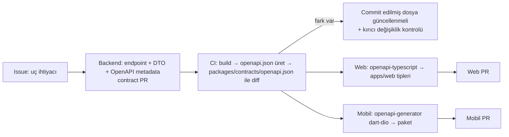

# API Stratejisi

> Sahip: Principal Software Architect · Durum: Taslak v1 · Tarih: 2026-11-04
> İlgili: [ADR 0007 OpenAPI contract-first](../adr/0007-openapi-contract-first.md) · [system-architecture.md §6](system-architecture.md#6-istek-yaşam-döngüsü)

## 1. Genel ilkeler

- REST, JSON (UTF-8), taban yol **`/api/v1`**. Tek API hem web hem mobil içindir (BFF yok).
- Minimal API, modül başına endpoint grubu (`MapGroup`). OpenAPI belgesi `Microsoft.AspNetCore.OpenApi` ile üretilir.
- Tüm uçlar varsayılan olarak kimlik doğrulama ister; anonim uçlar açıkça işaretlenir (`/health/*`).
- **Alan düzeyi yetki:** `prices.read.sell` / `prices.read.cost` izni olmayan rol için fiyat/maliyet alanları yanıttan çıkarılır (ör. `warehouse_staff` sipariş detayında fiyat yok — US-SEC-002); OpenAPI'de bu alanlar opsiyoneldir.
- İstemci verisi asla güvenilir değildir: `tenant_id`, `created_by`, fiyat (override izni yoksa), durum gibi alanlar gövdeden **alınmaz**.

## 2. Kaynak adlandırma

| Kural | Örnek |
|---|---|
| Çoğul, kebab-case isimler | `/api/v1/products`, `/api/v1/price-lists`, `/api/v1/picking-tasks` |
| Alt kaynak yalnızca gerçek sahiplikte | `/products/{id}/variants`, `/orders/{id}/lines`, `/customers/{id}/addresses` |
| Durum geçişleri = eylem alt yolu, `POST` | `/orders/{id}/approve`, `/orders/{id}/cancel`, `/shipments/{id}/confirm` |
| ID'ler | UUID (string); insan-dostu numaralar (`SIP-2026-000123`) ayrı alan, arama filtresi olarak |
| JSON alanları | `camelCase`; enum'lar `snake_case` string (`pending_approval`) |
| Tarih/saat | ISO 8601 UTC (`2026-11-04T09:30:00Z`); yalnızca tarih alanları `YYYY-MM-DD` |
| Para | `{ "amount": "1250.5000", "currency": "TRY" }` — `amount` **string** (ondalık kaybı olmasın) |
| Miktar | string ondalık (`"12.500"`) |

## 3. Sürümleme

- URL'de ana sürüm: `/api/v1`. Kırıcı değişiklik → `/api/v2` (aynı süreçte paralel; v1 en az 6 ay desteklenir, mobil sürüm dağılımına göre).
- v1 içinde yalnızca **geriye uyumlu** değişiklikler: yeni opsiyonel alan, yeni uç, yeni enum değeri (istemciler bilinmeyen enum'u tolere etmek zorunda — sözleşme kuralı).
- Kırıcı değişiklik tespiti CI'da OpenAPI diff ile yapılır ([ADR 0007](../adr/0007-openapi-contract-first.md)).
- Mobil uygulama `X-Client-Version` gönderir; desteklenmeyen sürüme `426`-benzeri Problem (`type: client-upgrade-required`).

## 4. Standart başlıklar

| Başlık | Yön | Açıklama |
|---|---|---|
| `Authorization: Bearer <jwt>` | İstek | Supabase access token |
| `X-Tenant-Id: <uuid>` | İstek | Tenant bağımsız uçlar hariç zorunlu |
| `Idempotency-Key: <uuid>` | İstek | Tüm `POST` oluşturma ve durum geçişi uçlarında zorunlu |
| `If-Match: "<etag>"` | İstek | Düzenlenebilir kaynaklarda `PATCH/PUT/DELETE` ve onay gibi geçişlerde zorunlu |
| `X-Correlation-Id` | İki yön | GUID ise normalize edilip (`N` biçimi) kullanılır; yoksa veya GUID değilse sunucu üretir; yanıtta döner |
| `X-Client-Version`, `X-Client-Platform` | İstek | `web`, `android`, `ios` |
| `Accept-Language` | İstek | `tr-TR` varsayılan (yalnızca sunucu tarafı metinler için) |
| `ETag` | Yanıt | `W/"<row_version>"` |
| `Location` | Yanıt | `201` oluşturmada |
| `Retry-After` | Yanıt | `429`, `409 inventory.busy` / `order.busy` / `picking.busy` / `idempotency.in_progress`, `503`; CORS ile tarayıcıya açılır (OpenAPI'de ilgili 409 yanıtlarında belgeli) |
| `RateLimit-*` | Yanıt | Kalan kota bilgisi |
| `Idempotent-Replayed: true` | Yanıt | Kayıtlı yanıt tekrar döndüyse |

## 5. Sayfalama, filtreleme, sıralama

### 5.1 Sayfalama
- **Keyset (cursor) pagination** varsayılandır: `?limit=50&cursor=<opaque>`. `limit` varsayılan 50, maks 200.
- Cursor: sıralama anahtarı + `id`'nin base64url JSON'ı (istemci içeriğini yorumlamaz). Sorgu: `WHERE (created_at, id) < (:c_created_at, :c_id) ORDER BY created_at DESC, id DESC LIMIT :limit + 1`.
- Yanıt zarfı:
```json
{
  "items": [ ... ],
  "page": { "nextCursor": "eyJ...", "hasMore": true, "limit": 50 }
}
```
- Toplam sayı varsayılan olarak döndürülmez (pahalı); gerekiyorsa `?includeTotal=true` (yalnızca küçük koleksiyonlarda izinli) veya ayrı `/count` ucu.
- Küçük referans listeleri (birimler, markalar, depolar) sayfasız tam liste döner (üst sınır 1000).

### 5.2 Filtreleme
- Basit alan filtreleri query param: `?status=approved&customerId=…&warehouseId=…`.
- Çoklu değer: virgülle `?status=approved,picking`.
- Aralık: `?createdFrom=2026-11-01&createdTo=2026-11-30`, `?minAvailable=1`.
- Serbest arama: `?q=` (ad/SKU/barkod; trigram + tam eşleşme önceliği).
- Özel alan: `?attr.renk=kirmizi` → `attributes @> '{"renk":"kirmizi"}'` (yalnızca `filterable` tanımlı alanlar).
- Her uç izin verilen filtreleri OpenAPI'de açıkça listeler; bilinmeyen filtre `400`.

### 5.3 Sıralama
- `?sort=-createdAt` (eksi = azalan), çoklu: `?sort=name,-createdAt`. Uç başına izin listesi; keyset ile uyumlu olmayan sıralamalar desteklenmez veya offset'e düşmez — izin listesinde yoksa `400`.

## 6. Hata modeli (RFC 9457)

```json
{
  "type": "https://bayios.app/problems/inventory.insufficient_stock",
  "title": "Yetersiz stok",
  "status": 409,
  "detail": "2 satır için kullanılabilir stok yetersiz.",
  "instance": "/api/v1/orders/0193.../approve",
  "code": "inventory.insufficient_stock",
  "correlationId": "c-7f3a...",
  "errors": null,
  "shortages": [ { "variantId": "...", "sku": "ABC-1", "requested": "10.000", "available": "4.000" } ]
}
```

| HTTP | Kullanım | Örnek `code` |
|---|---|---|
| 400 | Biçim/şema hatası, bilinmeyen filtre | `request.malformed` |
| 401 | Token yok/geçersiz/süresi dolmuş | `auth.invalid_token` |
| 403 | İzin yok, üyelik yok, tenant aktif değil (`suspended`/`closed`), entitlement yok | `auth.forbidden`, `tenant.access_denied`, `tenant.inactive`, `entitlement.required`, `entitlement.limit_exceeded` |
| 404 | Kaynak yok (tenant içinde) | `resource.not_found` |
| 409 | İş kuralı / durum çakışması | `order.invalid_transition`, `inventory.insufficient_stock`, `inventory.busy`, `idempotency.in_progress` |
| 412 | `If-Match` uyuşmazlığı | `concurrency.version_mismatch` |
| 422 | Alan doğrulama hataları (`errors` sözlüğü) | `validation.failed`, `idempotency.key_reused` |
| 428 | Zorunlu `If-Match` / `Idempotency-Key` eksik | `precondition.required` |
| 429 | Hız sınırı | `rate_limit.exceeded` |
| 500/503 | Beklenmeyen / bakım | `server.error` (detay sızdırılmaz) |

`code` alanı istemcilerin yerelleştirme anahtarıdır; `title/detail` yalnızca geliştirici yardımıdır.

Uzantılar (OpenAPI şemaları, #86): `StockProblemDetails` — `shortages[]` (variantId, sku, warehouseId, locationId, requested, available) ve `confirmationRequired` (negatif stok politikası `warn`: aynı isteği onay bayrağıyla tekrarla); `CodeConflictProblemDetails` — `409 catalog.sku_taken` / `catalog.barcode_taken` için `conflict` {field: sku | barcode, value, variantId, productId, sku} (yalnızca eşzamanlı bir yazımı veritabanı indeksi yakaladığında yoktur). Para alanları şimdilik JSON sayısı (`number`) olarak yayınlanır; istemci para hesabı yapmaz, toplamlar API'den gelir (karar #86).

**Koşullu (K) / kendi kayıtları (O) izinleri (#69):** uç izin(ler)ini bildirir (`x-permission`; birden çoğu yeterliyse `x-permission-any-of`). Koşulsuz izin olduğu gibi geçer; tenant kuralına bağlı K (dipnot 2, 3, 6, 9) kural açıksa koşulsuz, kapalıysa `403 auth.forbidden`; kayıt düzeyi K/O (dipnot 1, 4, 5, 7, 8, 10, 11, 12, O) kapıdan geçer ve uygulama servisi `IAuthorizationContext` ile koşulu uygular. Hiçbir servis koşulu değerlendirmezse başarılı yanıt `403 auth.forbidden`'a çevrilir ve transaction geri alınır (fail-closed). Görünürlük koşulunun dışındaki kayıt `404`, görünür ama işleme kapalı kayıt `403` döner.

## 7. Idempotency

- `Idempotency-Key` zorunlu: tüm oluşturma `POST`'ları ve durum geçişleri. Eksikse `428`; 100 karakterden uzun veya birden çok değer → `400 request.malformed`.
- **Uygulama (#68):** uç tanımında tek çağrı — `.RequireIdempotencyKey()` (`BayiOS.SharedKernel`, `WithUnitOfWork` ile birlikte). Filtre istek UnitOfWork transaction'ı **içinde** çalışır (ilk taslaktaki "ayrı kısa transaction" yerine): anahtar kaydı ile iş yazımı birlikte commit olur ya da birlikte geri alınır; çökme sonrası `in_progress`'te takılı anahtar kalmaz.
- Akış:
  1. `INSERT INTO platform.idempotency_keys (…, status='in_progress') ON CONFLICT (kapsam, key) DO UPDATE … WHERE expires_at <= now` — süresi dolmuş anahtar yeni sayılır. Aynı anahtarla eşzamanlı ikinci istek unique index üzerinde ilk transaction bitene kadar bekler (`lock_timeout` 5 sn), sonra kayıtlı yanıtı alır; süre aşılırsa `409 idempotency.in_progress` + `Retry-After`.
  2. Canlı kayıt varsa: farklı kullanıcı veya farklı hash (metot + gerçek yol + bağlanmış JSON gövde, SHA-256) → `422 idempotency.key_reused`; aynı → kayıtlı yanıt birebir (durum, `Content-Type`/`Location`/`ETag`, gövde baytları) + `Idempotent-Replayed: true`.
  3. Handler 2xx dönerse yanıt aynı transaction'da kaydedilir (`status='completed'`). 4xx/5xx sonuçlarda transaction (anahtar dahil) geri alınır: hata yanıtları **saklanmaz**, aynı anahtarla düzeltilmiş istek yeniden çalışır (iş yazımı da geri alındığından çift etki olmaz).
- Saklama: 24 saat (`expires_at`); temizlik job'ı henüz yok (job altyapısı gelince `ix_idempotency_keys_expires_at` ile silinecek).
- Anahtar kapsamı: tenant'lı uçlarda (tenant_id, key); tenant'sız uçlarda (ör. `POST /tenants`) (user_id, key). Aynı anahtarın farklı kullanıcı/uç ile kullanımı `422`.

## 8. Optimistic concurrency (ETag / If-Match)

- Düzenlenebilir aggregate'ler (`products`, `product_variants`, `price_lists`, `customers`, `warehouses`, `orders` (taslak düzenleme ve geçişler), `tenant_settings`) `row_version` taşır.
- `GET` yanıtı `ETag: W/"17"`; `PATCH/PUT/DELETE` ve `approve` gibi geçişler `If-Match` ister. Uyuşmazlık → `412`; eksik → `428`.
- Güncelleme: `UPDATE … SET …, row_version = row_version + 1 WHERE id = :id AND row_version = :expected` (EF Core concurrency token). Etkilenen satır 0 → 412.
- Kısmi güncelleme `PATCH` + JSON Merge Patch (`application/merge-patch+json`).

## 9. Hız sınırlama

- ASP.NET Core yerleşik `RateLimiter` middleware'i.
- Bölümleme: `tenant_id + user_id` (kimlikli), IP (kimliksiz/başarısız auth).
- Başlangıç politikaları (yapılandırılabilir) için **tek kaynak `docs/security/threat-model.md` §6.5**: okuma 300/dk, yazma 60/dk (kullanıcı + tenant); AI ayrıştırma 30/saat/tenant + aylık entitlement kotası; import 10/saat/tenant; export 10/saat/tenant; auth hataları 30/dk/IP.
- Not: MVP'de sayaçlar süreç içi (instance başına). Çoklu instance'ta dağıtık limit gerekirse ADR.

## 10. Diğer konvansiyonlar

- **Oluşturma:** `201 Created` + `Location` + kaynak gövdesi.
- **Durum geçişleri:** `200 OK` + güncel kaynak (istemci ayrıca GET yapmasın).
- **Uzun işlemler** (import, AI ayrıştırma): `202 Accepted` + `Location: /api/v1/import-jobs/{id}`; istemci polling (sonra SignalR/FCM).
- **Dosya yükleme:** `multipart/form-data` API'ye (boyut ≤ 10 MB, `.xlsx/.csv`, içerik imzası kontrolü — PRD IMP-01'deki 20 MB / `.xls` ile fark ürün sahibi kararı bekliyor, bkz. `docs/operations/phase0-gate.md`) → API Storage'a yazar. İndirme: API `GET …/download-url` ile kısa ömürlü (ör. 5 dk) imzalı URL döner.
- **Toplu işlemler:** `POST /products/bulk` gibi uçlar en fazla 500 öğe, satır bazında sonuç (`207` değil, `200` + `results[]`).
- **Silme:** iş kaynaklarında `DELETE` = arşivleme (`archived_at`); `204`.
- **Genişletme:** `?include=lines,customer` yalnızca dokümante edilmiş ilişkiler.
- **Gerçek zamanlı (Hafta 8+):** SignalR hub `/hubs/tenant`; olay adları outbox tipleriyle aynı (`order_status_changed`); istemci olay aldığında ilgili sorguyu yeniden çeker (olay = invalidation sinyali, veri taşıyıcı değil).

## 11. Contract-first iş akışı



1. **Sözleşme önce:** Yeni/değişen uç önce backend'de iskelet (DTO, route, status kodları, örnekler; handler `501` dönebilir) olarak tanımlanır ve `packages/contracts/openapi.json` güncellenmiş hâliyle "contract PR" açılır. Principal Architect sözleşme review'u yapar.
2. **Tek doğruluk kaynağı:** Commit edilmiş `openapi.json`. CI, API'yi derleyip belgeyi build sırasında üretir (`Microsoft.Extensions.ApiDescription.Server` ile build-time üretim veya test host'tan `/openapi/v1.json` çekme) ve commit'li dosyayla **byte-düzeyinde** karşılaştırır; fark varsa CI kırmızı.
3. **Kırıcı değişiklik kontrolü:** CI'da `preview` dalındaki sözleşme ile OpenAPI diff aracı (ör. oasdiff) çalışır; kırıcı değişiklik `v1` altında bloklanır.
4. **İstemci üretimi:**
   - Web: `openapi-typescript` → `apps/web/src/lib/api/schema.d.ts` (üretilmiş, commit'li veya build'de üretilir — web ekibi kararı; CI drift kontrolü aynı mantıkla).
   - Mobil: `openapi-generator` (`dart-dio`) → `apps/mobile/packages/bayios_api` (ileride; o zamana kadar elle yazılmış ince dio katmanı, yalnızca sözleşmedeki tiplerle).
5. **Mock:** Ön yüz, backend hazır olmadan sözleşmeden mock (MSW) ile ilerleyebilir.
6. OpenAPI'de her uç: `operationId` (`Orders_Approve`), `tags` (modül), güvenlik şeması, tüm hata yanıtları (`application/problem+json`), örnekler, `x-permission` ve `x-entitlement` uzantıları, gerekli başlık parametreleri (`X-Tenant-Id`, `Idempotency-Key`, `If-Match`).

## 12. MVP uç listesi (ilk sürüm)

`{id}` = UUID. Tüm uçlar `/api/v1` altında. **İ** = Idempotency-Key, **M** = If-Match.

> **İzin sütunu** taslak grup adlarını kullanır. Kanonik izin kimlikleri `docs/product/roles-permissions.md` §3'tedir; eşleme [data-model §3](data-model.md#3-roller-ve-izinler-karar). W3 Gün 12 sözleşme PR'ında kanonik kimliklere geçilir (Phase 0 kapısı koşulu).

### 12.1 Identity & Tenancy
| Metot | Yol | İzin | Not |
|---|---|---|---|
| GET | `/me` | (kimlik) | Profil + üyelikler (tenant listesi); `X-Tenant-Id` gerekmez. Başlık aktif tenant'taki aktif bir üyeliği gösterirse `activeTenant`: rol + etkin izinler (`scope`: `all` / `conditional` / `own`, `condition` kodu; §4 tenant kuralları uygulanmış). Aksi hâlde `activeTenant: null` (hata değil) |
| GET | `/me/permissions` | (üyelik) | Etkin rol, izinler, entitlement'lar |
| PATCH | `/me` | (kimlik) | Profil |
| POST | `/tenants` | (kimlik) | Yeni tenant (İ); çağıran owner olur, deneme planı |
| GET/PATCH | `/tenant` | `tenant.manage` (PATCH, M) | Aktif tenant bilgisi |
| GET/PATCH | `/tenant/settings` | `tenant.manage` (M) | |
| GET | `/members` | `members.manage` | |
| PATCH | `/members/{id}` | `members.manage` (M) | Rol/durum |
| POST | `/invitations` | `members.manage` (İ) | |
| DELETE | `/invitations/{id}` | `members.manage` | |
| POST | `/invitations/accept` | (kimlik) (İ) | Token ile |

### 12.2 Billing & Entitlements
| GET | `/billing/plans` | (kimlik) | |
| GET | `/billing/subscription` | `billing.manage` | |
| GET | `/billing/usage` | `billing.manage` | Sayaçlar |

### 12.3 Catalog
| Metot | Yol | İzin |
|---|---|---|
| GET | `/products` (q, categoryId, brandId, status, attr.*) | `catalog.read` |
| POST | `/products` (İ) | `catalog.write` |
| GET | `/products/{id}` | `catalog.read` |
| PATCH | `/products/{id}` (M) | `catalog.write` |
| DELETE | `/products/{id}` (arşiv, M) | `catalog.write` |
| POST | `/products/{id}/variants` (İ) | `catalog.write` |
| PATCH/DELETE | `/variants/{id}` (M) | `catalog.write` |
| GET | `/variants` (q, sku, barcode, productId, status) | `catalog.read` |
| GET | `/variants/batch?ids=` | `catalog.read` | Toplu görüntüleme okuması: 1–100 id (virgülle; tekrarlar tekilleşir) → id, productId, sku, name, productName, barcode, status (SKU sırasıyla). Bulunmayan / başka tenant'a ait id'ler sonuçta yer almaz (404 yok, ipucu yok); sayfasız ayrı yanıt şekli olduğu için listeye `ids` parametresi yerine ayrı uç |
| GET | `/variants/lookup?barcode=` | `catalog.read` | Mobil okutma; tek sonuç veya 404 |
| POST/DELETE | `/variants/{id}/barcodes` · `/variants/{id}/barcodes/{barcodeId}` | `catalog.write` |
| POST/DELETE | `/variants/{id}/aliases` · `/variants/{id}/aliases/{aliasId}` | `catalog.write` |
| GET/POST/PATCH/DELETE | `/categories`, `/brands`, `/units`, `/suppliers` | read / write |
| GET/POST/PATCH/DELETE | `/custom-fields` (entityType) | `catalog.read` / `tenant.manage` |

### 12.4 Pricing
| GET/POST | `/price-lists` | `pricing.read` / `pricing.write` (İ) |
| GET/PATCH/DELETE | `/price-lists/{id}` | (M) |
| GET | `/price-lists/{id}/items` | `pricing.read` |
| PUT | `/price-lists/{id}/items` (toplu upsert ≤ 500, İ) | `pricing.write` |
| DELETE | `/price-lists/{id}/items/{itemId}` | `pricing.write` |
| POST | `/pricing/quote` | `orders.write` | Müşteri + satırlar → çözümlenmiş fiyatlar (yan etkisiz; İ gerekmez) |

### 12.5 Customers
| GET/POST | `/customers` (q, dealerGroupId, status) | `customers.read` / `customers.write` (İ) |
| GET/PATCH/DELETE | `/customers/{id}` (M) | |
| GET/POST | `/customers/{id}/addresses` | |
| PATCH/DELETE | `/customers/{id}/addresses/{addressId}` | |
| GET/POST/PATCH/DELETE | `/dealer-groups` | `customers.read` / `customers.write` |

### 12.6 Warehouse & Inventory
| Metot | Yol | İzin | Not |
|---|---|---|---|
| GET/POST | `/warehouses` | `inventory.read` / `tenant.manage` (İ) | |
| GET/PATCH | `/warehouses/{id}` (M) | | |
| GET/POST | `/warehouses/{id}/locations` | | |
| PATCH | `/locations/{id}` (M) | `tenant.manage` | |
| GET | `/inventory/balances` (variantId, warehouseId, locationId, q, belowThreshold) | `inventory.read` | on_hand, reserved, available |
| GET | `/inventory/availability?variantIds=…&warehouseId=` | `inventory.read` | Sipariş ekranı |
| GET | `/inventory/movements` (variantId, warehouseId, type, from, to) | `inventory.read` | Stok kartı, keyset |
| POST | `/inventory/receipts` (İ) | `inventory.receive` | §4.1 |
| POST | `/inventory/adjustments` (İ) | `inventory.adjust` | §4.2 |
| POST | `/inventory/transfers` (İ) | `inventory.transfer` | §4.7 |
| GET/POST | `/stock-counts` (İ) | `inventory.count` | |
| GET | `/stock-counts/{id}` | `inventory.count` | |
| PUT | `/stock-counts/{id}/lines` (M) | `inventory.count` | Sayılan miktarlar (toplu) |
| POST | `/stock-counts/{id}/submit` · `/apply` · `/cancel` (İ) | `inventory.count` / apply: `inventory.adjust` | §4.8 |

### 12.7 Orders
| Metot | Yol | İzin | Not |
|---|---|---|---|
| GET | `/orders` (status, customerId, source, from, to, q) | `orders.read` | keyset |
| POST | `/orders` (İ) | `orders.write` | Draft |
| GET | `/orders/{id}` (include=lines,history,shipments) | `orders.read` | |
| PATCH | `/orders/{id}` (M) | `orders.write` | Yalnızca Draft |
| PUT | `/orders/{id}/lines` (M) | `orders.write` | Satırları toptan değiştir (Draft) |
| POST | `/orders/{id}/submit` (İ, M) | `orders.submit` | |
| POST | `/orders/{id}/withdraw` (İ) | `orders.submit` | |
| POST | `/orders/{id}/reject` (İ) | `orders.approve` | |
| POST | `/orders/{id}/approve` (İ, M) | `orders.approve` | Rezervasyon |
| POST | `/orders/{id}/cancel` (İ) | `orders.cancel` | |
| POST | `/orders/{id}/close-remaining` (İ) | `orders.approve` | Short-close |
| POST | `/orders/{id}/complete` (İ) | `orders.write` | |
| GET | `/orders/{id}/history` | `orders.read` | |

### 12.8 Fulfillment (Warehouse)
| GET | `/picking-tasks` (warehouseId, status, assignedTo=me) | `fulfillment.pick` | Mobil iş listesi |
| GET | `/picking-tasks/{id}` | `fulfillment.pick` | |
| POST | `/picking-tasks/{id}/assign` (İ) | `fulfillment.pick` | |
| POST | `/picking-tasks/{id}/start` (İ) | `fulfillment.pick` | |
| POST | `/picking-tasks/{id}/scans` (İ) | `fulfillment.pick` | barkod, lokasyon, miktar (§4.5) |
| POST | `/picking-tasks/{id}/complete` (İ) | `fulfillment.pick` | |
| POST | `/shipments` (İ) | `fulfillment.ship` | Siparişten taslak sevkiyat (varsayılan: toplanan miktarlar) |
| GET | `/shipments/{id}` · `/shipments?orderId=` | `orders.read` | |
| PATCH | `/shipments/{id}` (M) | `fulfillment.ship` | Taşıyıcı, takip no, satırlar (draft) |
| POST | `/shipments/{id}/confirm` (İ) | `fulfillment.ship` | §4.6 |

### 12.9 Imports
| POST | `/import-jobs` (multipart, İ) | `imports.run` | `202` |
| GET | `/import-jobs` · `/import-jobs/{id}` | `imports.run` | |
| GET | `/import-jobs/{id}/rows?status=invalid` | `imports.run` | |
| PUT | `/import-jobs/{id}/mapping` | `imports.run` | |
| POST | `/import-jobs/{id}/validate` · `/start` · `/cancel` (İ) | `imports.run` | |
| GET | `/import-templates/{type}` | `imports.run` | İmzalı URL |

### 12.10 Integrations (AI) — entitlement: `ai_order_parsing`
| POST | `/ai/order-parses` (İ) | `ai.parse` | `{ text, customerId? , senderPhone? }` → `202` |
| GET | `/ai/order-parses` (status) · `/ai/order-parses/{id}` | `ai.review` | Eşleşme adaylarıyla |
| PUT | `/ai/order-parses/{id}/lines` (M) | `ai.review` | Kullanıcının satır/varyant seçimleri |
| POST | `/ai/order-parses/{id}/approve` (İ) | `ai.review` | Draft sipariş oluşturur → `orderId` |
| POST | `/ai/order-parses/{id}/reject` (İ) | `ai.review` | |

### 12.11 Audit & Notifications
| GET | `/audit-events` (entityType, entityId, actor, from, to) | `audit.read` |
| POST | `/devices` (İ) | (üyelik) | FCM token kaydı/yenileme |
| DELETE | `/devices/{id}` | (üyelik) | |
| GET | `/notifications` · POST `/notifications/{id}/read` | (üyelik) | |

### 12.12 Platform
| GET | `/health/live`, `/health/ready` | anonim |
| GET | `/openapi/v1.json` | yalnızca local/preview |
