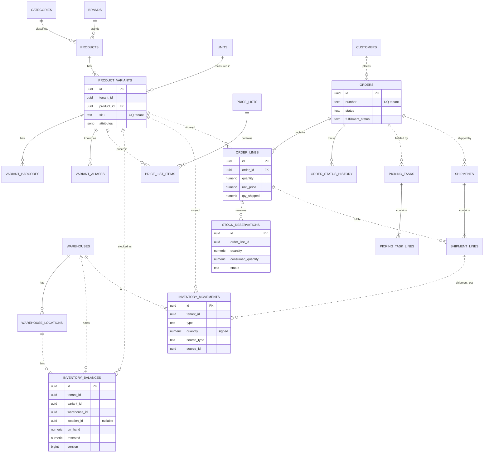

# BayiOS Veri Modeli (Taslak)

> Sahip: Principal Software Architect · Durum: Taslak v1 · Tarih: 2026-11-04
> Kaynak: EF Core 10 migration'ları ([ADR 0005](../adr/0005-ef-core-migrations.md)). Bu belge tasarım taslağıdır; nihai şema migration'lardır.

## 1. Genel kurallar

| Kural | Karar |
|---|---|
| Veritabanı | Supabase PostgreSQL 17 |
| Şemalar | **Modül başına bir PostgreSQL şeması**; `public` şeması iş verisi için **kullanılmaz** |
| Adlandırma | `snake_case`, tablo adları çoğul; EF Core'da snake_case adlandırma konvansiyonu |
| PK | `id uuid` (UUIDv7, uygulamada üretilir). Platform referans tablolarında doğal anahtar olabilir |
| Tenant | Tenant'a ait her tabloda `tenant_id uuid NOT NULL` |
| Tenant-güvenli FK | Modül içi FK'ler **bileşik**: `(tenant_id, x_id) → parent(tenant_id, id)`; bunun için parent'ta `UNIQUE (tenant_id, id)`. Böylece farklı tenant'ın satırına referans DB seviyesinde imkânsızdır |
| Modüller arası referans | **FK yok**, yalnızca ID (çıkarılabilirlik + modül sınırı). Bütünlük uygulamada (Contracts üzerinden doğrulama) ve arşivleme (hard delete yok) ile sağlanır |
| Zaman damgaları | `created_at timestamptz NOT NULL DEFAULT now()`, `updated_at timestamptz`, `created_by uuid`, `updated_by uuid` (tenant tablolarında) |
| Silme | `archived_at timestamptz NULL` (soft); iş tablolarında hard delete yok |
| Concurrency | Düzenlenebilir aggregate'lerde `row_version bigint NOT NULL DEFAULT 1` (uygulama artırır; ETag kaynağı) |
| Para | `numeric(18,4)` + `currency char(3)` |
| Miktar | `numeric(18,3)` |
| Esnek alanlar | `attributes jsonb NOT NULL DEFAULT '{}'` (bkz. §4) |
| Uzantılar | `pg_trgm` (bulanık arama), `citext` gerekirse; `extensions` şemasında |
| Benzersizlik + NULL | Nullable kolon içeren benzersizliklerde `UNIQUE NULLS NOT DISTINCT` (PG15+) |

Şemalar: `identity`, `billing`, `catalog`, `pricing`, `customers`, `inventory`, `warehouse`, `orders`, `imports`, `integrations`, `audit`, `notifications`, `platform`.

## 2. Veritabanı rolleri, yetkiler ve RLS

### 2.1 Roller

| Rol | Amaç | Özellikler |
|---|---|---|
| `bayios_migrator` | Migration'ları çalıştırır; tüm iş tablolarının **sahibi** | Yalnızca CI/deploy adımı kullanır |
| `bayios_app` | API ve worker'ın çalışma zamanı rolü | `NOSUPERUSER NOBYPASSRLS`, tablo sahibi **değil**; iş şemalarında `SELECT/INSERT/UPDATE/DELETE` (ledger ve audit tablolarında yalnızca `SELECT/INSERT`) |
| `anon`, `authenticated` (Supabase) | Supabase istemci rolleri | İş şemalarında **USAGE dahil hiçbir yetki yok**; migration'da açıkça `REVOKE ALL` |

### 2.2 Standart RLS kalıbı (her tenant tablosu)

```sql
ALTER TABLE catalog.products ENABLE ROW LEVEL SECURITY;
ALTER TABLE catalog.products FORCE ROW LEVEL SECURITY;   -- sahip rol bile politikaya tabi

CREATE POLICY tenant_isolation ON catalog.products
  FOR ALL TO bayios_app
  USING      (tenant_id = NULLIF(current_setting('app.tenant_id', true), '')::uuid)
  WITH CHECK (tenant_id = NULLIF(current_setting('app.tenant_id', true), '')::uuid);
```

- API her transaction başında: `SELECT set_config('app.tenant_id', @tenantId, true), set_config('app.user_id', @userId, true);` (`true` = transaction-local, `SET LOCAL` eşdeğeri ve parametre alabilir).
- `app.tenant_id` ayarlanmamışsa ifade `NULL` döner → hiçbir satır görünmez/yazılamaz (fail-closed).
- RLS'li her tablo için integration testi: tenant A bağlamında tenant B satırı okunamaz/yazılamaz.

### 2.3 RLS istisnaları

| Tablo | Politika |
|---|---|
| `identity.tenants` | `id = app.tenant_id` **veya** `id IN (SELECT tenant_id FROM identity.memberships WHERE user_id = app.user_id)` (kullanıcının tenant listesi) — yalnızca okuma; yazma yalnızca `id = app.tenant_id` |
| `identity.memberships` | `tenant_id = app.tenant_id` **veya** `user_id = app.user_id` (tenant çözümleme, tenant bilinmeden yapılır) — yalnızca okuma; yazma yalnızca `tenant_id = app.tenant_id` |
| `identity.user_profiles` | `user_id = app.user_id` veya aynı tenant üyeleri (okuma); yazma yalnızca `user_id = app.user_id` |
| `billing.subscription_plans` | Tenant'sız referans veri; RLS yok, `bayios_app` yalnızca `SELECT` |
| `platform.outbox_messages`, `platform.jobs` | Çok tenant'lı dispatcher tarafından okunur. RLS **yok**; yalnızca `bayios_app` erişir; worker bir işi işlerken iş öncesi `app.tenant_id`'yi o kaydın tenant'ına ayarlar, böylece iş verisine erişim yine RLS'li olur |
| `platform.idempotency_keys` | `tenant_id = app.tenant_id` **veya** (`tenant_id IS NULL` ve `user_id = app.user_id`) — tenant'sız uçların (ör. `POST /tenants`) anahtarları kullanıcıya kapsanır; yazma her zaman `user_id = app.user_id` (§5.12) |

### 2.4 EF Core tarafı (birincil zorlama)
- Tüm `ITenantOwned` entity'lerde global query filter: `e => e.TenantId == _tenantContext.TenantId`.
- `SaveChanges` interceptor: eklenen entity'ye `tenant_id` damgalar; değiştirilen/silinen entity'nin `tenant_id`'si bağlamdakiyle farklıysa istisna (ve güvenlik logu).
- `IgnoreQueryFilters()` kullanımı ArchitectureTests ile izin listesine bağlanır.

## 3. Roller ve izinler (karar)

**Karar: Roller ve izinler kodda tanımlanır; tabloda yalnızca üyeliğin rol kodu tutulur.**

- `identity.memberships.role text NOT NULL CHECK (role IN ('owner','admin','manager','sales','warehouse_staff','viewer'))`.
- `Permissions` sabitleri ve `RolePermissions` haritası `BayiOS.SharedKernel` / Identity modülünde statiktir; `GET /api/v1/me/permissions` istemcilere etkin izinleri döner.

Gerekçe: MVP'de sabit 6 rol var; harita kodla birlikte sürümlenir, code review'dan geçer, unit test ile doğrulanır (ör. "viewer hiçbir write iznine sahip değil"), DB round-trip'i ve cache invalidation sorunu yoktur; tenant'ın yanlış yapılandırmayla kendini kilitlemesi engellenir. Özel rol ihtiyacı doğarsa `identity.tenant_roles (tenant_id, code, permissions text[])` eklenir ve kodda tanımlı roller "sistem rolleri" olarak kalır (geriye uyumlu genişleme).

**Kanonik kaynak (Phase 0 kapısı kararı):** Rol × izin matrisi ve izin kimlikleri `docs/product/roles-permissions.md` §3–§4'tür. `Permissions` sabitleri o belgedeki kimliklerle birebir adlandırılır (ör. `orders.approve`, `inventory.count.perform`, `tasks.pick`, `prices.read.cost`). Koşullu izinler (K) `identity.tenant_settings` kurallarıyla (roles-permissions §4), "yalnızca kendi kaydı" (O) kuralları handler'da değerlendirilir. Bu belgenin ilk taslağındaki kaba izin tablosu roles-permissions.md ile çeliştiği için kaldırıldı (ör. `sales` için `orders.approve` koşullu açıktır; `manager` `prices.write` ve ürün `imports.run` iznine sahip değildir).

Taslak grup adları → kanonik izinler (API uç tablosu [api-strategy §12](api-strategy.md#12-mvp-uç-listesi-ilk-sürüm) W3 Gün 12 sözleşme PR'ında bu eşlemeyle güncellenir):

| Taslak grup | Kanonik izin(ler) — roles-permissions.md |
|---|---|
| `tenant.manage` | `tenant.settings.manage`, `catalog.fields.manage` (özel alan/kategori/birim), `warehouses.manage` (depo/raf) |
| `members.manage` | `members.read`, `members.invite`, `members.manage`, `ownership.transfer` |
| `billing.manage` | `billing.read`, `billing.manage` |
| `pricing.read` / `pricing.write` | `prices.read.sell`, `prices.read.cost` / `prices.write`, `pricelists.assign` |
| `inventory.receive` | `inventory.receive`, `inventory.receive.approve` |
| `inventory.count` | `inventory.count.manage`, `inventory.count.perform` |
| `inventory.transfer` | `inventory.transfer`, `inventory.transfer.receive` |
| `orders.write` | `orders.create`, `orders.edit.draft`, `orders.edit.approved` |
| `orders.override_price` | `orders.price.override` |
| `fulfillment.pick` / `fulfillment.ship` | `tasks.read.own`, `tasks.read.all`, `tasks.claim`, `tasks.assign`, `tasks.pick`, `tasks.pack`, `tasks.report_shortage` / `orders.ship` |
| `imports.run` | `imports.run`, `imports.run.stock`, `imports.rollback` |
| `ai.parse` / `ai.review` | `whatsapp.parse` (taslak sipariş oluşturma ayrıca `orders.create`) |
| `reports.read` | `reports.read`, `reports.export`, `data.export.full` |

## 4. Özel alanlar (karar)

**Karar: EAV yerine `attributes jsonb` + tenant'ın alan tanımlarına göre uygulama doğrulaması + GIN index.**

- `catalog.custom_field_definitions` hangi anahtarların hangi tipte olduğunu tanımlar.
- `catalog.product_variants.attributes`, `catalog.products.attributes`, `customers.customers.attributes` alanları kaydetmeden önce Catalog modülündeki `CustomFieldValidator` ile doğrulanır (bilinmeyen anahtar reddedilir, tip/zorunluluk/seçenek kontrolü).
- Index: `CREATE INDEX ... USING gin (attributes jsonb_path_ops);` → `attributes @> '{"renk":"kirmizi"}'` sorguları. Sık sıralanan/aralık sorgulanan alanlar için gerektiğinde ifade index'i (`((attributes->>'genislik')::numeric)`).
- Gerekçe: EAV; join patlaması, tipsiz değer kolonları ve yavaş filtreleme getirir. JSONB tek satırda okunur, GIN ile içerme sorguları hızlıdır, tenant başına farklı şema ihtiyacını karşılar. Bedel: DB seviyesinde tip zorlaması yok → uygulama doğrulaması + import doğrulaması zorunlu; tanım değişikliklerinde veri göçü job'ı.

## 5. Tablolar

Gösterim: **PK**, FK (modül içi, bileşik tenant FK), UQ = unique, IX = index. Tüm tenant tablolarında ayrıca `created_at/updated_at/created_by/updated_by` vardır, tekrar edilmez. "RLS: std" = §2.2 kalıbı.

### 5.1 `identity`

**identity.tenants** — RLS: istisna (§2.3)
| Kolon | Tip | Not |
|---|---|---|
| id | uuid **PK** | |
| name | text NOT NULL | |
| slug | text NOT NULL | UQ (global) |
| status | text NOT NULL | CHECK in (active, suspended, closed) |
| default_currency | char(3) NOT NULL | 'TRY' |
| locale | text NOT NULL | 'tr-TR' |
| time_zone | text NOT NULL | 'Europe/Istanbul' |
| sector | text NOT NULL | motorcycle_parts, led_electronics, general (TEN-03) |
| logo_object_path, tax_number, tax_office, phone | text NULL | TEN-04 |
| address | jsonb NULL | TEN-04 |
| row_version | bigint | |

**identity.tenant_settings** — RLS: std · PK `tenant_id`
| negative_stock_policy text NOT NULL DEFAULT 'block' CHECK in (block, warn, allow) — PRD TEN-12; `inventory_balances.allow_negative` = (policy ≠ 'block'); `warn`'da kullanıcı teyidi uygulamada istenir · require_order_approval bool DEFAULT true · sales_can_approve_orders bool DEFAULT true · sales_max_discount_percent numeric(5,2) DEFAULT 0 · show_cost_to_manager bool DEFAULT false · show_cost_to_viewer bool DEFAULT false · staff_can_assign_barcode bool DEFAULT false · staff_can_approve_receipt bool DEFAULT false · require_2fa bool DEFAULT false (roles-permissions §4 kuralları) · auto_create_picking_task bool DEFAULT true (WHT-01) · prices_include_tax_display bool DEFAULT false · default_tax_rate numeric(5,2) DEFAULT 20 (TEN-05) · order_number_prefix text DEFAULT 'SIP' (ORD-14) · low_stock_notifications bool · settings jsonb (diğer) · row_version |

**identity.user_profiles** — RLS: istisna · PK `user_id uuid` (= Supabase `auth.users.id` / JWT `sub`; **FK yok**, auth şeması Supabase'e ait)
| email text (yalnızca görüntüleme, Supabase'den senkron) · full_name text · phone text · locale text · last_seen_at |

**identity.memberships** — RLS: istisna
| Kolon | Tip | Not |
|---|---|---|
| id | uuid **PK** | |
| tenant_id | uuid NOT NULL | FK → tenants(id) |
| user_id | uuid NOT NULL | |
| role | text NOT NULL | CHECK (6 rol) |
| status | text NOT NULL | invited, active, disabled |
| UQ | (tenant_id, user_id) | |
| IX | (user_id, status) | tenant çözümleme sorgusu |

**identity.invitations** — RLS: std
| id **PK** · tenant_id · email citext · role · token_hash bytea UQ · expires_at · accepted_at · invited_by |
| UQ (tenant_id, email) WHERE accepted_at IS NULL (kısmi) |

### 5.2 `billing`

**billing.subscription_plans** — tenant'sız, RLS yok
| code text **PK** · name · features text[] · limits jsonb (`{"max_users":5,...}`) · is_public bool · sort_order |

**billing.tenant_subscriptions** — RLS: std · PK id · UQ (tenant_id)
| plan_code text · status (trialing, active, past_due, cancelled) · current_period_start/end timestamptz · provider text NULL · provider_ref text NULL |

**billing.tenant_entitlements** — RLS: std
| id **PK** · tenant_id · feature_code text · enabled bool · limit_value bigint NULL · source (plan, override) · expires_at NULL |
| UQ (tenant_id, feature_code) |

**billing.usage_counters** — RLS: std
| tenant_id · metric text · period_start date · value bigint NOT NULL DEFAULT 0 |
| **PK** (tenant_id, metric, period_start) |

### 5.3 `catalog`

**catalog.units** — RLS: std · UQ (tenant_id, code), UQ (tenant_id, id)
| id · code text · name · allows_fraction bool |

**catalog.brands** — RLS: std · UQ (tenant_id, lower(name)), UQ (tenant_id, id)
| id · name · archived_at |

**catalog.categories** — RLS: std · UQ (tenant_id, id)
| id · parent_id uuid NULL FK (tenant_id, parent_id) → categories · name · path text (materialized, ör. `/root-id/child-id/`) · sort_order · archived_at |
| UQ NULLS NOT DISTINCT (tenant_id, parent_id, lower(name)) · IX (tenant_id, path text_pattern_ops) |

**catalog.suppliers** — RLS: std
| id · name · tax_number · phone · email · notes · archived_at · UQ (tenant_id, id) |

**catalog.custom_field_definitions** — RLS: std
| id · entity_type text (product, variant, customer) · key text · label · data_type text · options jsonb · required bool · filterable bool · sort_order |
| UQ (tenant_id, entity_type, key) |

**catalog.products** — RLS: std
| Kolon | Tip | Not |
|---|---|---|
| id | uuid **PK** | UQ (tenant_id, id) |
| tenant_id | uuid NOT NULL | |
| name | text NOT NULL | |
| description | text | |
| category_id | uuid NULL | FK (tenant_id, category_id) → categories |
| brand_id | uuid NULL | FK (tenant_id, brand_id) → brands |
| default_unit_id | uuid NOT NULL | FK → units |
| tax_rate | numeric(5,2) NOT NULL | ör. 20.00 |
| status | text | active, inactive (pasif: satışa kapalı, stokta görünür), archived — PRD CAT-02 |
| attributes | jsonb NOT NULL DEFAULT '{}' | IX GIN jsonb_path_ops |
| row_version | bigint | |
| IX | (tenant_id, status, name) | liste |
| IX | GIN (name gin_trgm_ops) | arama |

**catalog.product_variants** — RLS: std
| Kolon | Tip | Not |
|---|---|---|
| id | uuid **PK** | UQ (tenant_id, id) — diğer modüllerin referans verdiği kimlik |
| tenant_id | uuid NOT NULL | |
| product_id | uuid NOT NULL | FK (tenant_id, product_id) → products |
| sku | text NOT NULL | UQ (tenant_id, sku) |
| name | text | varyant adı / seçenek özeti |
| option_values | jsonb | ör. `{"renk":"kırmızı","beden":"42"}` |
| unit_id | uuid NOT NULL | FK → units |
| purchase_price | numeric(18,4) NULL | bilgi |
| weight_kg | numeric(12,3) NULL | |
| attributes | jsonb NOT NULL DEFAULT '{}' | IX GIN jsonb_path_ops |
| normalized_name | text NOT NULL | AI/arama için (küçük harf, Türkçe karakter katlama) — IX GIN gin_trgm_ops |
| low_stock_threshold | numeric(18,3) NULL | |
| status | text | |
| row_version | bigint | |
| IX | (tenant_id, product_id) | |

**catalog.variant_barcodes** — RLS: std
| id · variant_id FK (tenant_id, variant_id) · barcode text · kind (ean13, upc, internal) · UQ (tenant_id, barcode) |

**catalog.variant_aliases** — RLS: std (AI eşleştirme ve arama için müşteri/serbest adlar)
| id · variant_id FK · alias text · normalized_alias text · customer_id uuid NULL (müşteriye özgü ad; modüller arası → FK yok) · source (manual, learned_from_ai) |
| UQ NULLS NOT DISTINCT (tenant_id, normalized_alias, customer_id) · IX GIN (normalized_alias gin_trgm_ops) |

### 5.4 `pricing`

**pricing.price_lists** — RLS: std · UQ (tenant_id, id)
| id · name · kind (sales, purchase) · currency char(3) · is_default bool · prices_include_tax bool · valid_from date NULL · valid_to date NULL · status · row_version |
| UQ (tenant_id, currency) WHERE is_default AND kind='sales' (kısmi) · CHECK valid_to ≥ valid_from |

**pricing.price_list_items** — RLS: std
| id · price_list_id FK (tenant_id, price_list_id) · variant_id uuid (→ catalog, FK yok) · min_quantity numeric(18,3) NOT NULL DEFAULT 1 · unit_price numeric(18,4) NOT NULL CHECK ≥ 0 |
| UQ (tenant_id, price_list_id, variant_id, min_quantity) · IX (tenant_id, variant_id) |

### 5.5 `customers`

**customers.dealer_groups** — RLS: std · UQ (tenant_id, lower(name)), UQ (tenant_id, id)
| id · name · price_list_id uuid NULL (→ pricing) · default_discount_percent numeric(5,2) NULL |

**customers.customers** — RLS: std · UQ (tenant_id, id)
| Kolon | Tip | Not |
|---|---|---|
| id | uuid **PK** | |
| code | text NOT NULL | UQ (tenant_id, code) |
| name | text NOT NULL | IX GIN trgm |
| tax_number / tax_office | text NULL | IX (tenant_id, tax_number) |
| phone, email | text NULL | |
| whatsapp_numbers | text[] NOT NULL DEFAULT '{}' | E.164; IX GIN — AI'da göndericiden cari bulma |
| dealer_group_id | uuid NULL | FK (tenant_id, dealer_group_id) |
| price_list_id | uuid NULL | → pricing (FK yok) |
| payment_term_days | int NULL | |
| credit_limit | numeric(18,4) NULL | |
| currency | char(3) | |
| attributes | jsonb | |
| status, archived_at, row_version | | |

**customers.customer_addresses** — RLS: std
| id · customer_id FK (tenant_id, customer_id) · type (billing, shipping) · is_default bool · title · line1 · line2 · district · city · postal_code · country char(2) · contact_name · contact_phone |
| UQ (tenant_id, customer_id, type) WHERE is_default (kısmi) |

### 5.6 `warehouse` (ana veri ve operasyonlar)

**warehouse.warehouses** — RLS: std · UQ (tenant_id, code), UQ (tenant_id, id)
| id · code · name · address jsonb · uses_locations bool NOT NULL DEFAULT false · is_default bool · status |
| UQ (tenant_id) WHERE is_default (kısmi) |

**warehouse.warehouse_locations** — RLS: std · UQ (tenant_id, id)
| id · warehouse_id FK (tenant_id, warehouse_id) · code text · barcode text NULL · pick_sequence int · is_active bool |
| UQ (tenant_id, warehouse_id, code) · UQ (tenant_id, barcode) WHERE barcode IS NOT NULL |

**warehouse.stock_counts** / **warehouse.stock_count_lines** — RLS: std
| counts: id · warehouse_id · scope · is_blind bool NOT NULL DEFAULT false (INV-06) · status (open, submitted, applied, cancelled) · snapshot_at timestamptz · applied_at · applied_by · row_version |
| lines: id · stock_count_id FK · variant_id · location_id NULL · expected_qty numeric(18,3) · counted_qty numeric(18,3) NULL · line_status (pending, counted, needs_review, applied) · applied_delta numeric(18,3) NULL · UQ NULLS NOT DISTINCT (tenant_id, stock_count_id, variant_id, location_id) |

**warehouse.picking_tasks** — RLS: std · UQ (tenant_id, id)
| id · type (pick, putaway) — putaway: iptal edilen siparişte toplananları rafa geri koyma (ORD-07) · order_id uuid (→ orders) · warehouse_id FK · status (open, in_progress, completed, completed_with_shortage, cancelled) — WHT-06 · assigned_to uuid NULL · started_at · completed_at · row_version |
| IX (tenant_id, warehouse_id, status) · IX (tenant_id, order_id) |

**warehouse.picking_task_lines** — RLS: std
| id · picking_task_id FK (tenant_id, picking_task_id) · order_line_id uuid · variant_id uuid · location_id uuid NULL · qty_to_pick numeric(18,3) · qty_picked numeric(18,3) DEFAULT 0 · qty_short numeric(18,3) DEFAULT 0 · shortage_reason text NULL (not_found, damaged, insufficient — WHT-06) · CHECK (qty_picked BETWEEN 0 AND qty_to_pick) |

**warehouse.shipments** — RLS: std · UQ (tenant_id, id)
| id · shipment_number text UQ (tenant_id, shipment_number) · order_id uuid · warehouse_id FK · status (draft, confirmed, cancelled) · carrier · tracking_number · package_count int NULL (ORD-15) · shipped_at · confirmed_by · row_version |
| IX (tenant_id, order_id) |

**warehouse.shipment_lines** — RLS: std
| id · shipment_id FK (tenant_id, shipment_id) · order_line_id uuid · variant_id uuid · location_id uuid NULL · quantity numeric(18,3) CHECK > 0 |
| IX (tenant_id, order_line_id) |

### 5.7 `inventory`

**inventory.inventory_movements** — RLS: std · **append-only** (`bayios_app`: yalnızca SELECT, INSERT; ayrıca `BEFORE UPDATE OR DELETE` trigger'ı exception fırlatır)
| Kolon | Tip | Not |
|---|---|---|
| id | uuid **PK** | UUIDv7 → zaman sıralı |
| tenant_id | uuid NOT NULL | |
| variant_id | uuid NOT NULL | → catalog (FK yok) |
| warehouse_id | uuid NOT NULL | → warehouse (FK yok) |
| location_id | uuid NULL | |
| type | text NOT NULL | CHECK in (receipt, adjustment_in, adjustment_out, count_correction, transfer_out, transfer_in, shipment_out, return_in, damage_out) |
| quantity | numeric(18,3) NOT NULL | işaretli; CHECK quantity <> 0; işaret–tip tutarlılığı CHECK |
| unit_cost | numeric(18,4) NULL | |
| source_type | text NOT NULL | receipt, adjustment, stock_count, transfer, shipment, return, import |
| source_id | uuid NULL | |
| source_line_id | uuid NULL | |
| transfer_group_id | uuid NULL | transfer çiftini bağlar |
| reason | text NULL | adjustment/damage için zorunlu (app) |
| balance_after | numeric(18,3) NOT NULL | ilgili bakiye satırının hareket sonrası on_hand'i (denetim/mutabakat kolaylığı) |
| correlation_id | text | |
| occurred_at | timestamptz NOT NULL | |
| IX | (tenant_id, variant_id, warehouse_id, occurred_at DESC) | stok kartı |
| IX | (tenant_id, source_type, source_id) | |
| UQ | (tenant_id, source_type, source_line_id, type, location_id) NULLS NOT DISTINCT WHERE source_line_id IS NOT NULL | aynı kaynak satırı iki kez işlenmesin (idempotency, ek güvence) |

Not: hacim büyüdüğünde `occurred_at` üzerinden aylık partitioning değerlendirilir (ADR gerektirir).

**inventory.inventory_balances** — RLS: std
| Kolon | Tip | Not |
|---|---|---|
| id | uuid **PK** | |
| tenant_id, variant_id, warehouse_id | uuid NOT NULL | |
| location_id | uuid NULL | depo lokasyon kullanmıyorsa NULL |
| on_hand | numeric(18,3) NOT NULL DEFAULT 0 | |
| reserved | numeric(18,3) NOT NULL DEFAULT 0 | |
| allow_negative | bool NOT NULL DEFAULT false | tenant ayarının denormalize kopyası (CHECK için) |
| version | bigint NOT NULL DEFAULT 0 | her güncellemede +1 |
| updated_at | timestamptz | |
| UQ | **NULLS NOT DISTINCT** (tenant_id, variant_id, warehouse_id, location_id) | |
| CHECK | `reserved >= 0` | |
| CHECK | `allow_negative OR (on_hand >= 0 AND reserved <= on_hand)` | |
| IX | (tenant_id, warehouse_id, variant_id) | |

`available` saklanmaz; sorgularda `on_hand - reserved`. Tenant `negative_stock_policy` ayarını değiştirdiğinde bir job tüm bakiyelerin `allow_negative` kolonunu günceller; `block`'a geçiş, negatif bakiye (veya `reserved > on_hand`) varsa reddedilir.

**inventory.stock_reservations** — RLS: std
| Kolon | Tip | Not |
|---|---|---|
| id | uuid **PK** | |
| order_id, order_line_id | uuid NOT NULL | → orders (FK yok) |
| variant_id, warehouse_id | uuid NOT NULL | |
| location_id | uuid NULL | lokasyonlu depoda tahsis edilen lokasyon |
| quantity | numeric(18,3) NOT NULL CHECK > 0 | |
| consumed_quantity | numeric(18,3) NOT NULL DEFAULT 0 | CHECK 0 ≤ consumed ≤ quantity |
| released_quantity | numeric(18,3) NOT NULL DEFAULT 0 | CHECK consumed + released ≤ quantity |
| status | text | active, consumed, released |
| IX | (tenant_id, order_id) WHERE status = 'active' | |
| UQ | NULLS NOT DISTINCT (tenant_id, order_line_id, location_id) WHERE status='active' | |

### 5.8 `orders`

**orders.order_number_sequences** — RLS: std · **PK** (tenant_id, year)
| next_value bigint — `UPDATE ... SET next_value = next_value + 1 RETURNING` (satır kilidi; boşluksuz numara) |

**orders.orders** — RLS: std · UQ (tenant_id, id)
| Kolon | Tip | Not |
|---|---|---|
| id | uuid **PK** | |
| number | text NOT NULL | UQ (tenant_id, number) |
| customer_id | uuid NOT NULL | → customers |
| warehouse_id | uuid NOT NULL | → warehouse (MVP: sipariş tek depodan karşılanır) |
| status | text NOT NULL | CHECK (Draft…Cancelled; snake_case: draft, pending_approval, approved, picking, packed, shipped, completed, cancelled) |
| fulfillment_status | text NOT NULL DEFAULT 'none' | none, partial, full |
| source | text NOT NULL | manual, whatsapp_ai, import, mobile |
| currency | char(3) NOT NULL | |
| price_list_id | uuid NULL | |
| shipping_address | jsonb | snapshot |
| billing_address | jsonb | snapshot |
| subtotal, discount_total, tax_total, grand_total | numeric(18,4) | |
| notes | text | |
| requested_delivery_date | date NULL | |
| submitted_at, approved_at, approved_by, cancelled_at, cancelled_by, cancel_reason | | |
| ai_parse_request_id | uuid NULL | → integrations |
| row_version | bigint | |
| IX | (tenant_id, status, created_at DESC, id) | liste (keyset) |
| IX | (tenant_id, customer_id, created_at DESC) | |

**orders.order_lines** — RLS: std
| id · order_id FK (tenant_id, order_id) · line_no int · variant_id uuid · sku_snapshot text · name_snapshot text · unit_snapshot text · quantity numeric(18,3) CHECK > 0 · unit_price numeric(18,4) · discount_percent numeric(5,2) DEFAULT 0 · discount_amount numeric(18,4) DEFAULT 0 (satır başına tek iskonto tipi, CHECK — ORD-03) · tax_rate numeric(5,2) · line_total numeric(18,4) · qty_shipped numeric(18,3) DEFAULT 0 · qty_cancelled numeric(18,3) DEFAULT 0 · price_overridden bool |
| CHECK qty_shipped + qty_cancelled ≤ quantity · UQ (tenant_id, order_id, line_no) |

**orders.order_status_history** — RLS: std · append-only
| id · order_id FK · from_status · to_status · changed_by uuid · changed_at · reason text · IX (tenant_id, order_id, changed_at) |

### 5.9 `imports`

**imports.import_jobs** — RLS: std
| id · type (products, prices, customers, opening_stock) · status · file_object_path text (Storage yolu) · file_name · file_size_bytes · file_sha256 · mapping jsonb · mode (create_only, update_only, upsert) — IMP-06 · dry_run bool · total_rows · valid_rows · invalid_rows · processed_rows · error_summary jsonb · started_at · finished_at · row_version |
| IX (tenant_id, created_at DESC) · IX (tenant_id, file_sha256, type) — aynı hash daha önce `completed` ise kullanıcıya uyarı (PRD IMP-09: engelleme değil uyarı); çoğalmayı SKU/barkod upsert anahtarı önler |

**imports.import_rows** — RLS: std
| id · import_job_id FK · row_number int · raw jsonb · normalized jsonb · status (valid, invalid, imported, skipped) · errors jsonb · target_id uuid NULL · previous_values jsonb NULL (geri alma için güncellenen alanların önceki değeri — IMP-12) |
| UQ (tenant_id, import_job_id, row_number) · IX (tenant_id, import_job_id, status) |

### 5.10 `integrations`

**integrations.integrations** — RLS: std
| id · kind text · status · config jsonb (sır değil) · secret_ref text NULL · UQ (tenant_id, kind) |

**integrations.ai_parse_requests** — RLS: std
| Kolon | Tip | Not |
|---|---|---|
| id | uuid **PK** | |
| channel | text | whatsapp_paste, whatsapp_webhook |
| sender_phone | text NULL | E.164 |
| customer_id | uuid NULL | eşleşen/seçilen cari |
| raw_text | text NOT NULL | saklama: `docs/security/data-policy.md` §4 (öneri 30 gün) sonunda maskelenir (job) |
| text_hash | bytea NOT NULL | normalize metnin SHA-256'sı; (tenant_id, customer_id, text_hash) son 24 saat mükerrer uyarısı (US-WAI-004) — IX |
| status | text | queued, parsing, parsed, needs_review, approved, rejected, failed |
| model | text | yapılandırmadan |
| prompt_version | text | |
| parsed_payload | jsonb | modelin şemaya uygun çıktısı |
| match_result | jsonb | satır başına adaylar, yöntem (sku, barcode, alias, trigram), skor |
| overall_confidence | numeric(4,3) | |
| order_id | uuid NULL | onay sonrası taslak sipariş |
| reviewed_by, reviewed_at | | |
| input_tokens, output_tokens | int | maliyet/kullanım |
| error | text NULL | |
| IX | (tenant_id, status, created_at DESC) | inceleme kuyruğu |

### 5.11 `audit` ve `notifications`

**audit.audit_events** — RLS: std · append-only (yalnızca INSERT/SELECT)
| id · actor_user_id · actor_role · action text · entity_type · entity_id · changes jsonb · ip_hash bytea (SHA-256 + tuz; data-policy §8) · user_agent (kısaltılmış) · correlation_id · occurred_at |
| IX (tenant_id, occurred_at DESC) · IX (tenant_id, entity_type, entity_id, occurred_at DESC) |

**notifications.device_tokens** — RLS: std (+ `user_id = app.user_id` ile kendi token'ları)
| id · user_id · platform (android, ios, web) · token text · app_version · last_seen_at · UQ (token) |

**notifications.notifications** — RLS: std
| id · user_id · type · payload jsonb · read_at · IX (tenant_id, user_id, read_at, created_at DESC) |

### 5.12 `platform`

**platform.outbox_messages** — RLS yok (§2.3)
| Kolon | Tip | Not |
|---|---|---|
| id | uuid **PK** | message id (tüketici idempotency anahtarı) |
| tenant_id | uuid NULL | |
| type | text NOT NULL | ör. `orders.order_status_changed.v1` |
| payload | jsonb NOT NULL | |
| correlation_id | text | |
| occurred_at | timestamptz NOT NULL | |
| processed_at | timestamptz NULL | |
| attempts | int DEFAULT 0 | |
| next_attempt_at | timestamptz NOT NULL DEFAULT now() | |
| last_error | text | |
| IX | (next_attempt_at) WHERE processed_at IS NULL | dispatcher |

**platform.jobs** — RLS yok (§2.3)
| id **PK** · tenant_id NULL · type text · payload jsonb · status (queued, running, succeeded, failed, dead) · priority smallint · run_after timestamptz · attempts · max_attempts · locked_by text · locked_until timestamptz · last_error · dedupe_key text NULL · created_at · finished_at |
| IX (status, priority DESC, run_after) WHERE status = 'queued' · UQ (type, dedupe_key) WHERE dedupe_key IS NOT NULL AND status IN ('queued','running') |

**platform.idempotency_keys** — RLS: tenant + kullanıcı kapsamı (#68). Sahibi `PlatformDbContext` (`BayiOS.SharedKernel/Platform/Persistence`, migration geçmişi `platform.__ef_migrations_history`).
Politika `idempotency_scope`: okuma `tenant_id = app.tenant_id` **veya** (`tenant_id IS NULL` ve `user_id = app.user_id`); yazma ayrıca `user_id = app.user_id` ister.
| Kolon | Tip | Not |
|---|---|---|
| id | uuid **PK** | |
| tenant_id | uuid NULL | NULL = tenant'sız uç (ör. `POST /tenants`); anahtar kullanıcıya kapsanır |
| key | text NOT NULL | istemci üretir (UUID önerilir), 1–100 karakter (CHECK) |
| user_id | uuid NOT NULL | |
| method, path | text NOT NULL | path = gerçek istek yolu (route değerleri dahil) |
| request_hash | bytea NOT NULL | SHA-256 (method + path + bağlanmış JSON gövde) |
| status | text NOT NULL | in_progress, completed (CHECK) |
| response_status | int NULL | yalnızca 2xx saklanır |
| response_body | bytea NULL | yanıt baytları birebir (jsonb anahtar sırasını değiştirirdi) |
| response_headers | jsonb NULL | Content-Type, Location, ETag |
| created_at | timestamptz | |
| expires_at | timestamptz | created_at + 24 saat; süresi dolan anahtar yeniden kullanılabilir; temizlik job'ı (henüz yok) |
| UQ | (tenant_id, key) WHERE tenant_id IS NOT NULL | `ux_idempotency_keys_tenant_key` |
| UQ | (user_id, key) WHERE tenant_id IS NULL | `ux_idempotency_keys_user_key` |
| IX | (expires_at) | temizlik |

### 5.13 Phase 0 kapısında tespit edilen eksik tablolar (P0 gereksinimleri)

Aşağıdaki P0 gereksinimlerinin tablosu ilk taslakta yoktu. Sahip modül ve asgari içerik burada sabitlenir; ayrıntı ilgili haftanın ilk günündeki migration PR'ında tasarlanır ve bu belgeye işlenir (Phase 0 kapısı koşulu).

| Tablo (modül) | Gereksinim | Asgari içerik | En geç |
|---|---|---|---|
| `catalog.variant_unit_conversions` | TEN-06, INV-16, sektör L-03 | variant_id · unit_id · factor numeric(18,6) (temel birime) · UQ (tenant_id, variant_id, unit_id). Ledger/rezervasyon daima temel birimde; sipariş/mal kabul satırı girilen birim + katsayı snapshot'ı tutar | W4 Gün 16 |
| `catalog.product_compatibilities` | CAT-06, US-CAT-005 | product_id · make · model · year_from · year_to · IX (tenant_id, make, model) | W4 Gün 16 |
| `pricing.price_lists` ek kolonlar | CAT-08, US-CAT-006 | base_price_list_id NULL · discount_percent NULL (yüzde kuralı; `price_list_items` ürün özel fiyatı kuralı ezer) | W4 Gün 19 |
| `inventory.stock_thresholds` | CAT-12, US-REP-002 | variant_id · warehouse_id · min_qty · UQ (tenant_id, variant_id, warehouse_id) | W6 Gün 26 |
| `warehouse.variant_default_locations` | INV-04 | variant_id · warehouse_id · location_id · UQ (tenant_id, variant_id, warehouse_id) | W6 Gün 28 |
| `warehouse.goods_receipts` / `goods_receipt_lines` | INV-05, US-INV-004 | supplier_id · document_no · warehouse_id · status (draft, approved, cancelled) · mükerrer uyarısı için IX (tenant_id, supplier_id, document_no) · satır: variant_id · unit_id · quantity · factor · location_id · unit_cost | W6 Gün 28 |
| `warehouse.stock_transfers` / `stock_transfer_lines` | INV-08, US-INV-007 | from/to warehouse(+location) · status · gönderilen/teslim alınan miktar — "yolda" modeli ürün sahibi kararına bağlı (phase0-gate OD-01) | W6 Gün 29 |
| `warehouse.customer_returns` / `customer_return_lines` | INV-09, US-INV-009 | order_id NULL · status (draft, approved) · satır: order_line_id NULL · variant_id · quantity · condition (sellable, damaged) · hedef depo/lokasyon. Hasarlı stoğun satılabilirden ayrılması için lokasyon düzeyinde `is_sellable` bayrağı (available hesabı satılamaz lokasyonları dışlar) tasarlanır | W6 Gün 29 |
| `identity.consents` | SEC-04, US-SEC-004 | user_id · document (ör. kvkk_aydinlatma) · version · accepted_at · ip_hash — tenant'sız; RLS: `user_id = app.user_id` | W3 Gün 13 |

## 6. ER diyagramı (çekirdek: katalog / stok / sipariş / sevkiyat)

Kesikli ilişkiler modüller arası **mantıksal** referanslardır (DB FK yok).



## 7. Açık noktalar
- Varyant–tedarikçi ilişkisi ve satın alma siparişi (MVP sonrası).
- Lot/seri numarası ve SKT takibi (MVP dışı; ledger'a `lot_id` kolonu olarak eklenebilir).
- Ledger partitioning eşiği.
