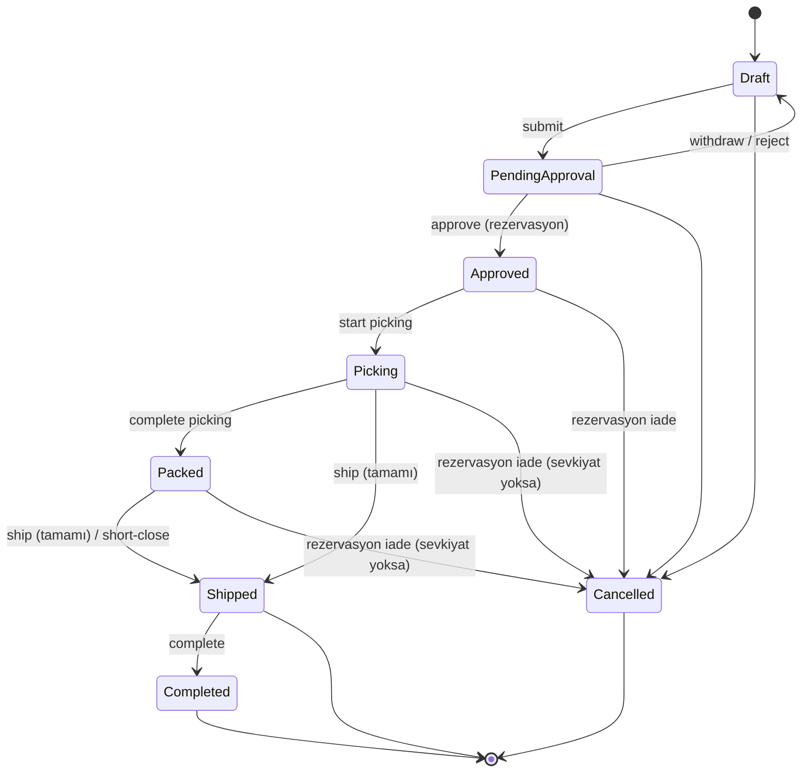

# Stok ve Sipariş Algoritmaları

> Sahip: Principal Software Architect · Durum: Taslak v1 · Tarih: 2026-11-04
> İlgili: [ADR 0004 Ledger tabanlı stok](../adr/0004-ledger-based-inventory.md) · [data-model.md §5.7–5.8](data-model.md)

## 1. Temel kurallar

1. Stok miktarı **yalnızca** `inventory.inventory_movements`'a hareket eklenerek değişir. `inventory.inventory_balances` aynı transaction'da güncellenen türetilmiş tablodur.
2. `available = on_hand − reserved`. Rezervasyon bir hareket **değildir**; yalnızca `reserved`'ı ve `stock_reservations`'ı değiştirir.
3. Rezervasyon sipariş **onayında**, fiziksel çıkış **sevkiyat onayında** yapılır.
4. Her stok işlemi tek bir ACID transaction'dır; kısmi başarı yoktur (çok satırlı işlemler ya hep ya hiç).
5. Bütün stok değiştiren işlemler `Inventory` modülünün public komutlarıyla yapılır; Warehouse/Orders bu komutları kendi transaction'ları içinde çağırır (paylaşılan UnitOfWork).

## 2. Eşzamanlılık stratejisi

### 2.1 İzolasyon ve kilitler
- İzolasyon seviyesi: **READ COMMITTED** + açık satır kilitleri (`SELECT … FOR UPDATE`). Serializable kullanılmaz (yeniden deneme maliyeti, öngörülebilirlik).
- Bakiye satırları her zaman **deterministik sırada** kilitlenir: `ORDER BY variant_id, warehouse_id, location_id NULLS FIRST`. PostgreSQL'de `ORDER BY … FOR UPDATE` sıralamadan sonra kilitlediği için, tek ifadede çoklu satır kilidi sıralı alınır.
- Bakiye satırı yoksa kilitten önce oluşturulur: `INSERT … ON CONFLICT DO NOTHING` (yine aynı sırada), ardından `SELECT … FOR UPDATE`.

### 2.2 Kilit hiyerarşisi (deadlock önleme)
Her işlem kilitleri **şu sırayla** alır; ters yönde kilit almak yasaktır:

1. `orders.orders` (sipariş başlığı, `FOR UPDATE`)
2. Warehouse doküman başlığı (`shipments`, `picking_tasks`, `stock_counts`) (`FOR UPDATE`)
3. `inventory.inventory_balances` (sıralı, `FOR UPDATE`)
4. `inventory.stock_reservations` (sipariş satırı sırasıyla)

### 2.3 Optimistic + pessimistic birlikte
- Kullanıcı düzenlemeleri (ürün, sipariş taslağı) **optimistic**: `If-Match` / `row_version`.
- Stok bakiyesi değişiklikleri **pessimistic**: satır kilidi. `inventory_balances.version` her güncellemede artar (okuma tarafı önbellek/ETag ve hata ayıklama için).
- Kilit beklemesi: `SET LOCAL lock_timeout = '5s'`; aşılırsa `409 inventory.busy` + `Retry-After`. `deadlock_detected (40P01)` ve `lock_not_available (55P03)` için UnitOfWork en fazla 3 kez, jitter ile, **tüm transaction'ı** yeniden dener (idempotency anahtarı sayesinde güvenli).

### 2.4 Son savunma: DB kısıtları
- `CHECK (reserved >= 0)`
- `CHECK (allow_negative OR (on_hand >= 0 AND reserved <= on_hand))`
- Ledger `UPDATE/DELETE` trigger ile engelli; kaynak satırı tekrar işleme benzersizlik kısıtı.
Uygulama kontrolü atlanırsa bile DB, tutarsız durumu commit ettirmez (`23514 check_violation` → `409 inventory.insufficient_stock`).
- **Stok eksiye düşmez (ürün sahibi kararı OD-09, 2026-11-09):** negatif stok politikası yoktur. Yeni bakiye satırları ve kötüleştiren her değişiklik `allow_negative = false` yazar; satılabilirin altına inen düzeltme `409 inventory.insufficient_available`, rezervasyon `409 inventory.insufficient_stock` ile reddedilir. Eski `confirmNegativeStock` istek alanı geriye uyumluluk için kabul edilir ve yok sayılır; `confirmationRequired` hiç gönderilmez; `inventory.negative_stock_confirmed` audit olayı artık yazılmaz. `allow_negative = true` yalnızca OD-09 öncesinden kalmış negatif bir satırda, satır sıfır veya üstüne dönene kadar (yalnızca iyileştiren değişikliklerle) kalabilir.

### 2.5 Ortak yardımcı: bakiye satırlarını kilitle

```sql
-- keys: (variant_id, warehouse_id, location_id) listesi, uygulamada aynı sırayla sıralanmış
INSERT INTO inventory.inventory_balances (id, tenant_id, variant_id, warehouse_id, location_id, allow_negative)
SELECT uuidv7_from_app, :tenant, k.variant_id, k.warehouse_id, k.location_id, false  -- OD-09
FROM unnest(:variant_ids, :warehouse_ids, :location_ids) AS k(variant_id, warehouse_id, location_id)
ORDER BY k.variant_id, k.warehouse_id, k.location_id NULLS FIRST
ON CONFLICT ON CONSTRAINT uq_inventory_balances_key DO NOTHING;

SELECT id, variant_id, warehouse_id, location_id, on_hand, reserved, version
FROM inventory.inventory_balances
WHERE tenant_id = :tenant
  AND (variant_id, warehouse_id, location_id) IS NOT DISTINCT FROM ANY(...)  -- uygulamada: join ile
ORDER BY variant_id, warehouse_id, location_id NULLS FIRST
FOR UPDATE;
```

Aşağıda bu adım `LOCK_BALANCES(keys)` olarak anılır. Her bakiye güncellemesi `version = version + 1, updated_at = now()` içerir ve hareket satırına `balance_after` yazılır.

### 2.6 Lokasyon kuralı
- `warehouses.uses_locations = false` → tüm bakiyeler `location_id = NULL` tek satırda.
- `uses_locations = true` → mal kabul/transfer/sayım lokasyon zorunlu; rezervasyon **lokasyon satırlarına tahsis edilir** (`stock_reservations.location_id`), toplama listesi bu tahsisle oluşur. Bir depo için "kullanılabilir" = o deponun lokasyon satırlarının toplamı.

---

## 3. Sipariş durum makinesi



### 3.1 İzin verilen geçişler

| # | Kimden | Kime | Tetikleyen uç | Gerekli izin | Koşullar | Yan etkiler (aynı transaction) |
|---|---|---|---|---|---|---|
| 1 | Draft | PendingApproval | `POST /orders/{id}/submit` | `orders.submit` | ≥1 satır; tüm satırlarda fiyat çözümlenmiş veya `price_overridden`; müşteri aktif | `submitted_at`; history; outbox `order_status_changed` |
| 1a | Draft | Approved | `POST /orders/{id}/submit` | `orders.submit` **ve** `orders.approve` | Tenant `require_order_approval = false` **ve** `source ≠ whatsapp_ai` | #3'ün tüm yan etkileri |
| 2 | PendingApproval | Draft | `POST /orders/{id}/withdraw` · `POST /orders/{id}/reject` | withdraw: `orders.submit` (oluşturan) · reject: `orders.approve` | — | `reason` zorunlu (reject); history |
| 3 | PendingApproval | Approved | `POST /orders/{id}/approve` | `orders.approve` | Onaylayan insan kullanıcı; satır/fiyat değişmemiş (`If-Match`) | **Fiyat snapshot dondurma**, **RESERVE (§4.3)** ya hep ya hiç; `OrderApproved` → picking task; history; outbox |
| 4 | Approved | Picking | `POST /picking-tasks/{id}/start` (veya ilk okutma) | `fulfillment.pick` | Açık picking task | Task `in_progress`; `OrderPickingStarted` |
| 5 | Picking | Packed | `POST /picking-tasks/{id}/complete` | `fulfillment.pick` | Tüm satırlar toplandı **veya** eksikler için `short_pick` kararı verildi (`orders.approve`) | `PickingCompleted` |
| 6 | Picking / Packed | Shipped | `POST /shipments/{id}/confirm` | `fulfillment.ship` | Bu sevkiyatla tüm satırlarda `qty_shipped + qty_cancelled = quantity` | **SHIP (§4.6)**; `fulfillment_status = full`; outbox |
| 6p | Picking / Packed | (aynı durum) | `POST /shipments/{id}/confirm` | `fulfillment.ship` | Kalan miktar var | **SHIP (§4.6)**; `fulfillment_status = partial` |
| 6s | Picking / Packed | Shipped | `POST /orders/{id}/close-remaining` | `orders.approve` | `fulfillment_status = partial` | Kalan miktar `qty_cancelled`'a; kalan rezervasyon **RELEASE**; history (sebep zorunlu) |
| 7 | Shipped | Completed | `POST /orders/{id}/complete` (veya N gün sonra job) | `orders.write` | — | `completed_at`; history |
| 8 | Draft / PendingApproval | Cancelled | `POST /orders/{id}/cancel` | `orders.cancel` (Draft'ı oluşturan için `orders.write` yeterli) | — | history; outbox |
| 9 | Approved / Picking / Packed | Cancelled | `POST /orders/{id}/cancel` | `orders.cancel` | `fulfillment_status = none` (hiç sevkiyat onaylanmamış). Kısmi sevkiyat sonrası iptal yok → 6s | **RELEASE (§4.4)**; açık picking task `cancelled`; toplanmış miktar varsa `putaway` görevi (PRD ORD-07, ledger hareketi yok); history; outbox |

Diğer tüm geçişler `409 order.invalid_transition` döner. Her geçiş: `orders` satırı `FOR UPDATE` kilitlenir, beklenen kaynak durum kontrol edilir (`WHERE status = :expected`), `row_version` artar, `order_status_history` satırı eklenir. Tüm geçiş uçları `Idempotency-Key` ister.

`fulfillment_status` ayrı bir türetilmiş alandır; ana durum makinesine "PartiallyShipped" durumu eklenmez.

---

## 4. Algoritmalar

Notasyon: `BEGIN` = UnitOfWork transaction'ı (`set_config('app.tenant_id', …, true)` ile). Hata durumunda tüm transaction ROLLBACK olur.

### 4.1 Mal kabul (receipt)

Girdi: `warehouse_id`, satırlar `(variant_id, location_id?, quantity > 0, unit_cost?)`, `reference`.

```sql
BEGIN;
-- doğrulama (uygulama): depo aktif; uses_locations ise location zorunlu ve depoya ait; varyant aktif; quantity birim kuralına uygun
-- aynı (variant, location) tekrarlanıyorsa satırlar toplanır
LOCK_BALANCES(keys sıralı);
FOR each line IN sıralı satırlar:
  UPDATE inventory.inventory_balances
     SET on_hand = on_hand + :q, version = version + 1, updated_at = now()
   WHERE id = :balance_id
  RETURNING on_hand INTO :after;
  INSERT INTO inventory.inventory_movements
    (id, tenant_id, variant_id, warehouse_id, location_id, type, quantity, unit_cost,
     source_type, source_id, source_line_id, balance_after, occurred_at, created_by, correlation_id)
  VALUES (…, 'receipt', +:q, :unit_cost, 'receipt', :receipt_id, :line_id, :after, now(), :user, :corr);
INSERT INTO audit.audit_events (...);  -- 'inventory.received'
COMMIT;
```

### 4.2 Düzeltme (adjust: adjustment_in / adjustment_out / damage_out / return_in)

Girdi: `variant_id, warehouse_id, location_id?, delta ≠ 0, type, reason (zorunlu)`.

```sql
BEGIN;
LOCK_BALANCES([(variant, warehouse, location)]);
IF delta < 0 AND NOT allow_negative AND (on_hand - reserved) < |delta| THEN
   RAISE 409 inventory.insufficient_available   -- rezerve edilmiş stok düzeltmeyle düşülemez
END IF;
UPDATE inventory.inventory_balances SET on_hand = on_hand + :delta, version = version + 1 WHERE id = :bid RETURNING on_hand;
INSERT INTO inventory.inventory_movements (…, type = :type, quantity = :delta, source_type = 'adjustment', reason = :reason, balance_after = …);
INSERT INTO audit.audit_events (...);
COMMIT;
```

Rezerveli stok hasarlıysa: önce ilgili sipariş/rezervasyon yönetici tarafından azaltılır/iptal edilir, sonra `damage_out`.

### 4.3 Onayda rezervasyon (çok satırlı, ya hep ya hiç)

Girdi: `order_id` (PendingApproval). Çağıran: Orders `ApproveOrder` → Inventory `ReserveForOrder`.

```sql
BEGIN;
SELECT * FROM orders.orders WHERE tenant_id = :t AND id = :order_id FOR UPDATE;
-- durum = pending_approval ve row_version = If-Match değilse → 409/412
SELECT id, variant_id, quantity FROM orders.order_lines WHERE order_id = :order_id ORDER BY variant_id, line_no;

-- 1) ihtiyaç: varyant bazında toplam
need(variant) = Σ line.quantity

-- 2) ilgili tüm bakiye satırlarını sıralı kilitle
--    lokasyonsuz depo: (variant, wh, NULL) satırları (yoksa oluştur)
--    lokasyonlu depo: o depodaki o varyantın TÜM lokasyon satırları
SELECT b.* FROM inventory.inventory_balances b
 WHERE b.tenant_id = :t AND b.warehouse_id = :wh AND b.variant_id = ANY(:variant_ids)
 ORDER BY b.variant_id, b.warehouse_id, b.location_id NULLS FIRST
 FOR UPDATE;

-- 3) yeterlilik kontrolü (önce TÜMÜ kontrol edilir, sonra yazılır)
shortages = []
FOR each variant: avail = Σ (on_hand - reserved) over its rows
   IF avail < need(variant) AND NOT allow_negative: shortages += (variant, need, avail)
IF shortages not empty: ROLLBACK; RETURN 409 inventory.insufficient_stock { shortages }

-- 4) tahsis (deterministik): her satır için, lokasyonları (pick_sequence, location_id) sırasıyla dolaş
FOR each line ORDER BY variant_id, line_no:
   remaining = line.quantity
   FOR each balance row of variant ORDER BY pick_sequence, location_id NULLS FIRST:
      take = min(remaining, row.on_hand - row.reserved)   -- stok eksiye düşmez (OD-09): yeterlilik yukarıda doğrulandı
      IF take > 0:
         UPDATE inventory.inventory_balances SET reserved = reserved + :take, version = version + 1 WHERE id = row.id;
         INSERT INTO inventory.stock_reservations (id, tenant_id, order_id, order_line_id, variant_id, warehouse_id,
                location_id, quantity, status) VALUES (…, :take, 'active');
         remaining -= take
   ASSERT remaining = 0

-- 5) sipariş
UPDATE orders.orders SET status = 'approved', approved_at = now(), approved_by = :user,
       row_version = row_version + 1 WHERE id = :order_id AND status = 'pending_approval';
UPDATE orders.order_lines SET unit_price/line_total = dondurulmuş snapshot …;
INSERT INTO orders.order_status_history (…);
-- domain event OrderApproved → Warehouse: picking_tasks + picking_task_lines (rezervasyon tahsisinden)
INSERT INTO platform.outbox_messages (…'orders.order_status_changed.v1'…);
INSERT INTO audit.audit_events (…);
COMMIT;
```

### 4.4 İptalde rezervasyon iadesi

```sql
BEGIN;
SELECT * FROM orders.orders WHERE id = :order_id FOR UPDATE;   -- durum ∈ {approved, picking, packed}, fulfillment_status = 'none'
SELECT * FROM warehouse.picking_tasks WHERE order_id = :order_id AND status IN ('open','in_progress') FOR UPDATE;
SELECT r.* FROM inventory.stock_reservations r
 WHERE r.order_id = :order_id AND r.status = 'active';
LOCK_BALANCES(rezervasyonların anahtarları, sıralı);
FOR each reservation r:
   open = r.quantity - r.consumed_quantity - r.released_quantity
   UPDATE inventory.inventory_balances SET reserved = reserved - :open, version = version + 1 WHERE key = r.key;
   UPDATE inventory.stock_reservations SET released_quantity = released_quantity + :open,
          status = CASE WHEN consumed_quantity > 0 THEN 'consumed' ELSE 'released' END WHERE id = r.id;
UPDATE warehouse.picking_tasks SET status = 'cancelled' WHERE …;
UPDATE orders.orders SET status = 'cancelled', cancelled_at = now(), cancelled_by = :user, cancel_reason = :reason, row_version = row_version + 1;
INSERT INTO orders.order_status_history (…); INSERT INTO platform.outbox_messages (…); INSERT INTO audit.audit_events (…);
COMMIT;
```

Aynı RELEASE alt adımı 6s "kalanı kapat" (short-close) için yalnızca kalan miktarlarla kullanılır.

### 4.5 Toplama (pick)

MVP'de toplama **ledger hareketi üretmez** (stok hâlâ aynı depodadır ve rezervelidir). Toplama, picking task satırlarında ilerleme kaydıdır.

```sql
BEGIN;
SELECT * FROM warehouse.picking_tasks WHERE id = :task FOR UPDATE;      -- open|in_progress
-- okutulan barkod → variant (Catalog), okutulan lokasyon barkodu → location
SELECT * FROM warehouse.picking_task_lines WHERE id = :line FOR UPDATE;
IF scanned_variant <> line.variant_id → 422 picking.wrong_item
IF line.qty_picked + :q > line.qty_to_pick → 422 picking.over_pick
IF scanned_location <> line.location_id:      -- toplayıcı farklı gözden aldı
   -- rezervasyonu yeniden tahsis: hedef lokasyonda available ≥ q olmalı
   LOCK_BALANCES([eski lokasyon, yeni lokasyon] sıralı)
   reserved(eski) -= q; reserved(yeni) += q; stock_reservations satırlarını böl/güncelle; line.location_id güncelle
UPDATE warehouse.picking_task_lines SET qty_picked = qty_picked + :q WHERE id = :line;
UPDATE warehouse.picking_tasks SET status = 'in_progress', started_at = coalesce(started_at, now());
-- ilk toplamada sipariş Approved → Picking (domain event, aynı tx)
COMMIT;
```

İleride "toplama alanına taşıma" gerekirse toplama = lokasyonlar arası `transfer_out/transfer_in` + rezervasyonun taşınması olarak eklenir (ADR).

### 4.6 Sevkiyat (kısmi destekli)

Girdi: `shipment_id` (draft), satırlar `(order_line_id, location_id?, quantity)`.

```sql
BEGIN;
SELECT * FROM orders.orders WHERE id = :order_id FOR UPDATE;           -- durum ∈ {picking, packed}
SELECT * FROM warehouse.shipments WHERE id = :shipment_id FOR UPDATE;   -- status = draft
SELECT * FROM orders.order_lines WHERE order_id = :order_id;
FOR each shipment line sl:
   remaining = ol.quantity - ol.qty_shipped - ol.qty_cancelled
   IF sl.quantity > remaining → 422 shipment.exceeds_remaining
SELECT * FROM inventory.stock_reservations
 WHERE order_line_id = ANY(:line_ids) AND status = 'active' ORDER BY order_line_id, location_id NULLS FIRST;
LOCK_BALANCES(sevk edilen (variant, wh, location) anahtarları, sıralı);
FOR each sl ORDER BY variant_id, location_id:
   r = ilgili satır+lokasyon aktif rezervasyonu;  open = r.quantity - r.consumed - r.released
   IF open < sl.quantity → 409 shipment.not_reserved   -- önce yeniden tahsis gerekir (§4.5)
   UPDATE inventory.inventory_balances
      SET on_hand = on_hand - :q, reserved = reserved - :q, version = version + 1
    WHERE key = (variant, wh, location) RETURNING on_hand INTO :after;
   INSERT INTO inventory.inventory_movements (…, type = 'shipment_out', quantity = -:q,
          source_type = 'shipment', source_id = :shipment_id, source_line_id = sl.id, balance_after = :after);
   UPDATE inventory.stock_reservations SET consumed_quantity = consumed_quantity + :q,
          status = CASE WHEN consumed_quantity + :q + released_quantity = quantity THEN 'consumed' ELSE 'active' END
    WHERE id = r.id;
   UPDATE orders.order_lines SET qty_shipped = qty_shipped + :q WHERE id = sl.order_line_id;  -- ShipmentConfirmed handler (Orders)
UPDATE warehouse.shipments SET status = 'confirmed', shipped_at = now(), confirmed_by = :user;
-- Orders handler: tüm satırlar tamamlandıysa status = 'shipped', fulfillment_status = 'full'; değilse 'partial'
INSERT INTO orders.order_status_history (…) (durum değiştiyse);
INSERT INTO platform.outbox_messages (…'warehouse.shipment_confirmed.v1'…);
COMMIT;
```

`on_hand` ve `reserved` aynı miktarda düştüğü için `available` değişmez — sevkiyat, başka siparişlerin kullanabileceği stoğu etkilemez.

### 4.7 Transfer (depolar veya lokasyonlar arası)

MVP: anlık transfer (yolda/in-transit durumu yok). Yalnızca **available** miktar taşınabilir.

```sql
BEGIN;
LOCK_BALANCES([(v, wh_from, loc_from), (v, wh_to, loc_to)] sıralı);   -- sıra kaynak/hedefe göre DEĞİL, anahtara göre
IF (from.on_hand - from.reserved) < :q AND NOT allow_negative → 409 inventory.insufficient_available
group = new uuid
UPDATE balances SET on_hand = on_hand - :q … WHERE key = from RETURNING on_hand INTO :a1;
INSERT movements (type='transfer_out', quantity=-:q, transfer_group_id=group, balance_after=:a1, source_type='transfer', source_id=:transfer_id);
UPDATE balances SET on_hand = on_hand + :q … WHERE key = to RETURNING on_hand INTO :a2;
INSERT movements (type='transfer_in',  quantity=+:q, transfer_group_id=group, balance_after=:a2, …);
COMMIT;
```

Depolar arası "yolda" takibi gerekirse: sanal "in-transit" lokasyonu + iki aşamalı onay (ADR).

### 4.8 Sayım düzeltmesi (count correction)

1. Sayım açılırken kapsamdaki satırlar için `expected_qty` = o anki `on_hand` snapshot'ı ve `snapshot_at` kaydedilir.
2. Personel `counted_qty` girer (mobil, barkodla).
3. Uygulama (`apply`):

```sql
BEGIN;
SELECT * FROM warehouse.stock_counts WHERE id = :count FOR UPDATE;      -- status = submitted
SELECT * FROM warehouse.stock_count_lines WHERE stock_count_id = :count AND counted_qty IS NOT NULL;
LOCK_BALANCES(satır anahtarları, sıralı);
FOR each line:
   -- snapshot sonrası bu anahtarda hareket olduysa satır 'needs_review' işaretlenir;
   -- kullanıcı açık onay (`acceptMovedLines=true`) vermeden uygulanmaz
   delta = line.counted_qty - balance.on_hand          -- fark UYGULAMA ANINDAKİ bakiyeye göre
   IF delta = 0 CONTINUE
   IF NOT allow_negative AND line.counted_qty < balance.reserved:
        → 409 count.below_reserved (satır listesiyle; yönetici rezervasyonu azaltmalı — negatif stok izni yok, OD-09)
   UPDATE balances SET on_hand = on_hand + :delta, version = version + 1 … RETURNING on_hand;
   INSERT movements (type='count_correction', quantity=:delta, source_type='stock_count', source_id=:count, source_line_id=line.id, reason='stock count', balance_after=…);
UPDATE warehouse.stock_counts SET status = 'applied', applied_at = now(), applied_by = :user;
INSERT INTO audit.audit_events (…);
COMMIT;
```

Gerekçe: Fark, uygulama anındaki bakiyeye göre alınır; snapshot sonrası hareket görmüş satırlar insan onayına düşer. Bu, sayım sırasında yapılan sevkiyatın çift sayılmasını önlemenin MVP için en basit güvenli yoludur.

### 4.9 Mutabakat (reconciliation) job'ı
Günlük job (tenant başına):
```sql
SELECT b.variant_id, b.warehouse_id, b.location_id, b.on_hand, coalesce(sum(m.quantity),0) AS ledger
FROM inventory.inventory_balances b
LEFT JOIN inventory.inventory_movements m USING (tenant_id, variant_id, warehouse_id, location_id)
GROUP BY … HAVING b.on_hand <> coalesce(sum(m.quantity),0);
-- ve: b.reserved = Σ aktif rezervasyonların açık miktarı
```
Fark = kritik alarm (otomatik düzeltme yok).

---

## 5. Test edilmesi zorunlu invariant'lar

### 5.1 Tekil (unit / integration)
| # | Invariant |
|---|---|
| I1 | Her (variant, warehouse, location) için `on_hand = Σ inventory_movements.quantity` |
| I2 | Her bakiye için `reserved = Σ (quantity − consumed − released)` aktif rezervasyonlar |
| I3 | Negatif stok kapalıyken hiçbir commit sonrası `on_hand < 0` veya `reserved > on_hand` olmaz |
| I4 | `inventory_movements` satırı UPDATE/DELETE edilemez (trigger + yetki) |
| I5 | Sevkiyat `available`'ı değiştirmez; onay `available`'ı sipariş miktarı kadar düşürür; iptal geri yükler |
| I6 | Rezervasyon ya tüm satırlar için yapılır ya hiçbiri (eksik stoklu satır varsa hiçbir rezervasyon/bakiye değişmez, sipariş PendingApproval kalır) |
| I7 | `order_lines.qty_shipped + qty_cancelled ≤ quantity` |
| I8 | §3.1 dışındaki her durum geçişi `order.invalid_transition` döner; terminal durumlardan çıkış yok |
| I9 | Kısmi sevkiyat sonrası iptal reddedilir; yalnızca short-close |
| I10 | Transfer çiftinin toplamı 0'dır (`Σ quantity WHERE transfer_group_id = g` = 0) |
| I11 | Aynı `Idempotency-Key` ile tekrarlanan onay/sevkiyat ikinci kez stok değiştirmez |
| I12 | AI kaynaklı sipariş insan onayı olmadan Approved olamaz |
| I13 | Tenant A bağlamında tenant B'nin bakiyesi/hareketi okunamaz/yazılamaz (EF filtresi kapatılarak da: RLS) |

### 5.2 Eşzamanlılık (Testcontainers PostgreSQL, gerçek paralel bağlantılar)
| # | Senaryo | Beklenen |
|---|---|---|
| C1 | Stok 10; 20 paralel onay, her biri 1 adet | Tam 10 başarılı, 10 `insufficient_stock`; `reserved = 10`; I1–I3 geçerli |
| C2 | Sipariş X satırları (A, B), sipariş Y satırları (B, A); paralel onay | Deadlock yok (ya da retry ile başarı); tutarlı sonuç |
| C3 | Onay ile `adjustment_out` aynı anda, stok sınırda | Toplam düşüş on_hand'i aşmaz |
| C4 | Aynı siparişin iki paralel onayı | Biri başarılı, diğeri `invalid_transition` veya idempotent yanıt; rezervasyon bir kez |
| C5 | Aynı sevkiyatın paralel iki confirm'ü | Tek `shipment_out` |
| C6 | İptal ile sevkiyat confirm yarışı | Ya iptal (rezervasyon iade, sevkiyat reddedilir) ya sevkiyat (iptal reddedilir); asla ikisi |
| C7 | Çift yönlü transfer (A→B ve B→A) paralel | Deadlock yok; on_hand toplamı korunur |
| C8 | Sayım apply sırasında sevkiyat | Satır `needs_review` veya sonuç I1 ile tutarlı |

Ayrıca property-based test: rastgele işlem dizileri (receipt/adjust/approve/cancel/ship/transfer) sonrası I1–I3, I7, I10 her adımda doğrulanır.

---

## 6. Uygulama durumu (JOB 09 — #26, #27, #28, #30)

Kod: `services/api/src/Modules/Inventory`, `services/api/src/Modules/Warehouse`. Bu bölüm yalnızca uygulanmış davranışı kaydeder.

- **Komutlar** (`IInventoryService`, Inventory.Contracts): `ReceiveAsync` (§4.1), `AdjustAsync` (§4.2), `ReserveAsync` (§4.3 stok kısmı), `ReleaseAsync` (§4.4 stok kısmı), `IssueAsync` (§4.6 stok kısmı). Sipariş/sevkiyat başlığı kilitleri ve durum geçişleri Orders/Warehouse işleriyle gelecek; komutlar çağıranın UnitOfWork transaction'ında çalışır.
- **HTTP:** `POST /inventory/receipts`, `POST /inventory/adjustments` (İ), `GET /inventory/balances`, `GET /inventory/movements`, `GET /inventory/movements/{id}`; depo/lokasyon CRUD (`/warehouses`, `/warehouses/{id}/locations`, `/locations/{id}`). Rezervasyon/iade/çıkış için HTTP ucu yoktur. Transfer (§4.7), sayım (§4.8), mutabakat job'ı (§4.9) ve `/inventory/availability` henüz yok.
- **Bakiye metin araması (#86):** `GET /inventory/balances?q=` — SKU, varyant adı veya ürün adı içinde geçen (büyük/küçük harf duyarsız, LIKE jokerleri düz metin) ya da tam barkod; diğer filtreler ve `id` keyset sayfalaması aynen. Terim Catalog portu `IVariantDirectory.SearchVariantIdsAsync` ile varyant kimliklerine çözülür (şemalar arası join yok, ADR 0005; pg_trgm GIN indeksleri) ve bakiyeler tek dizi parametresiyle süzülür. 10.000'den fazla varyant eşleşirse kesilmez, `422 inventory.search_too_broad` döner; `q` ≤ 100 karakter. 10k sentetik katalogda (tek bakiye/aktif varyant) p95 ≈ 18–20 ms (`CatalogPerformanceTests`).
- **Savepoint:** her komut bir savepoint altında çalışır; hata dönerse savepoint'e geri alınır, çağıran transaction'ı commit etse bile komuttan iz kalmaz (I6). Komut başında `SET LOCAL lock_timeout = '5s'`.
- **Kilit sırası:** `LOCK_BALANCES` §2.5'teki gibi tek ifadede `ORDER BY variant_id, warehouse_id, location_id NULLS FIRST … FOR UPDATE`; sıralama PostgreSQL'de yapılır (uygulamadaki GUID sıralaması kullanılmaz). Rezervasyon: lokasyonsuz depoda `(v, wh, NULL)` satırı yoksa oluşturulur, ardından varyantın o depodaki tüm satırları kilitlenir; rezervasyon satırları bakiyelerden sonra kilitlenir (§2.2 adım 3 → 4).
- **Hata kodları:** `inventory.insufficient_stock` (rezervasyon, `shortages` ile; teyitle geçme yok — OD-09), `inventory.insufficient_available` (düzeltme), `inventory.not_reserved` (sevk edilen miktar o satır+lokasyon için rezerve değil), `inventory.already_reserved`, `inventory.duplicate_source` (kaynak satır benzersizliği), `inventory.busy` (`55P03`/`40P01`, `Retry-After: 1`). DB `23514` → `inventory.insufficient_stock`. UnitOfWork düzeyinde otomatik yeniden deneme (§2.3) **henüz yok**; istemci aynı `Idempotency-Key` ile tekrar dener.
- **Negatif stok (OD-09, 2026-11-09):** politika portu (`INegativeStockPolicyProvider`) ve `warn`/`allow` yolları kaldırıldı; `identity.tenant_settings.negative_stock_policy` yalnızca `block` olabilir (CHECK; migration `NegativeStockBlockOnly` mevcut satırları `block` yaptı). `allow_negative` bakiye satırına her güncellemede yazılır: yeni satırda ve kötüleştiren değişiklikte `false`; yalnızca OD-09 öncesinden kalmış negatif bir satır, durumu kötüleştirmeyen bir değişiklikte (mal kabul, iade, rezervasyon iadesi, sevkiyat) bayrağını sıfıra dönene kadar korur — böylece CHECK son savunma olarak kalır.
- **Varsayılan depo:** tenant'ın ilk oluşturduğu depo varsayılandır. `warehouseId` verilmeyen ilk mal kabulde tenant'ın hiç deposu yoksa `MAIN / Ana Depo` aynı transaction'da oluşturulur (`INSERT … WHERE NOT EXISTS … ON CONFLICT DO NOTHING`; eşzamanlı ilk kabuller tek varsayılanda birleşir). Varsayılan depo pasifleştirilemez; `uses_locations` yalnızca depoda stok yokken değişir.
- **Tahsis:** lokasyonlu depoda rezervasyon aktif lokasyonlara `(pick_sequence, location_id)` sırasıyla dağıtılır; yeterlilik `Σ (on_hand − reserved)` ile ölçülür. Negatif stok izinliyse kalan son aday satıra yazılır.
- **Denetim izi:** her hareket `created_by` (aktör), `reason` (düzeltmede zorunlu; mal kabulde referans), `source_type/source_id/source_line_id` ve `correlation_id` (istek `X-Correlation-Id`) taşır; rezervasyonlar `created_by/updated_by/correlation_id` taşır. `audit.audit_events` tablosu henüz yok.
- **Testler** (`tests/BayiOS.IntegrationTests/Inventory`, Testcontainers PostgreSQL 17): C1 (20 paralel 1'lik rezervasyon, stok 5 → tam 5 başarılı), son birim (10 paralel düzeltme, stok 1 → tam 1), C3 (rezervasyon + düzeltme yarışı), eşzamanlı mal kabul + sevkiyat (sürüm sayacıyla kayıp güncelleme yok), C2/C7 eşdeğeri (ters satır sırasıyla çok satırlı kabul/rezervasyon, deadlock yok), I1–I6, I11, I13, append-only (yetki + trigger), CHECK son savunması ve rastgele işlem dizisi sonrası mutabakat.
- **Minimum stok eşikleri (#137):** `inventory.stock_thresholds` (data-model §5.7) — varyant başına bir genel eşik (`warehouse_id NULL`) ve depo başına bir istisna. Eşik stok değildir: hareket/bakiye yazmaz, ledger kuralları etkilenmez. Okuma `inventory.read`, yazma `catalog.write` (PRD CAT-12 ürün verisi; roles-permissions'ta ayrı bir eşik izni yok). HTTP: `GET /inventory/thresholds`, `GET/PUT/DELETE /inventory/thresholds/{id}` (If-Match), `POST /inventory/thresholds` (upsert, İ), `POST /inventory/thresholds/bulk` (≤ 500, hepsi ya da hiçbiri, İ). Varyant ve depo yalnızca çağıranın tenant'ında aranır (portlar), kesirsiz birimde tam sayı. Her değişiklik aynı transaction'da `inventory.threshold_set` / `inventory.threshold_removed` audit olayı (variantId, warehouseId, minQuantity from/to). **Etkin minimum ve kritik kuralı** Inventory sözleşmesi `IStockThresholdQueries`'tedir (tek depo: istisna → genel; tüm depolar: genel → Σ istisna; kritik = satılabilir ≤ minimum, bakiye yoksa satılabilir 0); Reports kritik stok raporu ve `GET /inventory/balances` (`minQuantity`, `belowMinimum`) aynı kuralı kullanır. Eşzamanlılık: aynı anahtarlara paralel toplu yazımlar tek satır üretir, her toplu yazım atomiktir (testte 6 yazar, ters sıralarla). `StockBelowThreshold` outbox olayı (domain-model) henüz yok; içe aktarma sihirbazında eşik kolonu da yok (ayrı iş).

## 7. Uygulama durumu — Siparişler (JOB 11 — #32, #33, #35)

Kod: `services/api/src/Modules/Orders`. Bu bölüm yalnızca uygulanmış davranışı kaydeder.

- **HTTP** (`/api/v1/orders`): `GET` liste (keyset `(created_at, id)` yeniden eskiye; `status` (virgüllü), `customerId`, `source`, `from`/`to` (oluşturma tarihi, UTC), `q` = sipariş no içinde arama, `limit` ≤ 200, `cursor`), `GET /{id}` (satırlar, toplamlar + KDV dökümü, zaman çizelgesi, sevkiyatlar; ETag), `POST` taslak (`orders.create`), `PATCH /{id}` merge patch, yalnızca taslak (`orders.edit.draft`, If-Match zorunlu; `lines` verilirse tüm satırlar değişir). Geçişler: `submit`, `withdraw` (`orders.submit`), `reject`, `approve` (`orders.approve`; approve'da If-Match zorunlu), `close-remaining` (`orders.approve`), `complete` (`orders.edit.approved`), `cancel` (`orders.cancel`). Oluşturma ve tüm geçişler `Idempotency-Key` ister; diğer geçişlerde If-Match gönderilirse kontrol edilir. `reject`, `cancel`, `close-remaining` sebep ister.
- **Durum makinesi:** tek yer `OrderStateMachine.Next` (§3.1 tablosu).
- **1a — onaysız tenant'ta submit (#92):** tenant ayarı `require_order_approval` (varsayılan `true` = her sipariş `pending_approval`'da bekler). `false` iken submit, aynı istek transaction'ında önce `submit` (draft → pending_approval, adres snapshot'ı), ardından **onayın kendisini** (`ApproveEffectAsync`: fiyat/müşteri kontrolü, tek `ReserveAsync` ya hep ya hiç, audit `order.approved` (`approvedOnSubmit: true`), outbox `orders.approved.v1`, toplama görevi) çalıştırır; zaman çizelgesinde `submit` + `approve` satırları, `approved_by` = gönderen. Koşullar: kaynak `whatsapp_ai` değil (ADR 0010: AI taslağını insan onaylar) **ve** gönderen `orders.approve`'u aktif kurallarla **koşulsuz** taşır (sales için dipnot 9 açık). Koşul sağlanmazsa (ör. kural kapalıyken sales, veya AI taslağı) sipariş sessizce `pending_approval`'a düşer (hata değil). Eksik stokta `409 inventory.insufficient_stock` + `shortages` döner ve **tüm** transaction geri alınır: sipariş `draft` kalır, sürüm/geçmiş değişmez, rezervasyon yok. `warn` politikasında submit gövdesi `{ "confirmNegativeStock": true }` (approve ile aynı). `start_picking`, `pack` ve `ship` HTTP ucu değildir: JOB 10 geçici `start-picking` / `pack` / `shipments` uçlarını kaldırdı; Warehouse bu geçişleri `IOrderFulfillment` ile tetikler (§8). `orders.order_shipments` / `order_shipment_lines` onaylanan Warehouse sevkiyatının sipariş tarafı kaydıdır (aynı kimlikler = hareketlerin `source_id` / `source_line_id`'si). Kısmi sevk durumu değiştirmez, `fulfillment_status = partial` yapar; açık miktar kalmayınca `shipped` + `full`. Short-close sonrası durum `shipped`, `fulfillment_status` `partial` kalır (kalan `qty_cancelled`'a yazılır). Kısmi sevkten sonra iptal `409 order.invalid_transition` (I9).
- **Kilitler:** her geçiş önce `SET LOCAL lock_timeout = '5s'` + sipariş başlığı `FOR UPDATE` (§2.2 adım 1), sonra If-Match sürümü, sonra durum kontrolü; stok işleri `IInventoryService` ile aynı transaction'da (adım 3–4). Kilit zaman aşımı/deadlock → `409 order.busy` + `Retry-After: 1`.
- **Onay (§4.3):** fiyatsız satır varsa `422 order.price_missing`; müşteri aktif değilse `422`; tüm satırlar tek `ReserveAsync` çağrısıyla ya hep ya hiç rezerve edilir; eksikte `409 inventory.insufficient_stock` + `shortages` (`warn` politikasında `confirmationRequired`, istekte `confirmNegativeStock: true`). Fiyatlar taslağın son düzenlemesindeki snapshot'tır; onayda yeniden çözülmez (If-Match onaylayanın gördüğünü onaylamasını sağlar).
- **İptal / short-close (§4.4):** rezervasyon tutan durumlarda `ReleaseAsync(orderId)`; satırlardaki `qty_reserved` aynası serbest bırakılan miktar kadar düşer. Serbest bırakmadan önce (kilit sırası adım 2 → 3) `IOrderFulfillmentListener.OnReservationsReleasedAsync` açık toplama görevlerini ve onaylanmamış sevkiyatları iptal eder, toplanmış ürünler için putaway görevi açar (§8).
- **Sevkiyat (§4.6):** yalnızca `IOrderFulfillment.ShipAsync` (Warehouse sevkiyat onayı): satır başına miktar ≤ açık miktar (`422 order.ship_exceeds_remaining`); her satır sipariş satırı + rezerve lokasyon taşır; `IssueAsync` ile `shipment_out` (`IssueAsync`'ın tek çağıranı).
- **Fiyatlandırma (taslakta, her düzenlemede yeniden):** `IPriceResolver.QuoteAsync(müşteri, sipariş tarihi (Europe/Istanbul), satırlar, para birimi)`. `no_price` satır `unit_price = NULL` kalır (asla 0). Manuel fiyat ve liste dışı iskonto `orders.price.override` ister (sales için K → reddedilir); iskonto verilmezse bayi grubu varsayılan iskontosu satıra yazılır (override sayılmaz). Para birimi: istek → müşteri → tenant varsayılanı. Vergi modu (`prices_include_tax`): istek → ilk fiyatlı satırın listesi → hariç; diğer moddaki liste fiyatı 4 haneye çevrilir (`× (100 + oran) / 100` veya `× 100 / (100 + oran)`).
- **Yuvarlama (PRD ORD-04, `OrderMath`):** round2 = 2 hane, yarım sıfırdan uzağa. Satır ara toplamı = round2(miktar × birim fiyat); iskonto = round2(ara toplam × % / 100) veya sabit tutar (≤ ara toplam, satırda tek tip); satır toplamı = ara toplam − iskonto. KDV oran bazında, toplanmış satır toplamları üzerinden bir kez yuvarlanır: hariç → vergi = round2(matrah × oran / 100); dahil → matrah = round2(toplam × 100 / (100 + oran)), vergi = toplam − matrah. Sipariş: hariç modda genel toplam = ara toplam − iskonto + KDV; dahil modda = ara toplam − iskonto. Toplamlar yalnızca sunucuda hesaplanır, `numeric(18,4)` kolonlarda 2 haneli değer olarak saklanır.
- **Sipariş numarası:** `{önek}-YYYY-NNNNNN`; önek tenant ayarı `order_number_prefix` (#92, varsayılan `SIP`, 1–10 karakter `^[A-Z][A-Z0-9]{0,9}$`, oluşturma anındaki değer). Sayaç `orders.order_number_sequences (tenant_id, prefix, year)` satır kilidiyle boşluksuz (geri alınan oluşturma numara tüketmez); önek değişince o önekin sayacı başlar/kaldığı yerden sürer, numara öneki içerdiği için `ux_orders_tenant_id_number` benzersizliği korunur. Mevcut numaralar değişmez.
- **Adres snapshot'ı (#92, PRD ORD-02):** taslakta `shippingAddressId` / `billingAddressId` seçilir (oluşturma veya PATCH; müşterinin ve doğru türün adresi olmalı, aksi `422`; `null` = o türün varsayılanı; müşteri değişir ve seçim verilmezse ikisi de varsayılana döner). Taslak detayında adresler canlı önizlemedir. Submit'te seçilen (yoksa varsayılan) adres `orders.shipping_address` / `billing_address` (jsonb) kolonlarına kopyalanır; seçilen adres silinmişse submit `422` (`shippingAddressId` / `billingAddressId`). Müşterinin o türde adresi yoksa snapshot `null`. Onayda snapshot yoksa (bu özellikten önce gönderilmiş siparişler) o an alınır. Withdraw / reject ile taslağa dönen siparişte seçim yeniden açılır, sonraki submit yeni snapshot alır. **Onaydan sonra değişmez:** trigger `trg_orders_address_snapshot_immutable` (durum `draft`/`pending_approval` dışındayken adres kolonlarında değişiklik `restrict_violation`). Yanıtta `shippingAddress`/`billingAddress` + `addressesAreSnapshot`; adresler kişisel veri olduğundan yalnızca `customers.read` sahiplerine dolu (warehouse_staff için `null`).
- **Kayıt düzeyi 403 kodları (#111):** taslak sahibi değil (düzenleme/iptal) `orders.not_owner`, sales kendi siparişini onay sonrası iptal `orders.cancel_not_allowed_in_status`, iskonto sınırı aşımı `orders.discount_limit_exceeded` (`limitPercent`), sınır altındaki sales manuel fiyat `orders.manual_price_not_allowed` (`limitPercent`), kuralı kapalı K (sales onayı, %0 iskonto sınırı) `auth.disabled_by_tenant_rule`. Ayrıntı: api-strategy §6.
- **Açık karar (#92):** fiyatlar onayda yeniden çözülmüyor (taslağın son düzenlemesindeki snapshot); "onayda fiyat değişikliği uyarısı" ürün sahibi kararını bekliyor.
- **Denetim / outbox (#79):** audit `order.created`, `order.approved`, `order.cancelled`, `order.shipped`, `order.remaining_closed`, `order.price_overridden`; outbox `orders.approved.v1`, `orders.cancelled.v1`, `orders.shipped.v1` (her sevkiyat ve short-close; yük yalnızca kimlik/durum). Hepsi aynı transaction'da.
- **Sözleşme eki:** `IStockQueries.GetOpenReservationsAsync(orderId)` (Inventory.Contracts) — siparişin aktif rezervasyonlarının açık miktarları (sevkte lokasyon bölme için).
- **Görünen adlar (#86):** liste özetinde `customerName`, `warehouseName`; detayda ayrıca `createdByName`, `approvedByName`, `history[].changedByName`, `shipments[].shippedByName`. Port `IOrderReferenceNames` (Orders.Contracts; host: Customers/Warehouse DbContext + Identity `IUserDirectory`), yanıt başına dizin başına tek toplu sorgu (N+1 yok). Kullanıcı adı kuralı (`UserDisplayName`): profildeki `full_name` (kırpılmış), boşsa e-postanın `@` öncesi, ikisi de yoksa `null`; yalnızca aktif tenant'ta üyeliği olan (veya olmuş) kullanıcılar çözülür. `customerName` yalnızca `customers.read` sahiplerine dolu; warehouse_staff (K⁸) için `null` (fiyatlar gibi), depo ve kullanıcı adları görünür.
- **Testler:** `tests/BayiOS.IntegrationTests/Orders` (Testcontainers PostgreSQL 17) — toplam/KDV/iskonto/yuvarlama (KDV dahil liste ve mod çevrimi dahil), no_price, durum makinesi, ya hep ya hiç onay, iptalde tam iade, kısmi sevk + short-close sonrası mutabakat (ledger ⇔ bakiye ⇔ rezervasyon ⇔ sipariş satırı aynası ⇔ sevkiyat satırı), lokasyon bölme, idempotent oluşturma/onay tekrarı, yetki reddi, tenant izolasyonu (API + RLS); eşzamanlılık: 10 paralel onay / stok 3 → tam 3 (C1), aynı siparişin 5 paralel onayı → tek rezervasyon (C4), ters satır sıralı 10 paralel onay → deadlock yok (C2), iptal ↔ sevk yarışı ×4 → her seferinde tam biri (C6). #92 (`OrderSettingsTests`): onaysız submit (yan etkiler, ya hep ya hiç eksik, `warn` teyidi, yetki düşüşü, AI kaynağı), önek sayaçları ve 16 paralel oluşturmada benzersiz/boşluksuz numara, adres snapshot'ı (önizleme, seçim doğrulama, silinen adres, withdraw sonrası yeni snapshot, onay sonrası trigger, staff'a gizli). Birim: `tests/BayiOS.UnitTests/Orders` (yuvarlama vakaları, tam geçiş tablosu).

## 8. Uygulama durumu — Depo hazırlama ve sevkiyat (JOB 10 — #36, #37, #38, #39)

Kod: `services/api/src/Modules/Warehouse` (görev/sevkiyat), Orders tarafı `IOrderFulfillment` (Orders.Contracts). Bu bölüm yalnızca uygulanmış davranışı kaydeder.

- **Sorumluluk ayrımı:** Warehouse toplama görevlerinin ve sevkiyat belgelerinin sahibidir; sipariş durumu ve stok çıkışı Orders'tadır. Warehouse siparişi yalnızca `IOrderFulfillment` ile değiştirir: `LockAsync` (başlık `FOR UPDATE`), `StartPickingAsync` (approved → picking; picking/packed'te no-op), `MarkPackedAsync` (picking → packed; packed'te no-op), `ReportShortageAsync` (durum değişmez; `has_shortage = true` + `report_shortage` zaman çizelgesi satırı), `ShipAsync` (§4.6). Geçişlerin hepsi `OrderStateMachine.Next`'ten geçer. Ters yön (aynı transaction): Orders onayda `IOrderFulfillmentListener.OnApprovedAsync` (görev oluştur), iptal / short-close'da `OnReservationsReleasedAsync` çağırır. `IInventoryService.IssueAsync`'ın tek çağıranı `OrderService.ShipAsync`'tır; stok çıkaran ikinci bir yol yoktur.
- **Görev oluşturma (WHT-01):** onay transaction'ında otomatik (tenant ayarı `auto_create_picking_task` henüz yok → her zaman). Satırlar `GetOpenReservationsAsync`'ten: rezervasyon (sipariş satırı, lokasyon) başına bir satır; sıra = lokasyon `pick_sequence`, lokasyon kodu, sipariş satır no. Satırda SKU/ad/birim snapshot'ı; barkod ve lokasyon kodu okumada canlı. `POST /picking-tasks {orderId}` (`tasks.assign`) yalnızca aktif görev ve onaylanmamış sevkiyat yokken kalan açık rezervasyondan yeni görev açar (`409 picking.fulfillment_in_progress` / `picking.nothing_to_pick` / `picking.order_not_fulfillable`). Kısmi indeks: sipariş başına tek aktif `pick` görevi.
- **Görev durumları:** `open → in_progress` (start, ilk okutma veya eksik bildirimi; sipariş approved → picking) → `completed` | `completed_with_shortage` (tüm satırlarda `qty_picked + qty_short = qty_to_pick`, aksi `409 picking.incomplete`); aktifken iptal (`cancelled`). Tek yer `FulfillmentStateMachine`. `putaway` görevi okutulmaz, yalnızca `complete` edilir. Ayrı bir "closed" durumu yok: sevkiyatın `confirmed` olması kapanıştır.
- **Atama (WHT-02):** `assign` / `unassign` (`tasks.assign`; atanan aktif üye ve rolü `tasks.pick` taşımalı), `claim` (`tasks.claim`; havuzdan, satır kilidiyle — eşzamanlı iki claim'den biri kazanır, diğeri `409 picking.already_assigned`). Görünürlük: `tasks.assign` sahibi (owner/admin/manager) her görevi görür ve üzerinde işlem yapar; diğerleri (warehouse_staff) kendine atanan + havuzdaki aktif görevleri görür, yalnızca kendine atananlarda işlem yapar (`403 picking.not_assignee`; başkasının görevi `404`). Staff izinleri ✓ olduğundan #69'u beklemez. `GET /picking-tasks` `tasks.read.all`, `GET /picking-tasks/mine` ve `GET /picking-tasks/{id}` `tasks.read.own` ister (viewer listeyi görür, detayı göremez).
- **Okutma (§4.5, WHT-05):** `POST /picking-tasks/{id}/scans {code, location?, quantity = 1, lineId?}` — kod önce barkod (tam eşleşme), sonra SKU (büyük harf). Red kodları (422, hiçbir şey değişmez): `picking.unknown_code`, `picking.wrong_item`, `picking.location_required` (lokasyonlu depoda), `picking.unknown_location`, `picking.wrong_location`, `picking.over_pick`, birimi kesirsiz ürüne kesirli miktar `validation.failed`. Toplama ledger hareketi üretmez. **§4.5'ten fark:** farklı gözden alınan ürün için rezervasyon yeniden tahsisi yapılmaz; okutma `picking.wrong_location` ile reddedilir.
- **Eksik (WHT-06, #38):** `POST /picking-tasks/{id}/lines/{lineId}/shortage {quantity?, reason}` (`not_found | damaged | insufficient`; miktar verilmezse satırda açık kalan). Paketlemede: `POST /shipments/{id}/lines/{lineId}/shortage` (yalnızca taslak; satır daha az sevk edilir). İkisi de siparişi işaretler (Orders `report_shortage`), `picking.shortage_reported` audit ve `warehouse.shortage_reported.v1` outbox yazar. Rezervasyon **serbest bırakılmaz**: karar yöneticinin — kısmi sevkten sonra short-close (§3.1 6s) veya kalan için yeni görev.
- **Tamamlama:** toplanan > 0 ise sipariş picking → packed (§3.1 #5) ve toplananlardan **taslak sevkiyat** (`{sipariş no}-S{n}`; sipariş başına tek onaylanmamış sevkiyat, kısmi indeks). Hiç toplanmadıysa sipariş değişmez, sevkiyat oluşmaz. Audit `order.pick_progress`, outbox `warehouse.picking_completed.v1`.
- **Paket kontrolü (WHT-07, isteğe bağlı):** `POST /shipments/{id}/pack {packages: [{items: [{code | shipmentLineId, quantity}]}]}` — satır başına paketlenen = sevk edilecek olmalı: `packing.unknown_code`, `packing.wrong_item`, `packing.over_pack`, `packing.quantity_mismatch` (eksik ürün önce shortage olarak bildirilir). Koliler `shipment_packages` / `shipment_package_items`'a yazılır, `package_count` set edilir, durum `packed`. Taslak paket kontrolü olmadan da onaylanabilir (PRD WHT-07 P1).
- **Sevkiyat onayı (§4.6, WHT-08, #39):** `POST /shipments/{id}/confirm {carrier?, trackingNumber?, packageCount?}` (`orders.ship`; staff için görev kendisine atanmış olmalı). Sıra: sipariş başlığı kilidi (Orders) → sevkiyat kilidi → `ShipAsync` (miktar kontrolü, `IssueAsync`, satır aynaları, durum: açık kalmazsa `shipped/full`, kalırsa durum aynı + `partial`, `orders.shipped.v1`) → sevkiyat `confirmed`, audit `shipment.confirmed`, outbox `warehouse.shipment_confirmed.v1`. Hareketler `source_type = shipment`, `source_id` = Warehouse sevkiyat kimliği, `source_line_id` = sevkiyat satırı; geçmiş `GET /inventory/movements?sourceId={id}` (yanıt `movementIds` da döner). Tekrar: aynı `Idempotency-Key` saklı yanıtı döner; farklı anahtarla ikinci onay `409 shipment.already_confirmed` — stok bir kez çıkar.
- **İptal / short-close ile etkileşim (ORD-07):** Orders release'ten önce dinleyici siparişin görev ve sevkiyatlarını kilitler; aktif `pick` görevleri `cancelled`, `draft`/`packed` sevkiyatlar `cancelled`; aktif görevlerde toplanmış ve onaylanmamış sevkiyatlardaki miktarlar için `putaway` görevi açılır (ledger hareketi yok, `warehouse.putaway_created.v1`).
- **Kilit sırası:** siparişi veya stoğu değiştirebilen her komut önce sipariş başlığını (`IOrderFulfillment.LockAsync`, adım 1), sonra görev/sevkiyat satırını (adım 2) kilitler; atama/claim yalnızca görevi kilitler. Kilit zaman aşımı → `409 picking.busy` (Orders kilidi için `order.busy`) + `Retry-After: 1`.
- **İstemci sözleşmesi:** tüm POST'lar `Idempotency-Key` ister (tekrarlanan okutma bir kez sayılır); If-Match gönderilirse kontrol edilir (görev/sevkiyat `row_version`, ETag). Yanıtlarda fiyat yok. Staff, `orders.read` (K⁸) ve `inventory.movements.read` (O⁵) #69'a kadar fail-closed olduğundan sipariş detayını ve hareket geçmişini okuyamaz; görev/sevkiyat yanıtları sipariş no, SKU, ad, barkod ve lokasyonu kendisi taşır.
- **Onaylanmamış sevkiyat iptali (#86):** `POST /shipments/{id}/cancel {reason}` (`tasks.assign`; sebep zorunlu ≤ 500; `Idempotency-Key`, If-Match isteğe bağlı). Geçiş `FulfillmentStateMachine.NextShipment(cancel)`: `draft`/`packed` → `cancelled`; `confirmed`/`cancelled` → `409 shipment.invalid_transition`. Kilit: sipariş başlığı → sevkiyat (onayla serileşir). Sonuçlar: **ledger hareketi yok, bakiye değişmez** (stok hiç çıkmadı); **rezervasyonlar aktif kalır ve sipariş durumu değişmez** (sipariş hâlâ bu mala ihtiyaç duyar — yeniden toplama `POST /picking-tasks`, ya da short-close / iptal yöneticinin kararı); sevk edilecek miktarlar (`quantity > 0`; paketlemede eksik bildirilenler hariç) için `putaway` görevi açılır (ORD-07 ile aynı yol). Audit `shipment.cancelled`, outbox `warehouse.shipment_cancelled.v1` + `warehouse.putaway_created.v1`. Yanıt: sevkiyat + `putawayTaskId`.
- **Görünen alanlar (#86):** görev özetlerinde `assigneeName` (liste, `/mine`, detay; Identity'nin ad kuralı, `ITaskAssigneeDirectory.DisplayNamesAsync` ile tek toplu sorgu); sevkiyat satırlarında `barcode` (görev satırları gibi Catalog'dan canlı).
- **Testler:** `tests/BayiOS.IntegrationTests/Warehouse` (Testcontainers PostgreSQL 17) — lokasyonlu tam akış (onay → görev → atama → okutma redleri → toplama → tamamlama → paket kontrolü → onay; ledger ⇔ bakiye ⇔ rezervasyon ⇔ sipariş satırı ⇔ Warehouse/Orders sevkiyat satırı mutabakatı), eksik + kısmi sevk + paketleme eksiği + short-close, kalan için ikinci görev ve tek aktif görev kuralı, onay tekrarı/çift onay, okutma tekrarı, iptal sonrası putaway, staff kapsamı ve yetki redleri, tenant izolasyonu (API + RLS, CHECK'ler, kısmi benzersiz indeksler); eşzamanlılık: aynı göreve iki claim ×5 → tam biri, 10 paralel +1 okutma / 5 → tam 5, 6 paralel onay → tek `shipment_out` (C5), iptal ↔ okutma yarışı ×4, iptal ↔ sevkiyat onayı yarışı ×4 (C6, `Orders`). Birim: `tests/BayiOS.UnitTests/Warehouse` (tam görev/sevkiyat geçiş tablosu).
