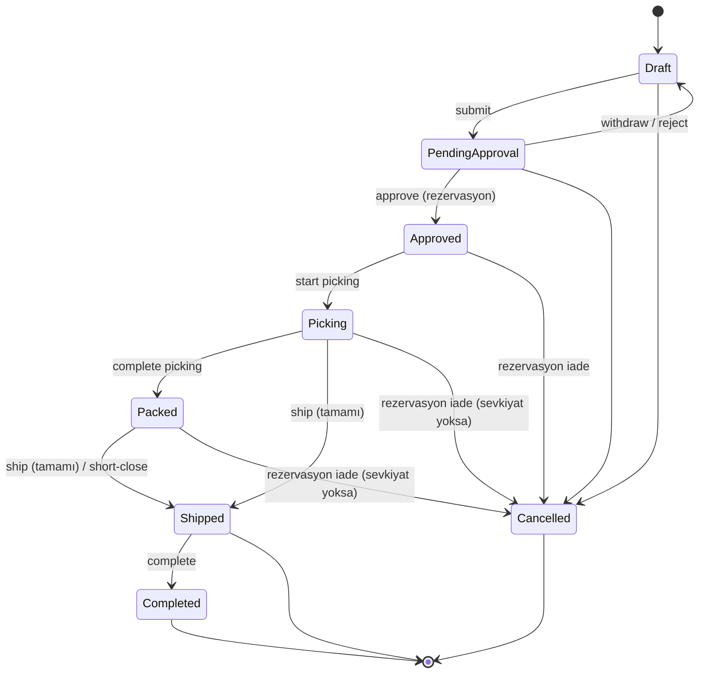

# Stok ve Sipariş Algoritmaları

> Sahip: Principal Software Architect · Durum: Taslak v1 · Tarih: 2026-11-04
> İlgili: [ADR 0004 Ledger tabanlı stok](../adr/0004-ledger-based-inventory.md) · [data-model.md §5.7–5.8](data-model.md)

## 1. Temel kurallar

1. Stok miktarı **yalnızca** `inventory.inventory_movements`'a hareket eklenerek değişir. `inventory.inventory_balances` aynı transaction'da güncellenen türetilmiş tablodur.
2. `available = on_hand − reserved`. Rezervasyon bir hareket **değildir**; yalnızca `reserved`'ı ve `stock_reservations`'ı değiştirir.
3. Rezervasyon sipariş **onayında**, fiziksel çıkış **sevkiyat onayında** yapılır.
4. Her stok işlemi tek bir ACID transaction'dır; kısmi başarı yoktur (çok satırlı işlemler ya hep ya hiç).
5. Bütün stok değiştiren işlemler `Inventory` modülünün public komutlarıyla yapılır; Warehouse/Orders bu komutları kendi transaction'ları içinde çağırır (paylaşılan UnitOfWork).

## 2. Eşzamanlılık stratejisi

### 2.1 İzolasyon ve kilitler
- İzolasyon seviyesi: **READ COMMITTED** + açık satır kilitleri (`SELECT … FOR UPDATE`). Serializable kullanılmaz (yeniden deneme maliyeti, öngörülebilirlik).
- Bakiye satırları her zaman **deterministik sırada** kilitlenir: `ORDER BY variant_id, warehouse_id, location_id NULLS FIRST`. PostgreSQL'de `ORDER BY … FOR UPDATE` sıralamadan sonra kilitlediği için, tek ifadede çoklu satır kilidi sıralı alınır.
- Bakiye satırı yoksa kilitten önce oluşturulur: `INSERT … ON CONFLICT DO NOTHING` (yine aynı sırada), ardından `SELECT … FOR UPDATE`.

### 2.2 Kilit hiyerarşisi (deadlock önleme)
Her işlem kilitleri **şu sırayla** alır; ters yönde kilit almak yasaktır:

1. `orders.orders` (sipariş başlığı, `FOR UPDATE`)
2. Warehouse doküman başlığı (`shipments`, `picking_tasks`, `stock_counts`) (`FOR UPDATE`)
3. `inventory.inventory_balances` (sıralı, `FOR UPDATE`)
4. `inventory.stock_reservations` (sipariş satırı sırasıyla)

### 2.3 Optimistic + pessimistic birlikte
- Kullanıcı düzenlemeleri (ürün, sipariş taslağı) **optimistic**: `If-Match` / `row_version`.
- Stok bakiyesi değişiklikleri **pessimistic**: satır kilidi. `inventory_balances.version` her güncellemede artar (okuma tarafı önbellek/ETag ve hata ayıklama için).
- Kilit beklemesi: `SET LOCAL lock_timeout = '5s'`; aşılırsa `409 inventory.busy` + `Retry-After`. `deadlock_detected (40P01)` ve `lock_not_available (55P03)` için UnitOfWork en fazla 3 kez, jitter ile, **tüm transaction'ı** yeniden dener (idempotency anahtarı sayesinde güvenli).

### 2.4 Son savunma: DB kısıtları
- `CHECK (reserved >= 0)`
- `CHECK (allow_negative OR (on_hand >= 0 AND reserved <= on_hand))`
- Ledger `UPDATE/DELETE` trigger ile engelli; kaynak satırı tekrar işleme benzersizlik kısıtı.
Uygulama kontrolü atlanırsa bile DB, tutarsız durumu commit ettirmez (`23514 check_violation` → `409 inventory.insufficient_stock`).
- Negatif stok politikası `warn` ise bakiyelerde `allow_negative = true`'dur; kullanıcı teyidi uygulama katmanında alınır (istekte açık `confirmNegativeStock=true`, yoksa `409 inventory.insufficient_stock` + teyit gerektiğini belirten alan) ve audit'e `inventory.negative_stock_confirmed` yazılır (US-TEN-006).

### 2.5 Ortak yardımcı: bakiye satırlarını kilitle

```sql
-- keys: (variant_id, warehouse_id, location_id) listesi, uygulamada aynı sırayla sıralanmış
INSERT INTO inventory.inventory_balances (id, tenant_id, variant_id, warehouse_id, location_id, allow_negative)
SELECT uuidv7_from_app, :tenant, k.variant_id, k.warehouse_id, k.location_id, :allow_negative
FROM unnest(:variant_ids, :warehouse_ids, :location_ids) AS k(variant_id, warehouse_id, location_id)
ORDER BY k.variant_id, k.warehouse_id, k.location_id NULLS FIRST
ON CONFLICT ON CONSTRAINT uq_inventory_balances_key DO NOTHING;

SELECT id, variant_id, warehouse_id, location_id, on_hand, reserved, version
FROM inventory.inventory_balances
WHERE tenant_id = :tenant
  AND (variant_id, warehouse_id, location_id) IS NOT DISTINCT FROM ANY(...)  -- uygulamada: join ile
ORDER BY variant_id, warehouse_id, location_id NULLS FIRST
FOR UPDATE;
```

Aşağıda bu adım `LOCK_BALANCES(keys)` olarak anılır. Her bakiye güncellemesi `version = version + 1, updated_at = now()` içerir ve hareket satırına `balance_after` yazılır.

### 2.6 Lokasyon kuralı
- `warehouses.uses_locations = false` → tüm bakiyeler `location_id = NULL` tek satırda.
- `uses_locations = true` → mal kabul/transfer/sayım lokasyon zorunlu; rezervasyon **lokasyon satırlarına tahsis edilir** (`stock_reservations.location_id`), toplama listesi bu tahsisle oluşur. Bir depo için "kullanılabilir" = o deponun lokasyon satırlarının toplamı.

---

## 3. Sipariş durum makinesi



### 3.1 İzin verilen geçişler

| # | Kimden | Kime | Tetikleyen uç | Gerekli izin | Koşullar | Yan etkiler (aynı transaction) |
|---|---|---|---|---|---|---|
| 1 | Draft | PendingApproval | `POST /orders/{id}/submit` | `orders.submit` | ≥1 satır; tüm satırlarda fiyat çözümlenmiş veya `price_overridden`; müşteri aktif | `submitted_at`; history; outbox `order_status_changed` |
| 1a | Draft | Approved | `POST /orders/{id}/submit` | `orders.submit` **ve** `orders.approve` | Tenant `require_order_approval = false` **ve** `source ≠ whatsapp_ai` | #3'ün tüm yan etkileri |
| 2 | PendingApproval | Draft | `POST /orders/{id}/withdraw` · `POST /orders/{id}/reject` | withdraw: `orders.submit` (oluşturan) · reject: `orders.approve` | — | `reason` zorunlu (reject); history |
| 3 | PendingApproval | Approved | `POST /orders/{id}/approve` | `orders.approve` | Onaylayan insan kullanıcı; satır/fiyat değişmemiş (`If-Match`) | **Fiyat snapshot dondurma**, **RESERVE (§4.3)** ya hep ya hiç; `OrderApproved` → picking task; history; outbox |
| 4 | Approved | Picking | `POST /picking-tasks/{id}/start` (veya ilk okutma) | `fulfillment.pick` | Açık picking task | Task `in_progress`; `OrderPickingStarted` |
| 5 | Picking | Packed | `POST /picking-tasks/{id}/complete` | `fulfillment.pick` | Tüm satırlar toplandı **veya** eksikler için `short_pick` kararı verildi (`orders.approve`) | `PickingCompleted` |
| 6 | Picking / Packed | Shipped | `POST /shipments/{id}/confirm` | `fulfillment.ship` | Bu sevkiyatla tüm satırlarda `qty_shipped + qty_cancelled = quantity` | **SHIP (§4.6)**; `fulfillment_status = full`; outbox |
| 6p | Picking / Packed | (aynı durum) | `POST /shipments/{id}/confirm` | `fulfillment.ship` | Kalan miktar var | **SHIP (§4.6)**; `fulfillment_status = partial` |
| 6s | Picking / Packed | Shipped | `POST /orders/{id}/close-remaining` | `orders.approve` | `fulfillment_status = partial` | Kalan miktar `qty_cancelled`'a; kalan rezervasyon **RELEASE**; history (sebep zorunlu) |
| 7 | Shipped | Completed | `POST /orders/{id}/complete` (veya N gün sonra job) | `orders.write` | — | `completed_at`; history |
| 8 | Draft / PendingApproval | Cancelled | `POST /orders/{id}/cancel` | `orders.cancel` (Draft'ı oluşturan için `orders.write` yeterli) | — | history; outbox |
| 9 | Approved / Picking / Packed | Cancelled | `POST /orders/{id}/cancel` | `orders.cancel` | `fulfillment_status = none` (hiç sevkiyat onaylanmamış). Kısmi sevkiyat sonrası iptal yok → 6s | **RELEASE (§4.4)**; açık picking task `cancelled`; toplanmış miktar varsa `putaway` görevi (PRD ORD-07, ledger hareketi yok); history; outbox |

Diğer tüm geçişler `409 order.invalid_transition` döner. Her geçiş: `orders` satırı `FOR UPDATE` kilitlenir, beklenen kaynak durum kontrol edilir (`WHERE status = :expected`), `row_version` artar, `order_status_history` satırı eklenir. Tüm geçiş uçları `Idempotency-Key` ister.

`fulfillment_status` ayrı bir türetilmiş alandır; ana durum makinesine "PartiallyShipped" durumu eklenmez.

---

## 4. Algoritmalar

Notasyon: `BEGIN` = UnitOfWork transaction'ı (`set_config('app.tenant_id', …, true)` ile). Hata durumunda tüm transaction ROLLBACK olur.

### 4.1 Mal kabul (receipt)

Girdi: `warehouse_id`, satırlar `(variant_id, location_id?, quantity > 0, unit_cost?)`, `reference`.

```sql
BEGIN;
-- doğrulama (uygulama): depo aktif; uses_locations ise location zorunlu ve depoya ait; varyant aktif; quantity birim kuralına uygun
-- aynı (variant, location) tekrarlanıyorsa satırlar toplanır
LOCK_BALANCES(keys sıralı);
FOR each line IN sıralı satırlar:
  UPDATE inventory.inventory_balances
     SET on_hand = on_hand + :q, version = version + 1, updated_at = now()
   WHERE id = :balance_id
  RETURNING on_hand INTO :after;
  INSERT INTO inventory.inventory_movements
    (id, tenant_id, variant_id, warehouse_id, location_id, type, quantity, unit_cost,
     source_type, source_id, source_line_id, balance_after, occurred_at, created_by, correlation_id)
  VALUES (…, 'receipt', +:q, :unit_cost, 'receipt', :receipt_id, :line_id, :after, now(), :user, :corr);
INSERT INTO audit.audit_events (...);  -- 'inventory.received'
COMMIT;
```

### 4.2 Düzeltme (adjust: adjustment_in / adjustment_out / damage_out / return_in)

Girdi: `variant_id, warehouse_id, location_id?, delta ≠ 0, type, reason (zorunlu)`.

```sql
BEGIN;
LOCK_BALANCES([(variant, warehouse, location)]);
IF delta < 0 AND NOT allow_negative AND (on_hand - reserved) < |delta| THEN
   RAISE 409 inventory.insufficient_available   -- rezerve edilmiş stok düzeltmeyle düşülemez
END IF;
UPDATE inventory.inventory_balances SET on_hand = on_hand + :delta, version = version + 1 WHERE id = :bid RETURNING on_hand;
INSERT INTO inventory.inventory_movements (…, type = :type, quantity = :delta, source_type = 'adjustment', reason = :reason, balance_after = …);
INSERT INTO audit.audit_events (...);
COMMIT;
```

Rezerveli stok hasarlıysa: önce ilgili sipariş/rezervasyon yönetici tarafından azaltılır/iptal edilir, sonra `damage_out`.

### 4.3 Onayda rezervasyon (çok satırlı, ya hep ya hiç)

Girdi: `order_id` (PendingApproval). Çağıran: Orders `ApproveOrder` → Inventory `ReserveForOrder`.

```sql
BEGIN;
SELECT * FROM orders.orders WHERE tenant_id = :t AND id = :order_id FOR UPDATE;
-- durum = pending_approval ve row_version = If-Match değilse → 409/412
SELECT id, variant_id, quantity FROM orders.order_lines WHERE order_id = :order_id ORDER BY variant_id, line_no;

-- 1) ihtiyaç: varyant bazında toplam
need(variant) = Σ line.quantity

-- 2) ilgili tüm bakiye satırlarını sıralı kilitle
--    lokasyonsuz depo: (variant, wh, NULL) satırları (yoksa oluştur)
--    lokasyonlu depo: o depodaki o varyantın TÜM lokasyon satırları
SELECT b.* FROM inventory.inventory_balances b
 WHERE b.tenant_id = :t AND b.warehouse_id = :wh AND b.variant_id = ANY(:variant_ids)
 ORDER BY b.variant_id, b.warehouse_id, b.location_id NULLS FIRST
 FOR UPDATE;

-- 3) yeterlilik kontrolü (önce TÜMÜ kontrol edilir, sonra yazılır)
shortages = []
FOR each variant: avail = Σ (on_hand - reserved) over its rows
   IF avail < need(variant) AND NOT allow_negative: shortages += (variant, need, avail)
IF shortages not empty: ROLLBACK; RETURN 409 inventory.insufficient_stock { shortages }

-- 4) tahsis (deterministik): her satır için, lokasyonları (pick_sequence, location_id) sırasıyla dolaş
FOR each line ORDER BY variant_id, line_no:
   remaining = line.quantity
   FOR each balance row of variant ORDER BY pick_sequence, location_id NULLS FIRST:
      take = min(remaining, row.on_hand - row.reserved)   -- allow_negative ise son satıra kalan eklenir
      IF take > 0:
         UPDATE inventory.inventory_balances SET reserved = reserved + :take, version = version + 1 WHERE id = row.id;
         INSERT INTO inventory.stock_reservations (id, tenant_id, order_id, order_line_id, variant_id, warehouse_id,
                location_id, quantity, status) VALUES (…, :take, 'active');
         remaining -= take
   ASSERT remaining = 0

-- 5) sipariş
UPDATE orders.orders SET status = 'approved', approved_at = now(), approved_by = :user,
       row_version = row_version + 1 WHERE id = :order_id AND status = 'pending_approval';
UPDATE orders.order_lines SET unit_price/line_total = dondurulmuş snapshot …;
INSERT INTO orders.order_status_history (…);
-- domain event OrderApproved → Warehouse: picking_tasks + picking_task_lines (rezervasyon tahsisinden)
INSERT INTO platform.outbox_messages (…'orders.order_status_changed.v1'…);
INSERT INTO audit.audit_events (…);
COMMIT;
```

### 4.4 İptalde rezervasyon iadesi

```sql
BEGIN;
SELECT * FROM orders.orders WHERE id = :order_id FOR UPDATE;   -- durum ∈ {approved, picking, packed}, fulfillment_status = 'none'
SELECT * FROM warehouse.picking_tasks WHERE order_id = :order_id AND status IN ('open','in_progress') FOR UPDATE;
SELECT r.* FROM inventory.stock_reservations r
 WHERE r.order_id = :order_id AND r.status = 'active';
LOCK_BALANCES(rezervasyonların anahtarları, sıralı);
FOR each reservation r:
   open = r.quantity - r.consumed_quantity - r.released_quantity
   UPDATE inventory.inventory_balances SET reserved = reserved - :open, version = version + 1 WHERE key = r.key;
   UPDATE inventory.stock_reservations SET released_quantity = released_quantity + :open,
          status = CASE WHEN consumed_quantity > 0 THEN 'consumed' ELSE 'released' END WHERE id = r.id;
UPDATE warehouse.picking_tasks SET status = 'cancelled' WHERE …;
UPDATE orders.orders SET status = 'cancelled', cancelled_at = now(), cancelled_by = :user, cancel_reason = :reason, row_version = row_version + 1;
INSERT INTO orders.order_status_history (…); INSERT INTO platform.outbox_messages (…); INSERT INTO audit.audit_events (…);
COMMIT;
```

Aynı RELEASE alt adımı 6s "kalanı kapat" (short-close) için yalnızca kalan miktarlarla kullanılır.

### 4.5 Toplama (pick)

MVP'de toplama **ledger hareketi üretmez** (stok hâlâ aynı depodadır ve rezervelidir). Toplama, picking task satırlarında ilerleme kaydıdır.

```sql
BEGIN;
SELECT * FROM warehouse.picking_tasks WHERE id = :task FOR UPDATE;      -- open|in_progress
-- okutulan barkod → variant (Catalog), okutulan lokasyon barkodu → location
SELECT * FROM warehouse.picking_task_lines WHERE id = :line FOR UPDATE;
IF scanned_variant <> line.variant_id → 422 picking.wrong_item
IF line.qty_picked + :q > line.qty_to_pick → 422 picking.over_pick
IF scanned_location <> line.location_id:      -- toplayıcı farklı gözden aldı
   -- rezervasyonu yeniden tahsis: hedef lokasyonda available ≥ q olmalı
   LOCK_BALANCES([eski lokasyon, yeni lokasyon] sıralı)
   reserved(eski) -= q; reserved(yeni) += q; stock_reservations satırlarını böl/güncelle; line.location_id güncelle
UPDATE warehouse.picking_task_lines SET qty_picked = qty_picked + :q WHERE id = :line;
UPDATE warehouse.picking_tasks SET status = 'in_progress', started_at = coalesce(started_at, now());
-- ilk toplamada sipariş Approved → Picking (domain event, aynı tx)
COMMIT;
```

İleride "toplama alanına taşıma" gerekirse toplama = lokasyonlar arası `transfer_out/transfer_in` + rezervasyonun taşınması olarak eklenir (ADR).

### 4.6 Sevkiyat (kısmi destekli)

Girdi: `shipment_id` (draft), satırlar `(order_line_id, location_id?, quantity)`.

```sql
BEGIN;
SELECT * FROM orders.orders WHERE id = :order_id FOR UPDATE;           -- durum ∈ {picking, packed}
SELECT * FROM warehouse.shipments WHERE id = :shipment_id FOR UPDATE;   -- status = draft
SELECT * FROM orders.order_lines WHERE order_id = :order_id;
FOR each shipment line sl:
   remaining = ol.quantity - ol.qty_shipped - ol.qty_cancelled
   IF sl.quantity > remaining → 422 shipment.exceeds_remaining
SELECT * FROM inventory.stock_reservations
 WHERE order_line_id = ANY(:line_ids) AND status = 'active' ORDER BY order_line_id, location_id NULLS FIRST;
LOCK_BALANCES(sevk edilen (variant, wh, location) anahtarları, sıralı);
FOR each sl ORDER BY variant_id, location_id:
   r = ilgili satır+lokasyon aktif rezervasyonu;  open = r.quantity - r.consumed - r.released
   IF open < sl.quantity → 409 shipment.not_reserved   -- önce yeniden tahsis gerekir (§4.5)
   UPDATE inventory.inventory_balances
      SET on_hand = on_hand - :q, reserved = reserved - :q, version = version + 1
    WHERE key = (variant, wh, location) RETURNING on_hand INTO :after;
   INSERT INTO inventory.inventory_movements (…, type = 'shipment_out', quantity = -:q,
          source_type = 'shipment', source_id = :shipment_id, source_line_id = sl.id, balance_after = :after);
   UPDATE inventory.stock_reservations SET consumed_quantity = consumed_quantity + :q,
          status = CASE WHEN consumed_quantity + :q + released_quantity = quantity THEN 'consumed' ELSE 'active' END
    WHERE id = r.id;
   UPDATE orders.order_lines SET qty_shipped = qty_shipped + :q WHERE id = sl.order_line_id;  -- ShipmentConfirmed handler (Orders)
UPDATE warehouse.shipments SET status = 'confirmed', shipped_at = now(), confirmed_by = :user;
-- Orders handler: tüm satırlar tamamlandıysa status = 'shipped', fulfillment_status = 'full'; değilse 'partial'
INSERT INTO orders.order_status_history (…) (durum değiştiyse);
INSERT INTO platform.outbox_messages (…'warehouse.shipment_confirmed.v1'…);
COMMIT;
```

`on_hand` ve `reserved` aynı miktarda düştüğü için `available` değişmez — sevkiyat, başka siparişlerin kullanabileceği stoğu etkilemez.

### 4.7 Transfer (depolar veya lokasyonlar arası)

MVP: anlık transfer (yolda/in-transit durumu yok). Yalnızca **available** miktar taşınabilir.

```sql
BEGIN;
LOCK_BALANCES([(v, wh_from, loc_from), (v, wh_to, loc_to)] sıralı);   -- sıra kaynak/hedefe göre DEĞİL, anahtara göre
IF (from.on_hand - from.reserved) < :q AND NOT allow_negative → 409 inventory.insufficient_available
group = new uuid
UPDATE balances SET on_hand = on_hand - :q … WHERE key = from RETURNING on_hand INTO :a1;
INSERT movements (type='transfer_out', quantity=-:q, transfer_group_id=group, balance_after=:a1, source_type='transfer', source_id=:transfer_id);
UPDATE balances SET on_hand = on_hand + :q … WHERE key = to RETURNING on_hand INTO :a2;
INSERT movements (type='transfer_in',  quantity=+:q, transfer_group_id=group, balance_after=:a2, …);
COMMIT;
```

Depolar arası "yolda" takibi gerekirse: sanal "in-transit" lokasyonu + iki aşamalı onay (ADR).

### 4.8 Sayım düzeltmesi (count correction)

1. Sayım açılırken kapsamdaki satırlar için `expected_qty` = o anki `on_hand` snapshot'ı ve `snapshot_at` kaydedilir.
2. Personel `counted_qty` girer (mobil, barkodla).
3. Uygulama (`apply`):

```sql
BEGIN;
SELECT * FROM warehouse.stock_counts WHERE id = :count FOR UPDATE;      -- status = submitted
SELECT * FROM warehouse.stock_count_lines WHERE stock_count_id = :count AND counted_qty IS NOT NULL;
LOCK_BALANCES(satır anahtarları, sıralı);
FOR each line:
   -- snapshot sonrası bu anahtarda hareket olduysa satır 'needs_review' işaretlenir;
   -- kullanıcı açık onay (`acceptMovedLines=true`) vermeden uygulanmaz
   delta = line.counted_qty - balance.on_hand          -- fark UYGULAMA ANINDAKİ bakiyeye göre
   IF delta = 0 CONTINUE
   IF NOT allow_negative AND line.counted_qty < balance.reserved:
        → 409 count.below_reserved (satır listesiyle; yönetici rezervasyonu azaltmalı veya negatif stok izni)
   UPDATE balances SET on_hand = on_hand + :delta, version = version + 1 … RETURNING on_hand;
   INSERT movements (type='count_correction', quantity=:delta, source_type='stock_count', source_id=:count, source_line_id=line.id, reason='stock count', balance_after=…);
UPDATE warehouse.stock_counts SET status = 'applied', applied_at = now(), applied_by = :user;
INSERT INTO audit.audit_events (…);
COMMIT;
```

Gerekçe: Fark, uygulama anındaki bakiyeye göre alınır; snapshot sonrası hareket görmüş satırlar insan onayına düşer. Bu, sayım sırasında yapılan sevkiyatın çift sayılmasını önlemenin MVP için en basit güvenli yoludur.

### 4.9 Mutabakat (reconciliation) job'ı
Günlük job (tenant başına):
```sql
SELECT b.variant_id, b.warehouse_id, b.location_id, b.on_hand, coalesce(sum(m.quantity),0) AS ledger
FROM inventory.inventory_balances b
LEFT JOIN inventory.inventory_movements m USING (tenant_id, variant_id, warehouse_id, location_id)
GROUP BY … HAVING b.on_hand <> coalesce(sum(m.quantity),0);
-- ve: b.reserved = Σ aktif rezervasyonların açık miktarı
```
Fark = kritik alarm (otomatik düzeltme yok).

---

## 5. Test edilmesi zorunlu invariant'lar

### 5.1 Tekil (unit / integration)
| # | Invariant |
|---|---|
| I1 | Her (variant, warehouse, location) için `on_hand = Σ inventory_movements.quantity` |
| I2 | Her bakiye için `reserved = Σ (quantity − consumed − released)` aktif rezervasyonlar |
| I3 | Negatif stok kapalıyken hiçbir commit sonrası `on_hand < 0` veya `reserved > on_hand` olmaz |
| I4 | `inventory_movements` satırı UPDATE/DELETE edilemez (trigger + yetki) |
| I5 | Sevkiyat `available`'ı değiştirmez; onay `available`'ı sipariş miktarı kadar düşürür; iptal geri yükler |
| I6 | Rezervasyon ya tüm satırlar için yapılır ya hiçbiri (eksik stoklu satır varsa hiçbir rezervasyon/bakiye değişmez, sipariş PendingApproval kalır) |
| I7 | `order_lines.qty_shipped + qty_cancelled ≤ quantity` |
| I8 | §3.1 dışındaki her durum geçişi `order.invalid_transition` döner; terminal durumlardan çıkış yok |
| I9 | Kısmi sevkiyat sonrası iptal reddedilir; yalnızca short-close |
| I10 | Transfer çiftinin toplamı 0'dır (`Σ quantity WHERE transfer_group_id = g` = 0) |
| I11 | Aynı `Idempotency-Key` ile tekrarlanan onay/sevkiyat ikinci kez stok değiştirmez |
| I12 | AI kaynaklı sipariş insan onayı olmadan Approved olamaz |
| I13 | Tenant A bağlamında tenant B'nin bakiyesi/hareketi okunamaz/yazılamaz (EF filtresi kapatılarak da: RLS) |

### 5.2 Eşzamanlılık (Testcontainers PostgreSQL, gerçek paralel bağlantılar)
| # | Senaryo | Beklenen |
|---|---|---|
| C1 | Stok 10; 20 paralel onay, her biri 1 adet | Tam 10 başarılı, 10 `insufficient_stock`; `reserved = 10`; I1–I3 geçerli |
| C2 | Sipariş X satırları (A, B), sipariş Y satırları (B, A); paralel onay | Deadlock yok (ya da retry ile başarı); tutarlı sonuç |
| C3 | Onay ile `adjustment_out` aynı anda, stok sınırda | Toplam düşüş on_hand'i aşmaz |
| C4 | Aynı siparişin iki paralel onayı | Biri başarılı, diğeri `invalid_transition` veya idempotent yanıt; rezervasyon bir kez |
| C5 | Aynı sevkiyatın paralel iki confirm'ü | Tek `shipment_out` |
| C6 | İptal ile sevkiyat confirm yarışı | Ya iptal (rezervasyon iade, sevkiyat reddedilir) ya sevkiyat (iptal reddedilir); asla ikisi |
| C7 | Çift yönlü transfer (A→B ve B→A) paralel | Deadlock yok; on_hand toplamı korunur |
| C8 | Sayım apply sırasında sevkiyat | Satır `needs_review` veya sonuç I1 ile tutarlı |

Ayrıca property-based test: rastgele işlem dizileri (receipt/adjust/approve/cancel/ship/transfer) sonrası I1–I3, I7, I10 her adımda doğrulanır.

---

## 6. Uygulama durumu (JOB 09 — #26, #27, #28, #30)

Kod: `services/api/src/Modules/Inventory`, `services/api/src/Modules/Warehouse`. Bu bölüm yalnızca uygulanmış davranışı kaydeder.

- **Komutlar** (`IInventoryService`, Inventory.Contracts): `ReceiveAsync` (§4.1), `AdjustAsync` (§4.2), `ReserveAsync` (§4.3 stok kısmı), `ReleaseAsync` (§4.4 stok kısmı), `IssueAsync` (§4.6 stok kısmı). Sipariş/sevkiyat başlığı kilitleri ve durum geçişleri Orders/Warehouse işleriyle gelecek; komutlar çağıranın UnitOfWork transaction'ında çalışır.
- **HTTP:** `POST /inventory/receipts`, `POST /inventory/adjustments` (İ), `GET /inventory/balances`, `GET /inventory/movements`, `GET /inventory/movements/{id}`; depo/lokasyon CRUD (`/warehouses`, `/warehouses/{id}/locations`, `/locations/{id}`). Rezervasyon/iade/çıkış için HTTP ucu yoktur. Transfer (§4.7), sayım (§4.8), mutabakat job'ı (§4.9) ve `/inventory/availability` henüz yok.
- **Savepoint:** her komut bir savepoint altında çalışır; hata dönerse savepoint'e geri alınır, çağıran transaction'ı commit etse bile komuttan iz kalmaz (I6). Komut başında `SET LOCAL lock_timeout = '5s'`.
- **Kilit sırası:** `LOCK_BALANCES` §2.5'teki gibi tek ifadede `ORDER BY variant_id, warehouse_id, location_id NULLS FIRST … FOR UPDATE`; sıralama PostgreSQL'de yapılır (uygulamadaki GUID sıralaması kullanılmaz). Rezervasyon: lokasyonsuz depoda `(v, wh, NULL)` satırı yoksa oluşturulur, ardından varyantın o depodaki tüm satırları kilitlenir; rezervasyon satırları bakiyelerden sonra kilitlenir (§2.2 adım 3 → 4).
- **Hata kodları:** `inventory.insufficient_stock` (rezervasyon, `shortages` ile; `warn` politikasında `confirmationRequired: true`), `inventory.insufficient_available` (düzeltme, `block`), `inventory.not_reserved` (sevk edilen miktar o satır+lokasyon için rezerve değil), `inventory.already_reserved`, `inventory.duplicate_source` (kaynak satır benzersizliği), `inventory.busy` (`55P03`/`40P01`, `Retry-After: 1`). DB `23514` → `inventory.insufficient_stock`. UnitOfWork düzeyinde otomatik yeniden deneme (§2.3) **henüz yok**; istemci aynı `Idempotency-Key` ile tekrar dener.
- **Negatif stok politikası:** tenant ayarı `identity.tenant_settings.negative_stock_policy` her komutta okunur (host adaptörü). `allow_negative` bakiye satırına her güncellemede yazılır: politika `block` değilse `true`; `block` iken yalnızca zaten negatif olan bir satır, durumu kötüleştirmeyen bir değişiklikte (mal kabul, iade, rezervasyon iadesi, sevkiyat) bayrağını korur — kötüleştiren değişikliklerde `false` yazılır, böylece CHECK son savunma olarak kalır. Politika değişince toplu güncelleme job'ı henüz yoktur; satırlar ilk güncellemede yeni politikaya geçer. `inventory.negative_stock_confirmed` audit olayı audit modülü gelince yazılacak.
- **Varsayılan depo:** tenant'ın ilk oluşturduğu depo varsayılandır. `warehouseId` verilmeyen ilk mal kabulde tenant'ın hiç deposu yoksa `MAIN / Ana Depo` aynı transaction'da oluşturulur (`INSERT … WHERE NOT EXISTS … ON CONFLICT DO NOTHING`; eşzamanlı ilk kabuller tek varsayılanda birleşir). Varsayılan depo pasifleştirilemez; `uses_locations` yalnızca depoda stok yokken değişir.
- **Tahsis:** lokasyonlu depoda rezervasyon aktif lokasyonlara `(pick_sequence, location_id)` sırasıyla dağıtılır; yeterlilik `Σ (on_hand − reserved)` ile ölçülür. Negatif stok izinliyse kalan son aday satıra yazılır.
- **Denetim izi:** her hareket `created_by` (aktör), `reason` (düzeltmede zorunlu; mal kabulde referans), `source_type/source_id/source_line_id` ve `correlation_id` (istek `X-Correlation-Id`) taşır; rezervasyonlar `created_by/updated_by/correlation_id` taşır. `audit.audit_events` tablosu henüz yok.
- **Testler** (`tests/BayiOS.IntegrationTests/Inventory`, Testcontainers PostgreSQL 17): C1 (20 paralel 1'lik rezervasyon, stok 5 → tam 5 başarılı), son birim (10 paralel düzeltme, stok 1 → tam 1), C3 (rezervasyon + düzeltme yarışı), eşzamanlı mal kabul + sevkiyat (sürüm sayacıyla kayıp güncelleme yok), C2/C7 eşdeğeri (ters satır sırasıyla çok satırlı kabul/rezervasyon, deadlock yok), I1–I6, I11, I13, append-only (yetki + trigger), CHECK son savunması ve rastgele işlem dizisi sonrası mutabakat.
