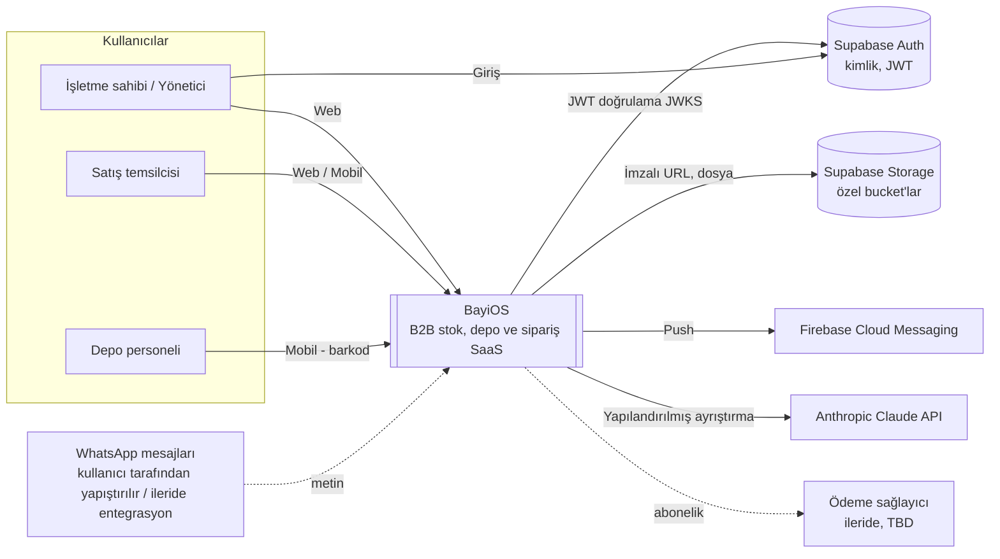
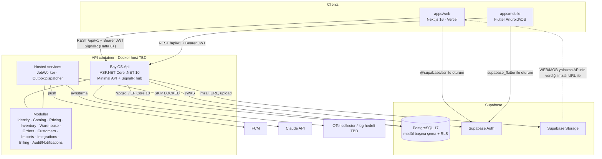
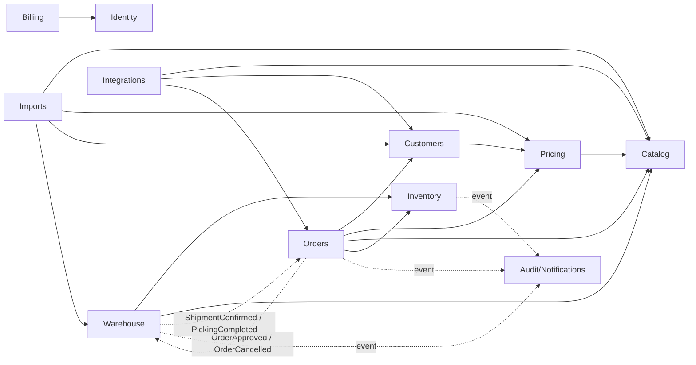

# BayiOS Sistem Mimarisi

> Sahip: Principal Software Architect · Durum: Taslak v1 · Tarih: 2026-11-04
> İlgili: [domain-model.md](domain-model.md) · [data-model.md](data-model.md) · [inventory-and-orders.md](inventory-and-orders.md) · [api-strategy.md](api-strategy.md) · [ADR dizini](../adr/README.md)

## 1. Özet

BayiOS; bayi/distribütör işletmelerinin ürün kataloğu, fiyat listeleri, çok depolu stok, sipariş, toplama/sevkiyat süreçlerini yöneten çok kiracılı (multi-tenant) bir B2B SaaS'tır.

Temel mimari kararlar:

| Konu | Karar | ADR |
|---|---|---|
| Uygulama biçimi | ASP.NET Core (.NET 10 LTS) **modüler monolith** (`services/api`) | [0001](../adr/0001-modular-monolith.md) |
| Çok kiracılık | Paylaşılan DB + paylaşılan şema, her satırda `tenant_id`; API'de zorlama + PostgreSQL RLS (derinlemesine savunma) | [0002](../adr/0002-multi-tenancy-shared-schema-rls.md) |
| Kimlik | Supabase Auth JWT, API'de JWKS ile doğrulama; yetki API'de | [0003](../adr/0003-supabase-auth-jwt-validation-in-api.md) |
| Stok | Append-only ledger (`inventory.inventory_movements`) + aynı transaction'da güncellenen bakiyeler | [0004](../adr/0004-ledger-based-inventory.md) |
| Şema yönetimi | EF Core 10 migration'ları tek doğruluk kaynağı; RLS raw SQL ile | [0005](../adr/0005-ef-core-migrations.md) |
| Arka plan işleri | PostgreSQL job tablosu (`FOR UPDATE SKIP LOCKED`) + transactional outbox | [0006](../adr/0006-postgres-job-queue-and-outbox.md) |
| API sözleşmesi | OpenAPI, `packages/contracts/openapi.json` commit'li, CI drift kontrolü | [0007](../adr/0007-openapi-contract-first.md) |
| Web | Next.js 16 App Router + React 19 + TS strict | [0008](../adr/0008-web-stack-nextjs.md) |
| Mobil | Flutter + Riverpod + dio + go_router | [0009](../adr/0009-mobile-stack-flutter.md) |
| AI | WhatsApp sipariş ayrıştırma, Claude API + deterministik eşleştirme + insan onayı | [0010](../adr/0010-ai-order-parsing-human-in-the-loop.md) |

## 2. Bağlam diyagramı (System Context)



## 3. Container diyagramı



Kurallar:
- İstemciler (web/mobil) **yalnızca** API üzerinden veri okur/yazar. Supabase yalnızca Auth (oturum) ve Storage (imzalı URL ile) için kullanılır.
- Supabase `anon` ve `authenticated` rollerinin iş şemalarında **hiçbir yetkisi yoktur**; iş şemaları Data API (PostgREST) üzerinden expose edilmez.

## 4. Çözüm yerleşimi (`services/api`)

```
services/api/
  BayiOS.sln
  src/
    BayiOS.Api/                      # host: Program.cs, middleware, endpoint grupları, SignalR hub, hosted services
    BayiOS.SharedKernel/             # Entity/AggregateRoot, Result, DomainEvent, ITenantContext, IClock,
                                     # UnitOfWork, outbox/job/idempotency altyapısı, permission sabitleri
    Modules/
      Identity/BayiOS.Modules.Identity/
        Domain/  Application/  Infrastructure/  Contracts/
      Catalog/BayiOS.Modules.Catalog/
      ...                            # modül yalnızca implement edildiğinde oluşturulur
  tests/
    BayiOS.UnitTests/
    BayiOS.IntegrationTests/         # Testcontainers PostgreSQL 17
    BayiOS.ArchitectureTests/        # modül sınırı kuralları (NetArchTest tarzı)
```

Modül içi kurallar:
- Her modül tek proje. `Contracts/` ad alanındaki tipler (public application arayüzleri, DTO'lar, integration event'ler) **dışındaki her şey `internal`**.
- Her modülün kendi `DbContext`'i ve kendi PostgreSQL şeması vardır (`catalog`, `inventory`, ...). Migration geçmiş tablosu modül şemasındadır (`<schema>.__ef_migrations_history`).
- Endpoint'ler modülün `Infrastructure/Endpoints` (veya `Api/`) klasöründe `MapGroup("/api/v1/<kaynak>")` ile tanımlanır; host yalnızca `app.MapCatalogModule()` gibi uzantıları çağırır.

## 5. Modül haritası

| Modül | Şema | Sorumluluk | Sahip olduğu başlıca tablolar |
|---|---|---|---|
| Identity & Tenancy | `identity` | Tenant, üyelik, rol, davet, tenant ayarları, kullanıcı profili (Supabase `sub` eşlemesi) | tenants, tenant_settings, user_profiles, memberships, invitations |
| Billing & Entitlements | `billing` | Plan, tenant hakları (modül/limit), kullanım sayaçları | subscription_plans, tenant_subscriptions, tenant_entitlements, usage_counters |
| Catalog | `catalog` | Ürün, varyant, kategori, marka, birim, özel alan tanımları, tedarikçi, barkod/alias | products, product_variants, variant_barcodes, variant_aliases, categories, brands, units, custom_field_definitions, suppliers |
| Pricing | `pricing` | Fiyat listeleri, fiyat çözümleme | price_lists, price_list_items |
| Customers | `customers` | Cari (müşteri/bayi), adres, bayi grubu | customers, customer_addresses, dealer_groups |
| Inventory | `inventory` | Stok ledger'ı, bakiyeler, rezervasyonlar. **Saf stok motoru**; dışa bağımlılığı yok | inventory_movements, inventory_balances, stock_reservations |
| Warehouse | `warehouse` | Depo/lokasyon ana verisi, mal kabul/sayım/transfer operasyonları, toplama, sevkiyat | warehouses, warehouse_locations, stock_counts, stock_count_lines, picking_tasks, picking_task_lines, shipments, shipment_lines |
| Orders | `orders` | Sipariş yaşam döngüsü, satırlar, durum geçmişi, numaralandırma | orders, order_lines, order_status_history, order_number_sequences |
| Imports | `imports` | Excel/CSV içe aktarma işleri ve satır sonuçları | import_jobs, import_rows |
| Integrations | `integrations` | Dış entegrasyon ayarları, AI (WhatsApp) ayrıştırma istekleri | integrations, ai_parse_requests |
| Audit & Notifications | `audit`, `notifications` | Denetim kaydı, bildirim tercihleri, cihaz token'ları, push gönderimi | audit_events, device_tokens, notifications |
| Platform (SharedKernel altyapısı) | `platform` | Outbox, job kuyruğu, idempotency | outbox_messages, jobs, idempotency_keys |

Not (Phase 0 kapısı): P0 gereksinimleri için eksik tablolar (mal kabul belgesi, transfer, iade, uyumluluk, birim dönüşümü, KVKK onayı vb.) [data-model §5.13](data-model.md#513-phase-0-kapısında-tespit-edilen-eksik-tablolar-p0-gereksinimleri)'te listelenmiştir.

### 5.1 Bağımlılık kuralları (kim kimi çağırabilir)

Bağımlılık = diğer modülün `Contracts` arayüzünü **senkron** çağırmak. Tersi yöndeki bilgi akışı **domain event** ile olur. Döngü yasaktır.



| Çağıran → | İzin verilen senkron bağımlılıklar | Gerekçe |
|---|---|---|
| Identity | — (SharedKernel hariç) | Temel modül |
| Billing | Identity | Tenant varlığı |
| Catalog | — | Ana veri; entitlement/izin kontrolü pipeline'da |
| Pricing | Catalog | Varyant doğrulama |
| Customers | Pricing | Atanan fiyat listesinin varlığı |
| Inventory | — | Saf ledger motoru; çağıran tarafın doğrulama yaptığı varsayılır (varyant/depo id'leri) |
| Warehouse | Inventory, Catalog | Stok hareketlerini Inventory API'si ile yazar; barkod → varyant çözümleme |
| Orders | Customers, Pricing, Catalog, Inventory | Fiyat snapshot, rezervasyon/iade |
| Imports | Catalog, Pricing, Customers, Warehouse | İçe aktarılan veri ilgili modülün komutlarıyla yazılır |
| Integrations | Catalog, Customers, Orders | Eşleştirme (okuma) + taslak sipariş oluşturma |
| Audit/Notifications | — | Yalnızca event dinler; `IAuditLog` arayüzünü herkes çağırabilir (tek istisna, SharedKernel üzerinden) |

`IAuditLog`, `ITenantContext`, `IEntitlementService`, `IUsageMeter` gibi kesişen arayüzler **SharedKernel**'de tanımlanır, implementasyonları ilgili modülde bulunur; böylece her modülün Audit/Billing'e derleme bağımlılığı olmaz.

### 5.2 Sınırların zorlanması

`BayiOS.ArchitectureTests` şunları test eder:
1. Bir modül, başka modülün yalnızca `BayiOS.Modules.<X>.Contracts` ad alanına bağımlı olabilir.
2. Yukarıdaki tablo dışındaki modül→modül bağımlılıkları başarısız olur (izin listesi yaklaşımı).
3. `Domain` katmanı `Infrastructure`'a, EF Core'a, ASP.NET Core'a bağımlı olamaz.
4. Bir modülün `DbContext`'i yalnızca kendi şemasındaki entity'leri map'leyebilir (konvansiyon testi: `HasDefaultSchema` = modül şeması).
5. `Contracts` dışındaki tipler `internal` olmalıdır.

### 5.3 Modüller arası transaction

Kritik akışlar (ör. sipariş onayı = Orders durum değişikliği + Inventory rezervasyonu + outbox) **tek ACID transaction** gerektirir. Bu nedenle:
- İstek başına bir `UnitOfWork` tek bir `NpgsqlConnection` + `NpgsqlTransaction` açar.
- Her modül `DbContext`'i bu bağlantı ve transaction'ı paylaşır (`Database.SetDbConnection` / `UseTransaction`).
- Modüller birbirinin tablosuna yazmaz; sahibi modülün Contracts arayüzü çağrılır ve o modül kendi DbContext'i ile aynı transaction içinde yazar.
- Commit, UnitOfWork tarafından tek noktadan yapılır.

### 5.4 Event türleri

| Tür | Nerede | Teslim | Kullanım |
|---|---|---|---|
| Domain event (in-process) | Aggregate tarafından üretilir, `SaveChanges` öncesi dispatch edilir | **Aynı transaction**, senkron handler | Modüller arası tutarlılık (ör. `OrderApproved` → Warehouse picking task oluşturur) |
| Integration event (outbox) | Handler/servis `platform.outbox_messages`'a yazar (aynı transaction) | Commit sonrası `OutboxDispatcher`, en az bir kez | Push bildirim (FCM), SignalR yayını, e-posta, dış webhook |

Outbox tüketicileri **idempotent** olmalıdır (`message_id` ile tekrar kontrolü).

## 6. İstek yaşam döngüsü

```mermaid
sequenceDiagram
    autonumber
    participant C as İstemci
    participant M as Middleware zinciri
    participant H as Endpoint handler
    participant UoW as UnitOfWork
    participant DB as PostgreSQL

    C->>M: HTTPS /api/v1/... Authorization: Bearer, X-Tenant-Id, Idempotency-Key, X-Correlation-Id
    M->>M: 1. Correlation Id (yoksa üret), log scope, trace
    M->>M: 2. Rate limit (tenant+kullanıcı)
    M->>M: 3. JWT doğrulama (JWKS imza, iss, aud, exp, nbf)
    M->>DB: 4. Tenant çözümleme: memberships(user_id=sub, tenant_id=X-Tenant-Id, status=active) [önbellekli]
    M->>M: 5. Permission kontrolü (endpoint policy → rol→izin haritası)
    M->>M: 6. Entitlement kontrolü (ücretli modül/limit)
    M->>DB: 7. Idempotency (POST/geçiş uçlarında): anahtar kaydı / önceki yanıtı dön
    M->>H: 8. Doğrulama (FluentValidation veya endpoint filter) → handler
    H->>UoW: 9. BEGIN; set_config('app.tenant_id', ...,true); set_config('app.user_id', ..., true)
    H->>DB: 10. Domain işlemleri (EF global filter + RLS)
    H->>UoW: 11. Domain event'ler dispatch (aynı tx) + outbox kayıtları + audit_event
    UoW->>DB: 12. COMMIT
    M->>C: 13. Yanıt (2xx / RFC 9457 Problem Details), ETag, X-Correlation-Id
```

Ayrıntılar:
1. **Kimlik doğrulama:** `Microsoft.AspNetCore.Authentication.JwtBearer`; `Authority`/metadata yerine JWKS URL'si `https://<project-ref>.supabase.co/auth/v1/.well-known/jwks.json` açıkça yapılandırılır (asimetrik anahtar; Supabase önerisi ES256). `iss` = `https://<project-ref>.supabase.co/auth/v1`, `aud` = `authenticated` (ortam yapılandırması; doğrulanır). HS256 (paylaşılan sır) **kabul edilmez**.
2. **Tenant çözümleme:** `X-Tenant-Id` başlığı zorunludur (tenant-bağımsız uçlar hariç: `/me`, `/tenants` oluşturma, davet kabul). Üyelik kontrolü başarısızsa **404 değil 403** döner (tenant varlığını sızdırmamak için tüm durumlarda aynı Problem `type`).
3. **Permission:** endpoint'e `.RequirePermission(Permissions.Orders.Approve)` gibi metadata; rol→izin haritası koddadır ([ADR 0003](../adr/0003-supabase-auth-jwt-validation-in-api.md), [data-model §3](data-model.md)); kanonik matris `docs/product/roles-permissions.md`.
4. **Entitlement:** endpoint grubu `.RequireEntitlement(Feature.AiOrderParsing)`; yoksa `402`'ye değil **403 + `code: entitlement.required`** (`type: .../entitlement.required`) döner.
5. **Transaction:** Her veri erişimi açık bir transaction içinde olur (okuma uçları için `READ ONLY`). `app.tenant_id` **transaction-local** (`set_config(..., true)` = `SET LOCAL` eşdeğeri, parametreli) ayarlanır; bağlantı havuza döndüğünde sızma olmaz.

## 7. Kesişen konular (cross-cutting)

| Konu | Yaklaşım |
|---|---|
| Hata modeli | RFC 9457 Problem Details (`AddProblemDetails`), `type` URI'leri `https://bayios.app/problems/<kod>` (alan adı TBD), `errors` alanı doğrulama için |
| Doğrulama | Request DTO doğrulama endpoint filtresi; domain invariant'ları aggregate içinde |
| Loglama | Serilog JSON; zorunlu alanlar: `correlation_id`, `tenant_id`, `user_id`, `trace_id`, `module`. PII (telefon, adres, mesaj metni) loglanmaz |
| İzleme | OpenTelemetry trace + metric (ASP.NET Core, HttpClient, Npgsql enstrümantasyonu), OTLP exporter; hedef ops kararıdır |
| Korelasyon | `X-Correlation-Id` gelen/giden; outbox ve job kayıtlarına taşınır |
| Zaman | `IClock` (UTC); DB'de `timestamptz` |
| Kimlik üretimi | UUIDv7, uygulamada `Guid.CreateVersion7()` (index yerelliği) |
| Para | `numeric(18,4)` + `char(3)` para birimi; float yok |
| Miktar | `numeric(18,3)`; birimin ondalık izni `units.allows_fraction` |
| Önbellek | MVP: süreç içi `HybridCache`/`IMemoryCache` (üyelik, rol, entitlement; kısa TTL, değişiklikte invalidation). Redis yok |
| Gerçek zamanlı | Hafta 8+: SignalR hub `/hubs/tenant`, grup `tenant:{id}`; outbox → hub yayını. Öncesinde polling/refetch |
| Dosyalar | Supabase Storage özel bucket'lar; API kısa ömürlü imzalı URL üretir; import yüklemeleri API üzerinden boyut/MIME/uzantı kontrolüyle |
| Gizli bilgiler | Ortam değişkenleri / host secret store; repo'da yalnızca `.env.example` adları |
| Yerelleştirme | API mesaj kodları sabit (`order.invalid_transition`); metin çevirisi istemcide. Varsayılan `tr-TR`, para `TRY` |
| Denetim | Önemli komutlar `audit.audit_events`'e aynı transaction'da yazılır (kim, ne, hangi kaynak, önce/sonra özeti) |

## 8. Ölçeklenme yolu

MVP tek API container'ı (yatay 2+ instance'a hazır) ile başlar.

| Aşama | Tetikleyici | Adım |
|---|---|---|
| 0 | MVP | Tek instance; job/outbox worker aynı süreçte |
| 1 | p95 gecikme veya CPU sürekli yüksek | API'yi 2+ instance'a çıkar. Job kuyruğu `SKIP LOCKED` ile zaten çoklu worker güvenli. SignalR için backplane gerekir (Redis veya yönetilen SignalR) → ADR |
| 2 | Arka plan işleri istek gecikmesini etkiliyor | Aynı image'ı `--role=worker` ile ayrı container'da çalıştır; API'de worker'ları kapat |
| 3 | Okuma yükü | Raporlama sorguları için read replica; liste uçlarında keyset pagination zaten var |
| 4 | Bir modülün bağımsız ölçek/yayın ihtiyacı (ör. Integrations/AI veya Imports) | Modülü ayrı servise çıkar: Contracts arayüzü HTTP/gRPC istemcisine dönüştürülür, in-process domain event'ler outbox üzerinden integration event'e çevrilir, modül şeması ayrı DB'ye taşınabilir |

Çıkarılabilirlik için bugünden uyulan kurallar: modül başına şema, modüller arası FK yok, Contracts dışı erişim yok, modüller arası iletişim arayüz + event. En olası ilk aday: **Integrations (AI)** — dış API gecikmesi ve maliyet izolasyonu.

## 9. Dağıtım görünümü

| Ortam | Web | API | Veritabanı / Auth / Storage | Notlar |
|---|---|---|---|---|
| local | `next dev` | `dotnet run` veya `infra/docker/compose.yml` | Supabase CLI local stack (veya compose içindeki Postgres 17) | Seed verisi sahte; gerçek anahtar yok |
| preview | Vercel Preview (PR başına) | `preview` dalından container, Docker host (TBD) | Ayrı Supabase projesi (preview) | Migration CI'da otomatik uygulanır |
| production | Vercel Production | `main`'den etiketli image, Docker host (TBD) | Ayrı Supabase projesi (prod) | Migration ve deploy **ürün sahibi onayı** ile ([AUTOPILOT.md](../../AUTOPILOT.md)) |

Dağıtım akışı:
1. CI: build → unit → architecture → integration (Testcontainers) → OpenAPI drift → idempotent SQL script export (artefakt).
2. Migration, uygulama deploy'undan **önce** ayrı adımda `bayios_migrator` rolüyle çalışır. Migration'lar geriye uyumlu yazılır (expand/contract).
3. API, Supabase PostgreSQL'e uzun ömürlü sunucu olarak bağlanır: Npgsql'in kendi havuzu + doğrudan bağlantı veya Supavisor **session** modu. Transaction modu pooler'da prepared statement kısıtları nedeniyle tercih edilmez (bkz. [ADR 0002](../adr/0002-multi-tenancy-shared-schema-rls.md)).
4. Sağlık uçları: `/health/live`, `/health/ready` (DB bağlantısı + migration sürümü).

## 10. Açık noktalar

- Docker host seçimi (ops kararı).
- Problem `type` URI alan adı.
- OTel/log toplama hedefi.
- SignalR backplane (yalnızca çoklu instance'ta).
- Raporlama ve tam veri dışa aktarma (PRD REP-01…09) için modül sınırı: çapraz şema okuma modeli (ayrı Reporting modülü / modül Contracts sorguları) — W11 öncesi ADR.
- Platform yöneticisi (PRD SUB-08): kimlik, tenant'lar arası yetki yolu (RLS dışı işlem), audit — W11 öncesi ADR.
- Davet kabulü ve tenant oluşturma gibi tenant bağlamı olmadan başlayan uçların RLS ile çalışma yolu (§2.3 istisnaları) — W3 Gün 12'de netleşir.
