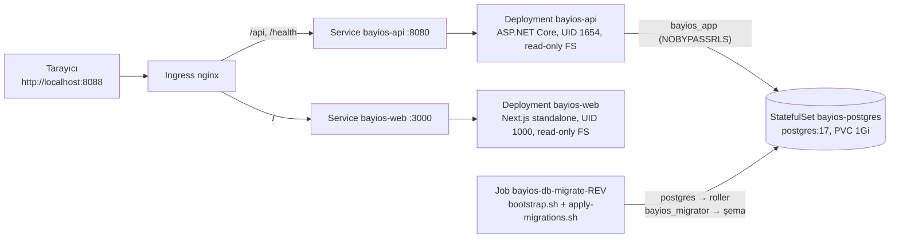

# BayiOS — Kubernetes (Helm + kind)

| Alan | Değer |
|---|---|
| Sahip | DevOps Engineer |
| Durum | **Prova ortamı.** Chart ve CI çalışır durumda; hiçbir gerçek kümeye deploy **edilmedi** ve edilmesi planlanmadı (hosting kararı: [hosting-options.md](hosting-options.md)) |
| Chart | [`infra/helm/bayios`](../../infra/helm/bayios) |
| CI | [`.github/workflows/k8s-kind.yml`](../../.github/workflows/k8s-kind.yml) |
| Tarih | 2026-11-09 |

## 1. Bu ne, ne değil

BayiOS'un üretim yolu Fly.io (API) + Vercel (web) + Supabase (DB/Auth) şablonlarıdır
([deploy-and-rollback.md](deploy-and-rollback.md)). Bu belge, aynı imajların ve aynı migration betiklerinin
**Kubernetes üzerinde** de çalıştığını gösteren bir prova ortamını anlatır:

- API ve web için Deployment + Service, ConfigMap/Secret, Ingress (ingress-nginx), probe'lar, resource limit'ler,
  opsiyonel HPA.
- kind (Kubernetes-in-Docker) için küme içi PostgreSQL 17 (tek replika StatefulSet) ve DB bootstrap + EF Core
  migration Job'ı.
- Her PR'da GitHub Actions'ta: imaj build → kind kümesi → `helm upgrade --install` → rollout → smoke.

**Sahte / eksik olan (bilerek):**

| Konu | kind'da durum |
|---|---|
| Kimlik (Supabase Auth) | **Yok.** `Auth__Authority` var olmayan bir host'a (`supabase-auth.kind.invalid`) işaret eder. `/health/ready` yeşildir (ayar mevcut) ama kimlik doğrulamalı her istek **401** döner; web'de giriş yapılamaz. Smoke testi bunu doğrular (fail-closed). |
| Supabase publishable key | Yer tutucu (`sb_publishable_ci-placeholder-not-a-key`), CI'daki web build'iyle aynı. |
| PostgreSQL | Küme içi, tek pod, TLS yok, yedek yok, HA yok. Yalnızca prova; gerçek ortam Supabase'tir. |
| Parolalar | `values-kind.yaml` içinde `kind-local-only` — atılabilir yerel değerler (compose'taki `change-me-local-only` gibi). Gerçek ortamda chart parola **üretmez/saklamaz**; Secret dışarıda oluşturulur (§5). |
| Ingress controller | ingress-nginx, kind sağlayıcı manifest'i (`controller-v1.15.1`). Not: ingress-nginx projesi 2026'da emekliye ayrıldı (son sürümler Mart 2026); yeni bir kümede Gateway API tabanlı bir controller tercih edilmelidir. Chart'ta `ingress.className` değiştirilebilir. |
| HPA | Şablon var, varsayılan kapalı: kind'da metrics-server kurulu değil. |

## 2. Mimari



- **Tek host, yol tabanlı yönlendirme:** `/api` ve `/health` API'ye, geri kalan her şey web'e. Tarayıcı API'yi aynı
  origin'den çağırır (`NEXT_PUBLIC_API_BASE_URL=http://localhost:8088`), bu yüzden CORS ayarı gerekmez.
- **Probe'lar** (API'de zaten var olan uçlar, yeni uç eklenmedi):
  - `startupProbe` + `livenessProbe` → `GET /health` (bağımlılıksız, `PlatformEndpoints.cs`).
  - `readinessProbe` → `GET /health/ready` (veritabanı, auth ayarı ve job kuyruğu gecikmesi; `DatabaseSetup.cs`,
    `QueueLagHealthCheck.cs`). Job kuyruğu tablosu migration'la oluştuğu için API pod'u **şema hazır olmadan Ready
    olmaz** — sıra "migration → API" hook kullanmadan korunur.
  - Web: `GET /` (public sayfa).
- **Güvenlik bağlamı:** tüm pod'larda `runAsNonRoot`, `seccompProfile: RuntimeDefault`, `allowPrivilegeEscalation:
  false`, `capabilities.drop: [ALL]`, `automountServiceAccountToken: false`; API ve web'de `readOnlyRootFilesystem:
  true` (yazılabilir yalnızca `emptyDir`: `/tmp`, web için `/app/.next/cache`).
- **Yapılandırma:** sır olmayan ayarlar ConfigMap'te (`ASPNETCORE_ENVIRONMENT`, `Auth__*`, `Cors__AllowedOrigins__N`,
  `api.extraEnv`); ConfigMap değişince `checksum/config` anotasyonu pod'ları yeniden başlatır.
  `ConnectionStrings__Default` yalnızca Secret'tan gelir.

## 3. Veritabanı: roller, RLS ve migration'lar nasıl kuruluyor

Repo'daki kural değişmez: **API veritabanına `bayios_app` (NOBYPASSRLS, NOINHERIT, hiçbir şeyin sahibi değil) ile
bağlanır; şemayı `bayios_migrator` kurar; `postgres` uygulama bağlantısında asla kullanılmaz.**

Kubernetes için yeni bir migration yolu yazılmadı; deploy hattının kullandığı betikler aynen paketlendi:

1. CI'da `bash infra/ci/ef-migrations.sh` (ci-migrations / deploy-preview ile aynı) idempotent EF Core script'lerini
   ve `manifest.txt`'i üretir ve boş bir Postgres'te iki kez uygulayarak doğrular.
2. [`infra/k8s/db-migrate/Dockerfile`](../../infra/k8s/db-migrate/Dockerfile) bu script'leri,
   `infra/supabase/bootstrap/*` ve `infra/deploy/apply-migrations.sh` dosyalarını repo düzeniyle bir `postgres:17`
   imajına koyar (yalnızca `psql` istemcisi için). İmajda parola/URL yok.
3. Helm her revizyonda bir Job (`bayios-db-migrate-<revision>`) oluşturur. Giriş noktası
   [`db-migrate.sh`](../../infra/k8s/db-migrate/db-migrate.sh):
   1. PostgreSQL'i bekler (iki kez başarılı kimlik doğrulamalı sorgu; ilk açılıştaki initdb yeniden başlatmasına karşı),
   2. `bootstrap.sh` → `01-roles.sql`, `02-extensions.sql` (pg_trgm), `03-access-token-hook.sql` (Supabase yoksa
      kendini atlar), `verify.sql`,
   3. rol parolalarını Secret'tan `ALTER ROLE ... PASSWORD :'var'` ile ayarlar (değerler komut satırına/log'a düşmez),
   4. `apply-migrations.sh` → script'ler `manifest.txt` sırasıyla **`bayios_migrator`** olarak, ardından `verify.sql`
      (ENABLE + FORCE RLS, `anon`/`PUBLIC` yetkisizliği, rol özellikleri).
4. Script'lerin hepsi idempotent olduğundan Job her `helm upgrade`'de tekrar koşar; Helm bir önceki revizyonun Job'ını
   kaldırır. `--wait --wait-for-jobs` Job bitene kadar bekler; hata olursa Job `backoffLimit` (3) kadar yeniden dener.

Küme içi bağlantı TLS'sizdir; bu yüzden betikler `ALLOW_INSECURE_DB_CONNECTION=1` ile çağrılır. Bu bayrak yalnızca
küme içi atılabilir DB için kullanılır; barındırılan (Supabase) yolda `sslmode=require` zorunluluğu aynen geçerlidir.
Chart, `postgres.enabled=false` iken `dbMigrate.enabled=true` kombinasyonunu **reddeder**: barındırılan veritabanı
kümeden değil, deploy hattından migrate edilir.

## 4. Yerelde çalıştırma (Windows / Linux / macOS)

Gerekenler: Docker, .NET SDK (`services/api/global.json`), `kubectl`, [kind](https://github.com/kubernetes-sigs/kind/releases)
v0.33.0, [Helm](https://get.helm.sh) v4.3.1 (resmi release'ler, SHA-256 dosyasıyla doğrulayın). Komutlar repo
kökünden, Git Bash veya bir Linux kabuğunda:

```bash
TAG=local
OUT=/tmp/bayios-migrations          # Windows: ör. E:/tmp/bayios-migrations

# 1) EF script'leri (+ boş bir Postgres'te doğrulama) ve imajlar
OUT_DIR="$OUT" bash infra/ci/ef-migrations.sh
docker build -t bayios-api:$TAG services/api
docker build -t bayios-web:$TAG apps/web \
  --build-arg NEXT_PUBLIC_API_BASE_URL=http://localhost:8088 \
  --build-arg NEXT_PUBLIC_SUPABASE_URL=http://supabase.kind.invalid \
  --build-arg NEXT_PUBLIC_SUPABASE_PUBLISHABLE_KEY=sb_publishable_ci-placeholder-not-a-key
docker build -t bayios-db-migrate:$TAG -f infra/k8s/db-migrate/Dockerfile --build-context migrations="$OUT" infra

# 2) Küme + imajlar + ingress-nginx
kind create cluster --name bayios-kind --config infra/k8s/kind-config.yaml --wait 120s
kind load docker-image --name bayios-kind bayios-api:$TAG bayios-web:$TAG bayios-db-migrate:$TAG
kubectl apply -f https://raw.githubusercontent.com/kubernetes/ingress-nginx/controller-v1.15.1/deploy/static/provider/kind/deploy.yaml
kubectl -n ingress-nginx wait --for=condition=ready pod -l app.kubernetes.io/component=controller --timeout=180s

# 3) Chart
helm lint infra/helm/bayios --strict -f infra/helm/bayios/values-kind.yaml
helm upgrade --install bayios infra/helm/bayios -n bayios --create-namespace \
  -f infra/helm/bayios/values-kind.yaml \
  --set api.image.tag=$TAG --set web.image.tag=$TAG --set dbMigrate.image.tag=$TAG \
  --wait --wait-for-jobs --timeout 10m

# 4) Smoke
API_URL=http://localhost:8088 EXPECT_ENVIRONMENT=Kind bash infra/deploy/smoke.sh   # /health, /health/ready, /api/v1/meta
curl -s -o /dev/null -w '%{http_code}\n' http://localhost:8088/                     # 200 (web)
curl -s -o /dev/null -w '%{http_code}\n' http://localhost:8088/api/v1/me            # 401 (kimlik yok, fail-closed)
# Tarayıcı: http://localhost:8088 -> "API bağlı: BayiOS API 0.1.0 (Kind)"

# 5) Temizlik
kind delete cluster --name bayios-kind
```

Port: ingress `127.0.0.1:8088`'e yayınlanır (`infra/k8s/kind-config.yaml`). Bu port doluysa kind config'teki
`hostPort`'u ve web imajının `NEXT_PUBLIC_API_BASE_URL` build argümanını birlikte değiştirin.

Ingress yerine doğrudan servis: `kubectl -n bayios port-forward svc/bayios-api 18080:8080` ve
`kubectl -n bayios port-forward svc/bayios-web 13000:3000`.

Faydalı komutlar:

```bash
kubectl -n bayios get pods,svc,ingress,jobs
kubectl -n bayios logs job/bayios-db-migrate-1          # bootstrap + migration çıktısı (verify: OK ...)
kubectl -n bayios exec statefulset/bayios-postgres -- psql -U postgres -d bayios \
  -c "select usename, count(*) from pg_stat_activity where datname='bayios' group by 1"   # API = bayios_app
helm -n bayios history bayios
helm -n bayios rollback bayios <revision>               # imaj etiketini/ayarı geri alır; şema geri alınmaz (ADR 0005)
```

## 5. Değerler (`values.yaml`) ve gerçek bir kümede kullanım

Varsayılan `values.yaml` "üretim benzeri"dir: küme içi Postgres ve migration Job'ı **kapalı**, API'nin bağlantı
cümlesi dışarıda oluşturulmuş bir Secret'tan okunur:

```bash
# Örnek — değeri bir sır yöneticisinden/CI'dan verin, asla git'e yazmayın.
kubectl -n bayios create secret generic bayios-api-db \
  --from-literal=ConnectionStrings__Default='Host=...;Username=bayios_app;Password=...;SSL Mode=Require'
helm upgrade --install bayios infra/helm/bayios -n bayios \
  --set api.image.repository=<registry>/bayios-api --set api.image.tag=<git-sha> \
  --set web.image.repository=<registry>/bayios-web --set web.image.tag=<git-sha> \
  --set api.auth.authority=https://<ref>.supabase.co/auth/v1 \
  --set ingress.enabled=true --set ingress.host=<host>
```

| Anahtar | Açıklama |
|---|---|
| `api.image.*`, `web.image.*`, `dbMigrate.image.*` | Depo/etiket. CI git SHA etiketi kullanır (`ci-<sha>`). |
| `api.environment` | `ASPNETCORE_ENVIRONMENT`; `/api/v1/meta` bunu döndürür, smoke testi kontrol eder. |
| `api.auth.*` | Supabase Auth issuer/audience/JWKS. Boşsa API açılır ama Ready olmaz (fail-closed). |
| `api.corsAllowedOrigins` | Web ve API farklı origin'deyse. Tek host Ingress'te gerekmez. |
| `api.database.existingSecret` | `ConnectionStrings__Default` anahtarlı Secret (yalnızca `bayios_app`). |
| `api.probes.*`, `web.probes.*` | Yol/süre/eşik. |
| `api.resources`, `web.resources` | Request/limit (varsayılan API 100m/192Mi → 1 CPU/512Mi). |
| `*.autoscaling.*` | HPA (autoscaling/v2, CPU). metrics-server gerekir. |
| `ingress.*` | `className`, `host`, `tls`, `annotations`. |
| `postgres.*` | Yalnızca kind/dev. `enabled=true` iken üç parola **zorunlu** (`required`). |
| `dbMigrate.*` | Yalnızca `postgres.enabled=true` ile. |

`NEXT_PUBLIC_*` değerleri Next.js kuralı gereği **build sırasında** bundle'a gömülür; bu yüzden web imajı ortama
özgüdür (build arg). Hepsi public değerdir (API origin'i, Supabase URL'si, publishable key) — sır değildir.

## 6. Dockerfile'lar

| İmaj | Dosya | Notlar |
|---|---|---|
| API | `services/api/Dockerfile` (mevcut, değişmedi) | Chiseled ASP.NET 10, UID 1654, shell yok, 8080. |
| Web | `apps/web/Dockerfile` (yeni) | `deps` (npm ci) → `build` (`next build`, `BAYIOS_NEXT_OUTPUT=standalone`) → `runtime` (yalnızca `server.js` + izlenen `node_modules` alt kümesi + `.next/static`), `node` kullanıcısı (UID 1000), 3000. `next.config.ts`'te `output: "standalone"` yalnızca bu değişkenle açılır; `next start` (CI/e2e) ve Vercel build'i etkilenmez. |
| db-migrate | `infra/k8s/db-migrate/Dockerfile` (yeni) | `postgres:17` + repo betikleri + üretilmiş EF script'leri (§3). |

Taban imajlar multi-arch index digest'iyle sabitlenmiştir; etiket ve digest birlikte güncellenir.

## 7. CI: `k8s-kind.yml`

Tetikleyici: chart, `infra/k8s`, bootstrap/migration betikleri, `services/api/**`, `apps/web/**` veya workflow'un
kendisi değişen PR'lar ve `preview`/`main` push'ları; elle `workflow_dispatch`. Push/registry/sır yok.

Adımlar: `helm lint --strict` (varsayılan + kind değerleri) ve `helm template` → `ef-migrations.sh` → üç imajın
build'i → `helm/kind-action` (kind v0.33.0, `infra/k8s/kind-config.yaml`) → `kind load docker-image` → ingress-nginx
→ `helm upgrade --install --wait --wait-for-jobs` → `kubectl rollout status` (postgres, api, web) → port-forward ile
`infra/deploy/smoke.sh` (`/health` 200, `/health/ready` 200, `/api/v1/meta` = `Kind`) + web `/` 200 → aynı smoke
Ingress üzerinden + `/api/v1/me` token'sız 401 → API oturumlarının yalnızca `bayios_app` olduğunun kontrolü →
ikinci `helm upgrade` (yeni migration Job'ı, idempotentlik) → hata olursa pod/event/log dökümü.

`ci-gate` path filtresiyle başlayan her workflow'u beklediği için bu workflow, tetiklendiği PR'larda gate'in
parçasıdır.

## 8. Yerel doğrulama kaydı (2026-11-09, Windows 11 + Docker Desktop)

- `helm lint --strict` (varsayılan ve kind değerleri) temiz; `helm template` 11 nesne üretir. Hatalı kombinasyonlar
  anlaşılır mesajla reddedilir (`postgres.enabled=true` ve parola yok; `dbMigrate` + harici DB; Secret adı boş).
- `ef-migrations.sh`: 13 DbContext, 13 idempotent script, iki kez uygulandı.
- kind kümesinde temiz kurulum (namespace silinip baştan, 6 kez): migration Job `verify: OK (14 business schema(s),
  55 table(s) checked)`, tüm pod'lar Ready. İlk denemelerden birinde Job'ın ilk pod'u başarısız olup ikinci denemede
  tamamlandı (ilk açılış yarışı); bekleme adımı bunun üzerine sıkılaştırıldı, sonraki kurulumlarda tekrar etmedi.
- Smoke (port-forward ve Ingress): `/health` 200, `/health/ready` 200 `{"status":"ready"}`, `/api/v1/meta`
  `environment = Kind`, web `/` 200, `/pano` → `/giris` yönlendirmesi, `/api/v1/me` token'sız 401.
- `pg_stat_activity`: API oturumları yalnızca `bayios_app`; `bayios_app` `rolsuper=f`, `rolbypassrls=f`.
- `helm upgrade` tekrarı: `bayios-db-migrate-2` 8 sn'de tamamlandı (idempotent), önceki Job kaldırıldı.
- Küme iş bitince `kind delete cluster --name bayios-kind` ile silindi.
- Workflow'un GitHub Actions'ta koşturulması bu dalda yapılmadı (push yok); adımlar yerelde aynı sırayla çalıştırıldı.
