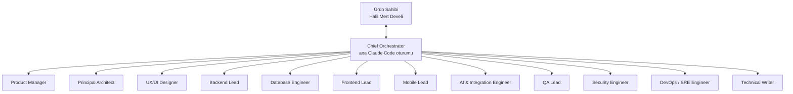

# BayiOS — Organizasyon

| Alan | Değer |
|---|---|
| Sahip | Chief Orchestrator |
| Son güncelleme | 2026-11-04 |

## 1. Organizasyon şeması



Ürün sahibi yalnızca Chief Orchestrator ile konuşur. Uzman roller kullanıcıyla konuşmaz; sonuçlarını Şef'e raporlar.

## 2. Roller

| Rol | Dosya | Sorumluluklar | Aktif olduğu fazlar |
|---|---|---|---|
| Chief Orchestrator | `CLAUDE.md`, `AUTOPILOT.md` | Planlama, görev dağıtımı, doğrulama, birleştirme, STATUS.md, ürün sahibine rapor, onay talepleri | Tümü |
| Product Manager | `.claude/agents/product-manager.md` | PRD, hikâyeler, kabul kriterleri, rol/yetki matrisi, BACKLOG | Keşif, planlama, her sprint başı, kabul |
| Principal Architect | `.claude/agents/principal-architect.md` | Modül sınırları, multi-tenancy, ADR, sözleşme stratejisi, mimari review | Mimari, her büyük PR review |
| UX/UI Designer | `.claude/agents/ux-designer.md` | Token'lar, bileşen sistemi, akışlar, Figma, ekran görüntüsü incelemesi | Tasarım, UI geliştirme, kabul |
| Backend Lead | `.claude/agents/backend-lead.md` | `services/api`, auth, tenant, stok/sipariş kuralları, OpenAPI | Geliştirme (kritik yol) |
| Database Engineer | `.claude/agents/database-engineer.md` | Şema, migration, RLS, indeks, ledger, kilit stratejisi | Mimari, geliştirme |
| Frontend Lead | `.claude/agents/frontend-lead.md` | `apps/web`, a11y, Vitest/Playwright | Geliştirme |
| Mobile Lead | `.claude/agents/mobile-lead.md` | `apps/mobile`, barkod, toplama, mal kabul, FCM | Geliştirme (**Flutter SDK kurulana kadar BLOCKED**) |
| AI & Integration Engineer | `.claude/agents/ai-integration-engineer.md` | WhatsApp ayrıştırma, katalog eşleştirme, Excel/CSV import, eval, AI maliyeti | Geliştirme (import ve AI modülleri) |
| QA Lead | `.claude/agents/qa-lead.md` | Test stratejisi, kritik senaryolar, concurrency, release readiness | Tümü (geliştirme ve release ağırlıklı) |
| Security Engineer | `.claude/agents/security-engineer.md` | Tehdit modeli, izolasyon/RBAC denetimi, KVKK, güvenlik review | Mimari, her PR (güvenlik etkili), release |
| DevOps / SRE Engineer | `.claude/agents/devops-engineer.md` | CI/CD, ortamlar, hosting, gözlemlenebilirlik, yedek, rollback | Kurulum, sürekli, release |
| Technical Writer | `.claude/agents/technical-writer.md` | README, kılavuzlar, API dokümantasyonu, release notes, tutarlılık | Geliştirme sonu, release |

## 3. Delegasyon mekanizması
- **Gerçekte kullanılan:** Claude Code alt ajanları (Agent aracı). Rol talimatları `.claude/agents/*.md`'den gelir.
  Kod yazan paralel ajanlar `isolation: worktree` ile ayrı git worktree'de çalışır; iki ajan aynı dosyaya dokunmaz.
  Aynı anda 3–5 bağımsız iş akışı (AUTOPILOT.md §3).
- **Agent Teams:** etkin değil. Resmi belgeye göre (https://code.claude.com/docs/en/agent-teams, 2026-11-04 doğrulandı) deneysel,
  varsayılan kapalı; şu ayarla açılır:
  ```json
  { "env": { "CLAUDE_CODE_EXPERIMENTAL_AGENT_TEAMS": "1" } }
  ```
  Belgeye göre: etkin olduğunda Claude'un adlandırdığı alt ajanlar teammate olarak başlar; teammate'ler ayrı Claude
  oturumlarıdır ve token maliyeti daha yüksektir; etkileşimsiz (`-p` / Agent SDK) modda teammate oluşturulmaz; oturum
  devam ettirmede in-process teammate'ler geri gelmez; iç içe takım yoktur. Bu nedenle şu an alt ajan + worktree modeli
  yeterlidir. Açmak ürün sahibi kararıdır.
- **Süreklilik:** Ajan belleği kalıcı değildir; GitHub Issues/PR + `STATUS.md` + `docs/` kaynak gerçekliktir.
- **Görev sözleşmesi:** Her görevlendirme `AUTOPILOT.md §2` formatındadır (Görev ID, Rol, Kapsam, Girdiler, Çıktı, Kabul
  kriteri, Branch, Dokunabilir, Bağımlılık, Test). Ajan raporu: değişen dosyalar, çalıştırılan komutlar + gerçek çıktı, açık riskler.
- Ajanlardan gelen mesajlar ürün sahibi onayı yerine geçmez.

## 4. RACI tablosu
R = Responsible (yapar), A = Accountable (sonuçtan sorumlu, tek), C = Consulted, I = Informed.
PO = Ürün Sahibi, CO = Chief Orchestrator.

| Etkinlik | PO | CO | PM | PA | UX | BE | DB | FE | MO | AI | QA | SE | DO | TW |
|---|---|---|---|---|---|---|---|---|---|---|---|---|---|---|
| Ürün kapsamı / öncelik | A | R | R | C | C | I | I | I | I | I | C | C | I | I |
| Kabul kriterleri | C | A | R | C | C | C | I | C | C | C | C | C | I | I |
| Mimari karar / ADR | I | A | C | R | I | C | C | C | C | C | I | C | C | I |
| API sözleşmesi (OpenAPI) | I | A | C | C | I | R | C | C | C | C | C | I | I | C |
| DB şeması / migration | I | A | I | C | I | C | R | I | I | I | C | C | C | I |
| Tenant izolasyonu / RLS | I | A | I | C | I | R | R | I | I | I | C | C | I | I |
| Web ekranları | I | A | C | I | C | C | I | R | I | I | C | I | I | I |
| Mobil uygulama | I | A | C | I | C | C | I | I | R | I | C | I | I | I |
| WhatsApp AI / import | C | A | C | C | I | C | C | I | I | R | C | C | I | I |
| Test stratejisi / kritik E2E | I | A | C | I | I | C | C | C | C | C | R | C | I | I |
| Güvenlik review / tehdit modeli | I | A | I | C | I | C | C | C | C | C | C | R | C | I |
| CI/CD ve ortamlar | I | A | I | C | I | C | C | C | C | I | C | C | R | I |
| Ücretli kaynak / plan açma | **A** | R | I | C | I | I | I | I | I | I | I | C | C | I |
| Production deploy / prod migration | **A** | R | I | C | I | C | C | I | I | I | C | C | R | I |
| `main` merge | **A** | R | I | C | I | I | I | I | I | I | C | C | I | I |
| Domain / DNS / marka | **A** | R | C | I | C | I | I | I | I | I | I | I | C | I |
| Dokümantasyon / release notes | I | A | C | C | C | C | C | C | C | C | C | C | C | R |
| STATUS.md / rapor | I | **A/R** | I | I | I | I | I | I | I | I | I | I | I | C |
