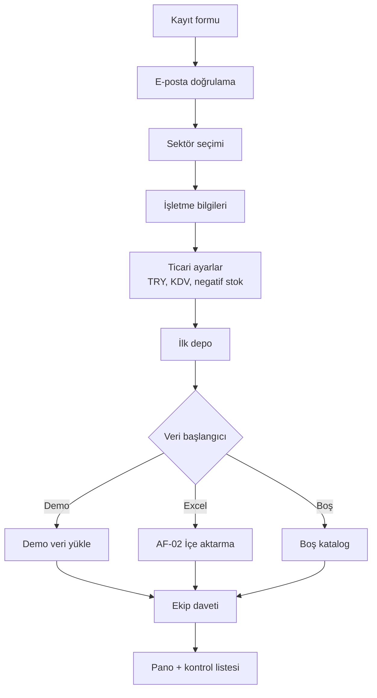
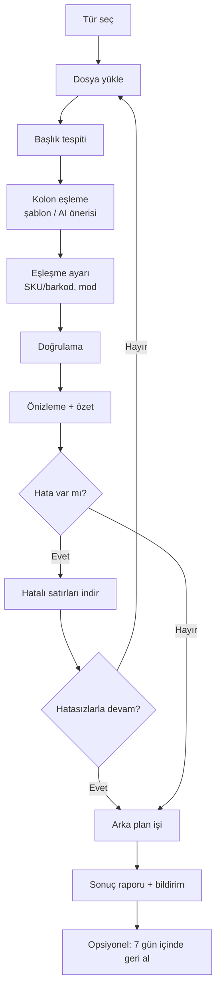
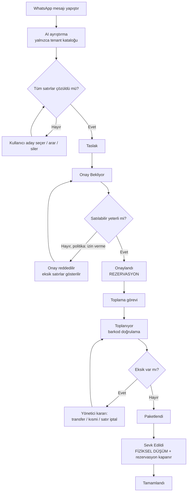
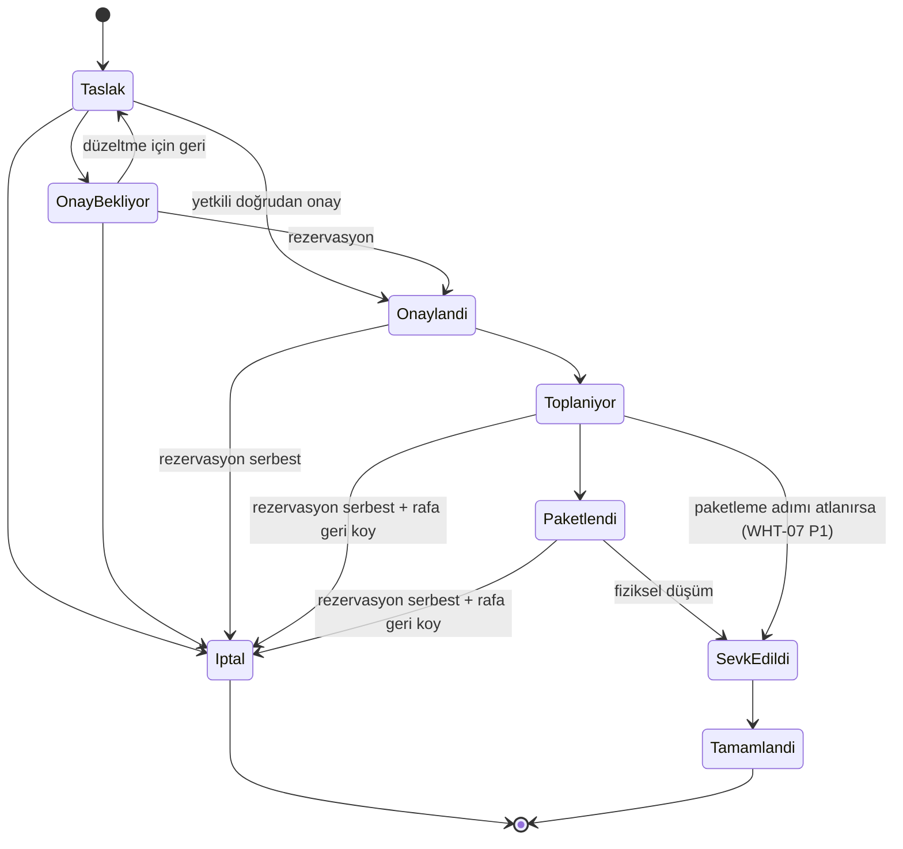
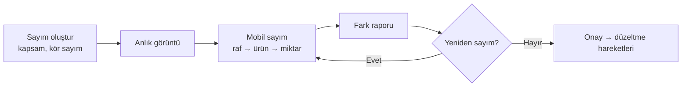

# BayiOS — Kullanıcı Akışları

Kapsam: MVP'nin kritik iş akışları. Her akış: aktör, ön koşul, adımlar, sonuç, hata/kenar durumları. Gereksinim referansları PRD ID'leridir (ör. INV-12).

Genel kurallar (tüm akışlar):
- Tüm yazma işlemleri API üzerinden; her istek tenant üyeliği, rol ve entitlement ile doğrulanır.
- Stok değişikliği yalnızca hareket defteri (ledger) kaydıyla olur; bakiye aynı transaction'da güncellenir.
- Durum değiştiren istekler `Idempotency-Key` taşır (ORD-09).
- Her kritik işlem denetim kaydına yazılır (PLT-03).

---

## AF-01 Onboarding (kayıttan ilk siparişe)

**Aktör:** İşletme sahibi (owner) · **Ön koşul:** yok · **Gereksinimler:** TEN-01…TEN-12, SUB-05

1. Kullanıcı "Ücretsiz başla" → e-posta, şifre, ad soyad, işletme adı girer; KVKK aydınlatma metnini onaylar.
2. E-posta doğrulama bağlantısına tıklar.
3. **Sektör seçimi:** Motosiklet yedek parça / LED-Elektronik / Genel. Şablon önizlemesi (kategoriler, özel alanlar, birimler) gösterilir.
4. **İşletme bilgileri:** logo (opsiyonel, atlanabilir), adres, telefon, vergi no (opsiyonel).
5. **Ticari ayarlar:** para birimi TRY (varsayılan), varsayılan KDV %20, fiyat gösterimi (KDV hariç/dahil), negatif stok politikası (varsayılan "izin verme").
6. **İlk depo:** ad (varsayılan "Merkez Depo"); raf kullanımı açık/kapalı.
7. **Veri başlangıcı** (üç seçenek): (a) Demo veriyle dene, (b) Excel'den içe aktar → AF-02, (c) Boş başla.
8. **Ekip daveti:** e-posta + rol (atlanabilir).
9. Pano açılır; onboarding kontrol listesi sağ panelde (logo, depo, ürünler, personel, ilk sipariş).
10. Tenant 30 günlük tüm modüller açık deneme ile başlar (SUB-05).

**Sonuç:** Tenant, owner üyeliği, şablon verileri, ilk depo oluşturulmuş.
**Kenar durumları:** Doğrulanmamış e-posta ile tenant oluşturulmaz · Aynı e-posta ile ikinci kayıt → giriş/şifre sıfırlama önerisi · Adımlar arası çıkışta ilerleme kaydedilir · Demo veri daha sonra tek işlemle temizlenir (TEN-09).

---

## AF-02 Toplu ürün içe aktarma

**Aktör:** admin / owner (imports.run) · **Gereksinimler:** IMP-01…IMP-14

1. Ürünler → "İçe aktar" → tür seçimi: Ürün / Stok / Fiyat listesi / Müşteri.
2. Dosya yükle (sürükle-bırak); sistem kodlama ve ayırıcıyı tespit eder; sayfa seçimi (xlsx çok sayfalıysa).
3. **Başlık satırı** tespiti (kullanıcı değiştirebilir).
4. **Kolon eşleme:** kayıtlı şablon varsa otomatik uygulanır; yoksa AI önerisi + güven skoru (IMP-04). Kullanıcı her öneriyi onaylar/değiştirir; eşlenmeyen kolonlar "yok say".
5. **Eşleşme ayarı:** anahtar (SKU / barkod), mod (oluştur / güncelle / ikisi), boş hücre davranışı (değeri koru / temizle).
6. **Doğrulama** (arka planda): tip, zorunlu alan, dosya içi tekrar, mevcut kayıt eşleşmesi, aynı dosya hash uyarısı.
7. **Önizleme:** özet kartları (Oluşturulacak N / Güncellenecek N / Hatalı N / Atlanacak N) + ilk 100 satır; hatalı satırlar kırmızı, hata açıklamasıyla.
8. Kullanıcı: "Hatalı satırları indir" (Excel) ve/veya "Hatasız satırlarla devam et".
9. **Çalıştır:** arka plan işi; ilerleme çubuğu; sayfadan ayrılabilir.
10. Tamamlanınca bildirim + sonuç raporu (indirilebilir); eşleme şablonu kaydedilsin mi sorusu.
11. **Geri alma** (7 gün): İçe aktarma geçmişi → "Geri al" → etki özeti → onay → ters işlemler.

**Stok içe aktarma farkı:** Adım 5'te depo (ve raf kolonu) seçilir; miktar "mutlak (sayım)" veya "artış" modunda; her satır `import` hareketi üretir (IMP-11).

**Kenar durumları:** Dosya > 20 MB veya > 50.000 satır → reddedilir, bölme önerisi · Aynı SKU dosyada iki kez → ikisi de hatalı · Ondalık "1.234,56" ve "1234.56" ikisi de geçerli · Geri alma sonrası işlem görmüş (siparişe girmiş) ürün → arşivlenir ama silinmez, uyarı.

---

## AF-03 WhatsApp → taslak → onay → rezervasyon → toplama → paketleme → sevk

**Aktörler:** sales (Elif), manager (Murat), warehouse_staff (Yusuf) · **Gereksinimler:** WAI-*, ORD-*, INV-12…14, WHT-*

### A. Mesajdan taslağa (web)
1. Siparişler → "WhatsApp'tan sipariş" (entitlement: AI WhatsApp asistanı; yoksa manuel forma metin taşınır).
2. Mesajı yapıştır; müşteri seç (telefonla arama, CUS-05) — opsiyonel ama onay için zorunlu.
3. "Ayrıştır" → yükleniyor durumu (≤ 8 sn hedef).
4. Sonuç tablosu: her satırda kaynak metin, eşleşen ürün, miktar, birim, fiyat (müşteri listesinden), satılabilir stok, durum etiketi (Kesin / Belirsiz / Eşleşmedi).
5. Kullanıcı belirsiz satırlar için aday seçer, eşleşmeyenleri arar veya siler; notları gözden geçirir.
6. "Taslak olarak kaydet" — tüm satırlar çözülmeden kaydedilebilir ama onaya gönderilemez.
7. Mükerrer kontrolü: aynı müşteri + aynı metin hash'i son 24 saatte → uyarı + mevcut taslağa bağlantı.

### B. Onay ve rezervasyon
8. Satış kullanıcısı "Onaya gönder" → Onay Bekliyor (veya tenant ayarı izin veriyorsa doğrudan "Onayla").
9. Onaylayan (manager+ veya yetkili sales) "Onayla":
   - API, tek transaction'da her satır için satılabilir ≥ istenen kontrolü yapar ve rezervasyon kaydı oluşturur (rezervasyon stok hareketi değildir: `reserved` artar, ledger'a satır yazılmaz).
   - Yetersizse: politika "izin verme" → onay reddedilir, eksik satırlar listelenir; "uyar" → onay için ek teyit.
10. Durum Onaylandı; toplama görevi oluşur (otomatik/manuel ayarı).

### C. Toplama (mobil)
11. Görev havuzda veya atanmış personelde görünür; push bildirimi (P1).
12. Yusuf "Başla" → durum Toplanıyor; görev başlangıç zamanı kaydedilir.
13. Satırlar raf sırasına göre; her satırda: raf kodu, ürün adı, görsel, istenen miktar.
14. Raf barkodu (opsiyonel) → ürün barkodu okut; doğru → yeşil + titreşim, miktar +1; yanlış → kırmızı + hata sesi, sayılmaz.
15. Eksik varsa "Eksik bildir" → sebep (bulunamadı / hasarlı / yetersiz) + bulunan miktar.
16. Tüm satırlar tamam/eksikli → "Toplamayı bitir".

### D. Paketleme ve sevk
17. Paketleme (opsiyonel ikinci kontrol, WHT-07): ürünler tekrar okutulur, koli sayısı girilir → Paketlendi.
18. "Sevk et": kargo firması, takip no, koli sayısı → onay.
19. API tek transaction'da: fiziksel çıkış hareketi + rezervasyon kapatma → Sevk Edildi.
20. Teslim teyidi veya X gün sonra otomatik (ayar) → Tamamlandı.

**Eksik durumunda dallanma:** Yönetici (a) transfer başlatır ve toplamayı bekletir, (b) kısmi sevk yapar (ORD-08, P1), (c) satırı iptal eder (rezervasyon serbest).

### Sipariş durum makinesi

Sevk Edildi sonrası iptal yoktur; iade akışı (INV-09) kullanılır.

---

## AF-04 Sipariş iptali

**Aktör:** sales (yalnızca Taslak/Onay Bekliyor, kendi siparişi), manager+ (Sevk öncesi tümü) · **Gereksinimler:** ORD-05, ORD-07

1. Sipariş detayı → "İptal et".
2. Sebep seç (müşteri vazgeçti, stok yok, fiyat anlaşmazlığı, mükerrer, diğer) + açıklama.
3. Etki özeti: serbest bırakılacak rezervasyon, iptal edilecek görev, rafa geri konacak ürünler.
4. Onay → API tek transaction'da: rezervasyonların serbest bırakılması (ledger hareketi yok), görev iptali, durum İptal.
5. Toplanmış ürün varsa "Rafa geri koy" görevi depo personeline düşer; tamamlanınca raf bazlı stok doğrulanır.
6. Zaman çizelgesine ve denetim kaydına yazılır.

**Kenar durumları:** Aynı anda iki kullanıcı iptal → idempotent, tek sonuç · Toplama sürerken iptal → mobil ekranda "Sipariş iptal edildi, toplamayı durdur" uyarısı · Sevk Edildi → iptal butonu yok, "İade oluştur" önerilir.

---

## AF-05 Mal kabul

**Aktör:** manager / warehouse_staff (inventory.receive) · **Gereksinimler:** INV-05, WHT-11

1. Stok → Mal kabul → "Yeni" (web) veya mobil "Mal kabul".
2. Başlık: tedarikçi, irsaliye/belge no, depo, tarih.
3. Satır ekleme: barkod okut / SKU ara; miktar, birim, raf (varsayılan raf önerilir), alış fiyatı (opsiyonel).
4. Bilinmeyen barkod → "Ürün bulunamadı": mevcut ürüne barkod ekle (yetki: catalog.barcode.assign) veya satırı atla; mobilde ürün oluşturulmaz.
5. Taslak kaydet (birden çok oturumda devam edilebilir).
6. "Kabulü onayla" → giriş hareketleri; alış fiyatı girildiyse ürünün son alış fiyatı güncellenir (geçmişe yazılır).
7. Fark varsa (belge miktarı ≠ sayılan) not alanı; rapor.

**Kenar durumları:** Aynı belge no + tedarikçi tekrar → uyarı · Onaylı kabul düzenlenemez; düzeltme ters kayıtla.

---

## AF-06 Stok sayımı

**Aktör:** manager başlatır/onaylar; warehouse_staff sayar · **Gereksinimler:** INV-06, INV-07

1. Stok → Sayım → "Yeni sayım": depo, kapsam (tam / kategori / raf aralığı), kör sayım açık/kapalı.
2. Sayım başlatılır; kapsamdaki ürünlerin o anki sistem miktarı "anlık görüntü" olarak alınır.
3. Personel mobilde raf raf sayar: raf okut → ürün okut → miktar gir.
4. Sayım sırasında stok hareketleri devam eder; fark hesabı anlık görüntü + sayım süresince oluşan hareketlere göre düzeltilir.
5. Yönetici "Fark raporu": ürün, sistem, sayılan, fark, tutar etkisi; sayılmayan ürünler listesi.
6. Yeniden sayım isteği (seçili satırlar) opsiyonel.
7. "Onayla" → her fark için `sayım düzeltme` hareketi (sebep: sayım farkı).
8. Rapor arşivlenir, dışa aktarılabilir.

**Kenar durumları:** Rezerve miktar sayılandan büyükse → etkilenen siparişler listelenir; politika "izin verme" ise sayım uygulanamaz (`409 count.below_reserved`), önce rezervasyon azaltılır · Sayım açıkken aynı kapsamda ikinci sayım başlatılamaz.

---

## AF-07 Depolar arası transfer

**Aktör:** manager (inventory.transfer) · **Entitlement:** Profesyonel (çoklu depo) · **Gereksinimler:** INV-08

1. Stok → Transfer → "Yeni": kaynak depo, hedef depo, satırlar (ürün, miktar, kaynak raf).
2. Kaynak depoda satılabilir kontrolü (rezerve miktar transfer edilemez).
3. "Gönder" → kaynakta çıkış hareketi, ürünler "yolda" durumunda (hiçbir depoda satılabilir değil).
4. Hedef depoda (mobil/web) "Teslim al": okutarak miktar teyidi, hedef raf.
5. Kabul edilen miktar → hedefte giriş hareketi; eksik/fazla farkı raporlanır, yönetici farkı "kayıp" veya "düzeltme" ile kapatır.
6. Durumlar: Taslak → Yolda → Teslim Alındı (kısmi/tam) / İptal (yalnızca Yolda öncesi).

**Kenar durumları:** Aynı depo kaynak ve hedef olamaz · Yolda bekleyen transfer 7 günden eskiyse panoda uyarı.

---

## AF-08 Müşteri iadesi (özet)

1. Sipariş detayı (Sevk Edildi/Tamamlandı) → "İade oluştur" veya Stok → İade.
2. Satır ve miktar seçimi (sevk edilen miktarı aşamaz), sebep (yanlış ürün, arızalı, vazgeçti).
3. Durum: Satılabilir → seçilen depo/rafa giriş; Hasarlı → hasarlı stoğa/depoya.
4. Onay → hareketler; sipariş zaman çizelgesine bağlanır.

---

## AF-09 Personel daveti ve rol değişikliği (özet)

1. Ayarlar → Ekip → "Davet et": e-posta, rol.
2. Davet e-postası (7 gün). Kabul eden kullanıcı kayıt/giriş yapar, tenant'a eklenir.
3. Rol değişikliği: owner/admin; owner rolünü yalnızca owner devredebilir; son owner kaldırılamaz.
4. Askıya alma: oturumlar geçersiz kılınır; geçmiş kayıtlar kullanıcı adıyla korunur.
