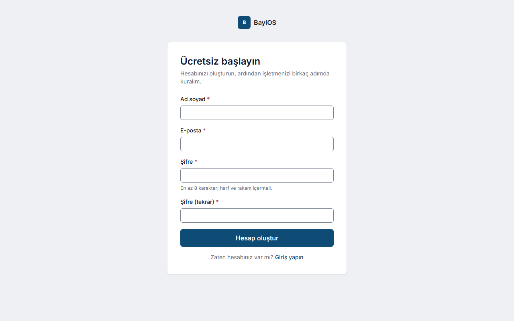
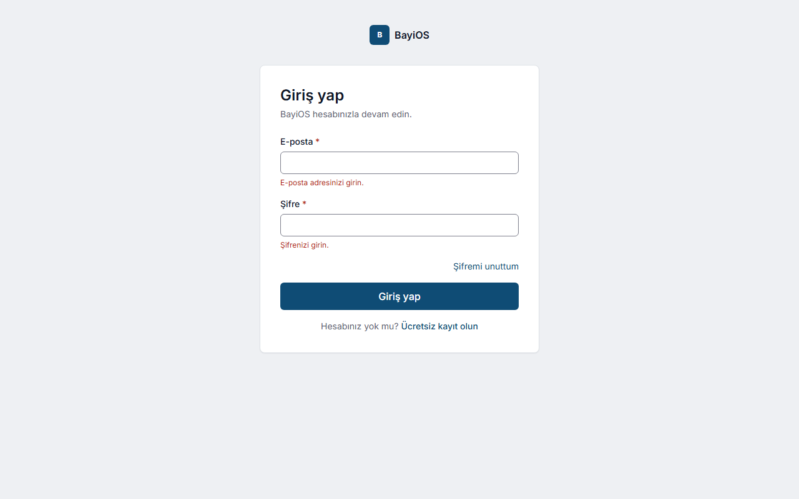
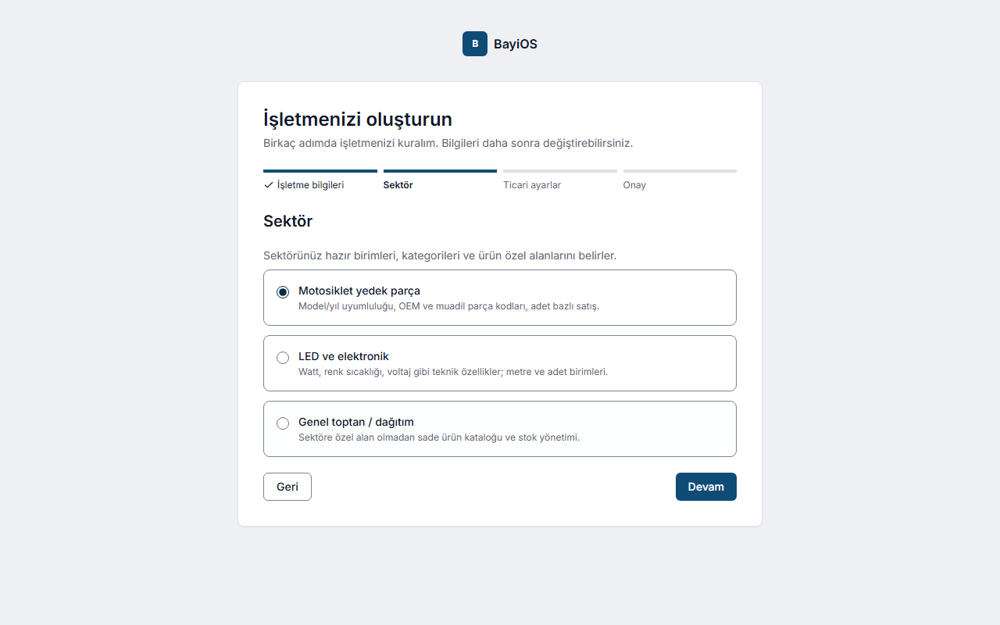
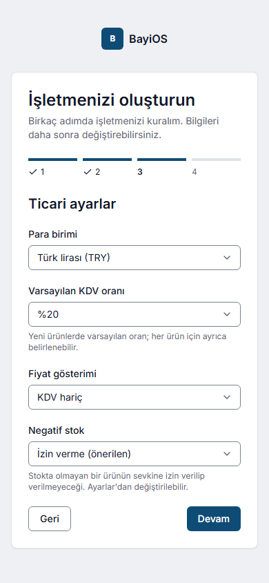

# 1. Hesap açma ve işletme kurulumu

## Amaç
Kendinize bir kullanıcı hesabı açmak ve işletmenizi (sektörünüze uygun hazır ayarlarla) BayiOS'ta oluşturmak.
İşletmeyi oluşturan kişi o işletmenin **İşletme sahibi** olur.

## Adımlar

### A. Hesap açma (`/kayit`)
1. Giriş ekranında **Ücretsiz kayıt olun** bağlantısına tıklayın.
2. **Ad soyad**, **E-posta**, **Şifre** ve **Şifre (tekrar)** alanlarını doldurun.
   Şifre en az 8 karakter olmalı, en az bir harf ve bir rakam içermelidir.
3. **Hesap oluştur** düğmesine basın.
4. E-postanıza gelen doğrulama bağlantısına tıklayın. Bağlantı sizi doğrudan işletme kurulumuna götürür.
   (E-posta gelmediyse istenmeyen/spam klasörüne bakın.)

### B. Giriş ve şifre
- **Giriş yap** ekranında e-posta ve şifrenizi girin.
- Şifrenizi unuttuysanız **Şifremi unuttum** bağlantısıyla e-postanıza sıfırlama bağlantısı isteyin.

### C. İşletmeyi oluşturma (`/isletme-olustur`) — 4 adım
1. **İşletme bilgileri**
   - **İşletme adı** (2–200 karakter), ör. "Yılmaz Motor Yedek Parça".
   - **İşletme adresi (kısa ad)**: adı yazarken otomatik önerilir (ör. `yilmaz-motor-yedek-parca`).
     Küçük harf, rakam ve tire; 3–63 karakter. Başka bir işletmede kullanılıyorsa değiştirmeniz istenir.
2. **Sektör** — üç seçenekten birini seçin. Sektör, hazır birimleri, kategorileri ve ürün özel alanlarını belirler:

   | Sektör | Hazır birimler | Hazır kategoriler | Hazır özel alanlar |
   |---|---|---|---|
   | **Motosiklet yedek parça** | Adet, Takım, Kutu, Litre, Metre | Motor, Debriyaj, Fren, Elektrik, Aktarma (zincir-dişli), Süspansiyon, Kaporta, Filtre & Yağ, Lastik & Jant, Aksesuar | Uyumlu motosiklet markaları, Uyumlu model, Model yılı aralığı, OEM / orijinal parça no, Taraf / konum, Garanti (ay); varyantta Parça tipi (Orijinal / Muadil / Yan sanayi) |
   | **LED ve elektronik** | Adet, Kutu, Koli, Metre | LED Modül, Kabinet, Kontrol Kartı, Video İşlemci, Güç Kaynağı, Kablo & Konnektör, Montaj Aparatı, Yedek LED/Lamba | Güç (W), Renk sıcaklığı (K), Voltaj (V), IP sınıfı, Pixel pitch (mm), Kullanım, Modül ölçüsü (mm), Parlaklık (nit), Tarama (scan), LED tipi, Kontrol kartı uyumu, Seri no takibi (Evet/Hayır) |
   | **Genel toptan / dağıtım** | Adet, Koli, Kilogram | – | – |

3. **Ticari ayarlar**
   - **Para birimi**: Türk lirası (TRY), ABD doları (USD) veya Euro (EUR). Varsayılan TRY.
   - **Varsayılan KDV oranı**: %20, %10, %1, %0 (KDV'siz). Yeni ürünlere önerilir.
   - **Fiyat gösterimi**: KDV hariç / KDV dahil.
   - **Negatif stok**: İzin verme (önerilen) / Uyar, devam etmeye izin ver / İzin ver.
     Ayrıntı: [Stok düzeltme ve negatif stok](06-stok-duzeltme-negatif-stok.md).
4. **Onay** — özeti kontrol edip **İşletmeyi oluştur** düğmesine basın.
   "İşletmeniz hazır" bildirimi çıkar ve ana ekrana geçersiniz.

### D. Birden çok işletme
Birden çok işletmenin üyesiyseniz girişten sonra **İşletme seç** ekranı açılır. Sağ üstteki
**İşletme seç** ile istediğiniz zaman değiştirebilirsiniz. Her işletmenin verisi tamamen ayrıdır.

## Sık hatalar ve mesajlar
| Mesaj | Ne yapmalı |
|---|---|
| Şifre en az 8 karakter olmalı. / Şifre en az bir harf ve bir rakam içermeli. | Daha uzun, harf ve rakam içeren şifre seçin. |
| Şifreler eşleşmiyor. | İki şifre alanına aynı şifreyi yazın. |
| Bu e-posta adresiyle zaten bir hesap var. Giriş yapmayı veya şifre sıfırlamayı deneyin. | Giriş yapın ya da **Şifremi unuttum**. |
| E-posta adresiniz henüz doğrulanmadı. … | E-postadaki doğrulama bağlantısına tıklayın. |
| E-posta adresi veya şifre hatalı. | Bilgileri kontrol edin. |
| Bağlantının süresi dolmuş. Lütfen yeni bir bağlantı isteyin. | Yeni doğrulama/sıfırlama bağlantısı isteyin. |
| Çok sayıda deneme yapıldı. Lütfen birkaç dakika bekleyip tekrar deneyin. | Birkaç dakika bekleyin. |
| Bu işletme adresi başka bir işletme tarafından kullanılıyor. Lütfen farklı bir adres girin. | Kısa adı değiştirin. |
| Yalnızca küçük harf (a-z), rakam ve tire kullanın; tire ile başlayamaz veya bitemez. | Türkçe karakter ve boşluk kullanmayın. |
| Devam etmek için bir sektör seçin. | Bir sektör kartına tıklayın. |
| İşletmeniz oluşturuldu, ancak sektör şablonu / ticari ayarlar / para birimi kaydedilemedi. | İşletme oluşmuştur. **Kalan adımları tamamla** düğmesine basın; ya da **Şimdilik atla, panoya geç** deyip ayarları sonra **Ayarlar**'dan yapın. |

## İpuçları
- Sektörü yanlış seçtiyseniz endişelenmeyin: özel alanları **Ayarlar → Özel alanlar** ekranından ekleyip arşivleyebilirsiniz.
- KDV, fiyat gösterimi ve negatif stok ayarları sonradan **Ayarlar** sayfasından değiştirilebilir. Para birimi sonradan ekrandan değiştirilemez.
- LED şablonundaki "Seri no takibi" yalnızca Evet/Hayır bilgisidir; BayiOS henüz seri numarası takibi yapmaz.
- Çalışma arkadaşlarınızı ekrandan davet etme özelliği henüz yoktur (bkz. [Bilinen sınırlamalar](bilinen-sinirlamalar.md)).
