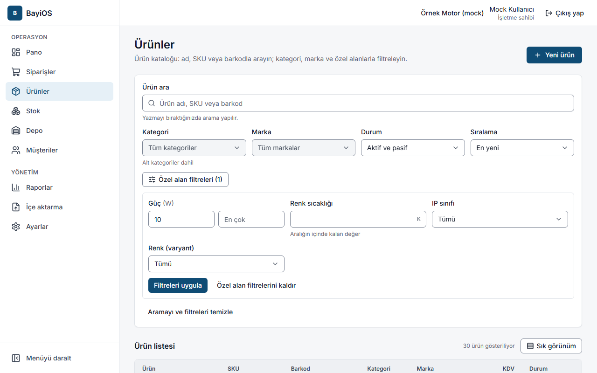
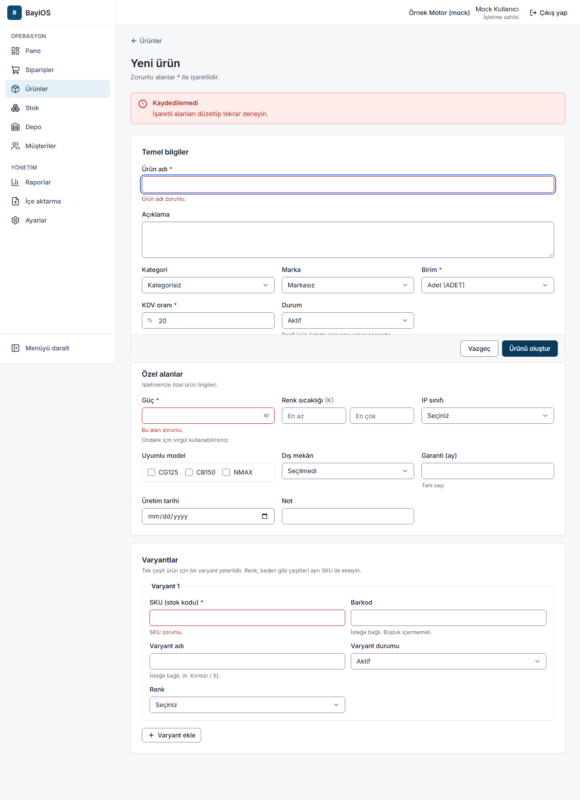
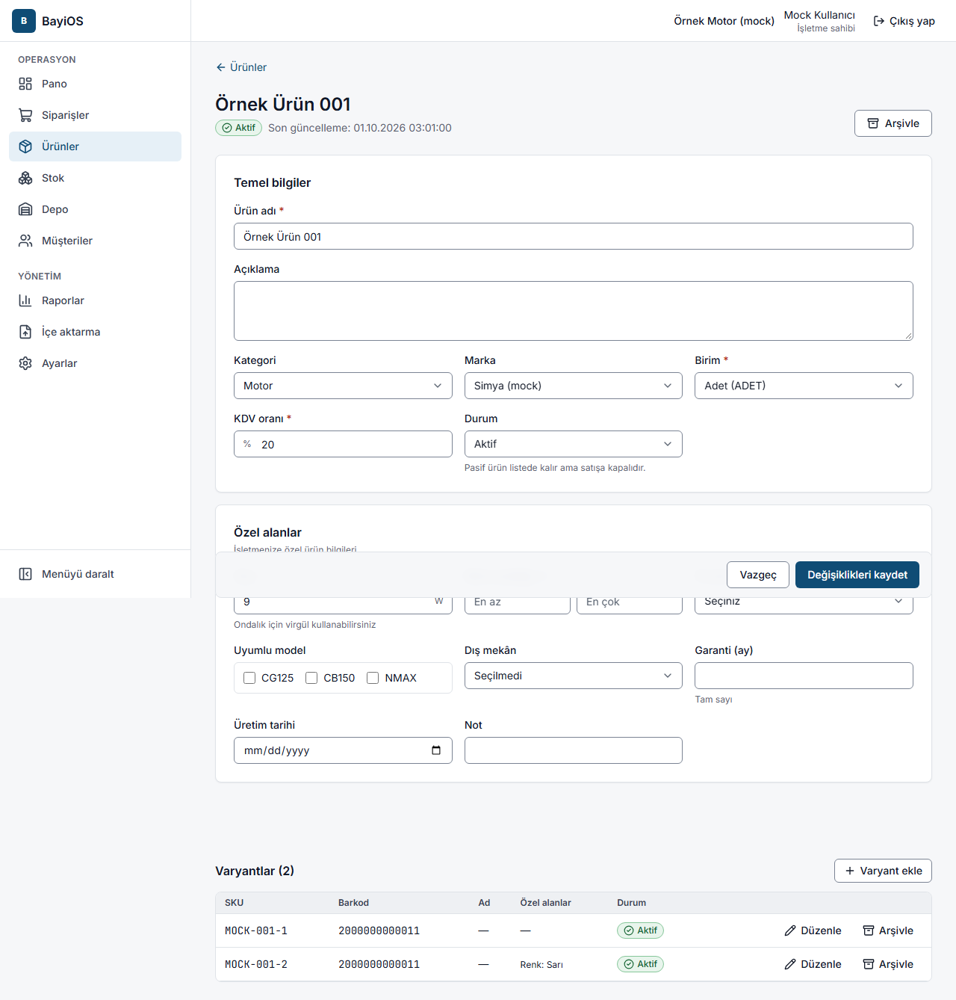
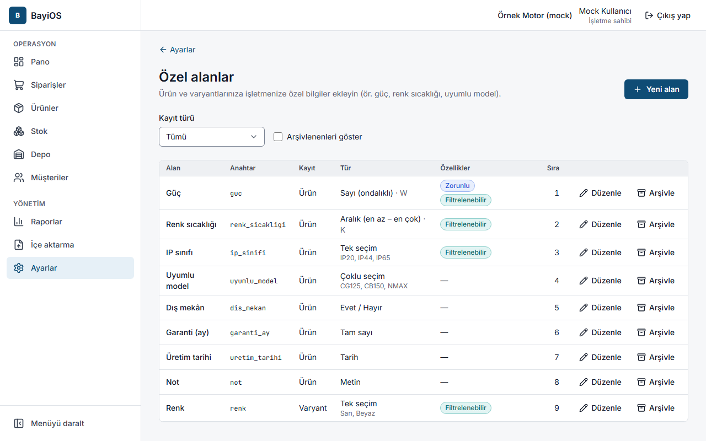

# 3. Ürünler ve özel alanlar

## Amaç
Sattığınız ürünleri (SKU, barkod, birim, KDV ve sektörünüze özel bilgilerle) kataloğa eklemek ve kolayca bulmak.

**Ürün** ve **varyant** farkı: Ürün genel kayıttır (ör. "Fren balatası"). Varyant, stokta tutulan ve satılan
tek çeşittir; kendi **SKU**'su ve **barkodu** vardır (ör. ön/arka, renk). Tek çeşit ürün için bir varyant yeterlidir.

## Adımlar

### Ürün listesi (`/urunler`)
- **Ürün ara** kutusuna ürün adı, SKU veya barkod yazın; yazmayı bıraktığınızda arama yapılır.
- **Kategori** (alt kategoriler dahil), **Marka**, **Durum** ve **Sıralama** ile süzün.
- Filtrelenebilir özel alanlar (ör. Güç, IP sınıfı, Uyumlu markalar) için ek filtreler çıkar; **Filtreleri uygula** deyin.
- **Aramayı ve filtreleri temizle** ile başa dönün. **Sık görünüm** ile daha çok satır görürsünüz.

### Yeni ürün (`/urunler/yeni`)
1. **Yeni ürün** düğmesine basın.
2. **Temel bilgiler**: **Ürün adı** (zorunlu), **Açıklama**, **Kategori**, **Marka**, **Birim** (zorunlu),
   **KDV oranı** (zorunlu, 0–100), **Durum** (Aktif / Pasif).
3. **Özel alanlar** bölümünde sektörünüze özel bilgileri doldurun.
4. **Varyantlar**: her varyant için **SKU** (zorunlu, en fazla 64 karakter), **Barkod** (isteğe bağlı, boşluksuz),
   **Varyant adı** ve varsa varyant özel alanları. Başka çeşit için **Varyant ekle**.
5. **Ürünü oluştur** düğmesine basın.

### Ürünü düzenleme (`/urunler/{ürün}`)
- Alanları değiştirip **Değişiklikleri kaydet** deyin.
- Varyantlar sayfanın altında ayrı listelenir; **Varyant ekle** ile yeni çeşit ekleyebilir, tek tek düzenleyip arşivleyebilirsiniz.
- **Arşivle**: ürün listelerde ve yeni siparişlerde görünmez; geçmiş kayıtlar korunur. **Arşivden çıkar** ile geri alınır.
- **Pasif** ürün listede kalır ama satışa kapalıdır.

### Özel alanlar (`/ayarlar/ozel-alanlar`)
**Ayarlar → Özel alanlar** sayfasından işletmenize özel bilgi alanları ekleyin (yalnızca işletme sahibi ve yönetici).
1. **Yeni alan** düğmesine basın.
2. **Alan adı** (ör. "Güç"), **Anahtar** (otomatik önerilir; küçük harf, rakam, alt çizgi; sonradan değişmez),
   **Kayıt türü** (Ürün / Varyant), **Veri türü**:
   Metin, Sayı (ondalıklı), Tam sayı, Evet / Hayır, Tek seçim, Çoklu seçim, Aralık (en az – en çok), Tarih.
3. Sayı ve aralık için **Birim** (ör. W, mm, K); seçim alanları için **Seçenekler** (her satıra bir seçenek).
4. **Zorunlu alan** ve **Ürün listesinde filtre olarak kullanılsın** seçeneklerini işaretleyin; **Sıra** ile formdaki yerini belirleyin.
5. **Alanı ekle**. Kullanmadığınız alanı **Arşivle**yin; ürünlerdeki kayıtlı değerler silinmez.

## Sık hatalar ve mesajlar
| Mesaj | Ne yapmalı |
|---|---|
| Ürün adı zorunlu. / Birim seçin. / KDV oranı zorunlu. | Zorunlu alanları doldurun. |
| 0 ile 100 arasında, en fazla 2 ondalıklı bir oran girin. | KDV'yi ör. 20 veya 1 olarak girin. |
| SKU zorunlu. | Her varyanta bir SKU verin. |
| Barkod boşluk içermemeli ve en fazla 64 karakter olmalı. | Barkoddaki boşlukları silin. |
| Bu SKU başka bir üründe kullanılıyor. Farklı bir SKU girin. | SKU benzersiz olmalı. |
| Bu barkod başka bir üründeki varyantta (SKU …) kullanılıyor. Farklı bir barkod girin. | Belirtilen SKU'yu arayıp kontrol edin. |
| Varyantların SKU'ları birbirinden farklı olmalı. | Aynı formda tekrar eden SKU'yu düzeltin. |
| Ürünün en az bir aktif varyantı olmalı. Bunun yerine ürünü arşivleyin. | Son varyant arşivlenemez. |
| Arşivlenmiş ürüne varyant eklenemez. Önce ürünü geri alın. | **Arşivden çıkar** deyin. |
| Bu anahtar başka bir özel alanda kullanılıyor. Farklı bir anahtar girin. | Anahtarı değiştirin. |
| Aktif özel alan sınırına ulaşıldı. Kullanmadığınız bir alanı arşivleyin. | Bir alanı arşivleyin. |
| Geçerli bir sayı girin (ör. 12,5). / En az değer, en çok değerden büyük olamaz. | Özel alan değerini düzeltin. |
| Kayıt başkası tarafından değiştirildi | **Yeniden yükle** deyip değişikliği tekrar yapın. |

## İpuçları
- Ondalık ayırıcı olarak virgül kullanabilirsiniz (12,5).
- Barkod okuyucu klavye gibi çalışır: arama kutusuna tıklayıp barkodu okutmanız yeterlidir.
- **Marka**, **kategori** ve **birim** listelerini düzenleme ekranı henüz yoktur. Kategoriler ve birimler sektör şablonundan gelir;
  marka listesi pilotta BayiOS ekibi tarafından doldurulur.
- Salt okunur rollerde ekranda "Salt okunur görünüm" uyarısı çıkar.
