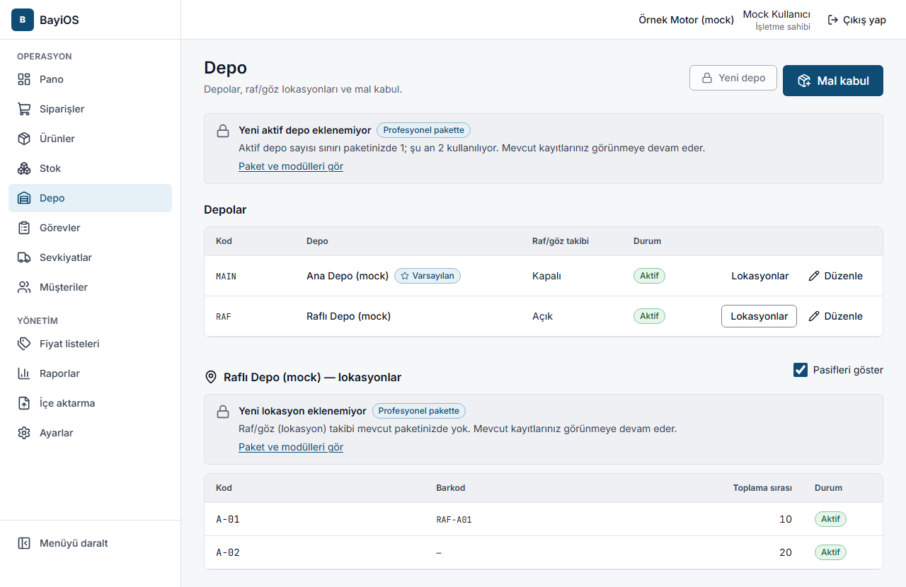

# 5. Depo, raf ve mal kabul

## Amaç
Depolarınızı ve (isterseniz) raf/göz yerlerini tanımlamak; gelen malı barkod okutarak stoğa almak.

## Adımlar

### Depo tanımlama (`/depo`)
Yalnızca işletme sahibi, yönetici ve operasyon müdürü.
1. **Depo** sayfasında **Yeni depo** düğmesine basın.
2. **Depo kodu** (kısa ve boşluksuz, ör. MERKEZ veya DUKKAN) ve **Depo adı** girin.
3. **Raf/göz (lokasyon) takibi**: açarsanız mal kabul ve düzeltmede raf seçmek zorunlu olur.
   Bu ayar yalnızca depoda stok yokken değiştirilebilir.
4. **Varsayılan depo yap**: mal kabul ve düzeltmede önce bu depo seçilir.
5. **Depoyu ekle**.

Hiç depo tanımlamadıysanız ilk mal kabulde **"Ana Depo" otomatik oluşturulur**.

### Raf/göz (lokasyon) tanımlama
1. Depo listesinde depoyu seçin; **Lokasyonlar** bölümünde **Yeni lokasyon** deyin.
2. **Lokasyon kodu** (ör. A-01-03 = koridor-raf-göz), **Raf barkodu** (isteğe bağlı; rafa yapıştırılan etiket),
   **Toplama sırası** (küçük numara toplama listesinde önce gelir), **Aktif**.
3. **Lokasyonu ekle**. Pasif lokasyonları görmek için **Pasifleri göster**.

> Raf/göz takibi **Profesyonel** paket özelliğidir. Temel pakette yeni lokasyon eklenemez ve
> ekranda "Yeni lokasyon eklenemiyor" kilidi görünür; mevcut raflar kullanılmaya devam eder.
> Temel pakette yalnızca **1 aktif depo** olabilir ("Yeni aktif depo eklenemiyor").

### Mal kabul (`/depo/mal-kabul`)
Sahip, yönetici, operasyon müdürü ve depo personeli. Telefon tarayıcısında da rahat kullanılır.
1. **Stok** veya **Depo** sayfasında **Mal kabul** düğmesine basın.
2. **Depo** seçin. İsterseniz **Referans (irsaliye / fatura no)** girin; hareket geçmişinde görünür.
3. Raf takibi açık depoda **Okutulan ürünlerin rafı**nı seçin; her yeni satıra bu raf atanır (satırda değiştirebilirsiniz).
4. **Barkod veya SKU okutun** kutusuna el terminali/barkod okuyucu ile okutun ya da elle yazıp Enter'a basın.
   Bulunan ürün satır olarak eklenir. Birden çok ürün eşleşirse listeden seçin.
5. Her satırda **miktar**ı girin. Miktar kutusunda Enter'a basmak sizi tekrar okutma kutusuna götürür.
6. Altta "… satır · toplam … birim" özetini kontrol edip **Mal kabulü kaydet** deyin.
7. "Mal kabul kaydedildi" mesajı çıkar; **Stokta gör** ile sonucu görebilir ya da sıradaki mal kabule devam edebilirsiniz.

### Stoğu görme (`/stok`)
- Her satırda **Rafta**, **Ayrılmış** ve **Satılabilir** miktarlar görünür.
  Satılabilir = Rafta − Ayrılmış (onaylı siparişlere ayrılan).
- **Depo** ile süzün; **SKU, barkod veya ürün adı** kutusunda okutarak arayın.
- Bir ürünün hareket geçmişi (stok kartı) için satırdaki ürüne tıklayın.

## Sık hatalar ve mesajlar
| Mesaj | Ne yapmalı |
|---|---|
| Mal kabul yetkiniz yok | Rolünüz mal kabule izin vermiyor. |
| Bu depoda raf/göz (lokasyon) seçmek zorunlu. | Satırda raf seçin. |
| Bu depo raf/göz takibi kullanmıyor; lokasyon seçmeyin. | Raf alanını boş bırakın. |
| Bu depo pasif. Aktif bir depo seçin. / Bu lokasyon pasif. Başka bir lokasyon seçin. | Aktif depo/raf seçin. |
| Bu ürün aktif değil; stok girişi yapılamaz. | Ürünü önce aktif yapın. |
| Bu ürünün birimi küsurat kabul etmiyor; tam sayı girin. | Adet bazlı üründe ondalık girmeyin. |
| 0'dan büyük, en fazla 3 ondalıklı bir miktar girin. | Miktarı düzeltin. |
| Bu depo kodu zaten kullanılıyor. Farklı bir kod girin. | Başka kod seçin. |
| Bu lokasyon kodu bu depoda zaten var. / Bu lokasyon barkodu başka bir lokasyonda kullanılıyor. | Kod/barkodu değiştirin. |
| Depoda stok varken raf/göz takibi açılıp kapatılamaz. … | Önce depoyu boşaltın. |
| Varsayılan depo pasif yapılamaz. Önce başka bir depoyu varsayılan yapın. | Önce başka depoyu varsayılan yapın. |
| Stok kayıtları meşgul, otomatik olarak yeniden deneniyor… | Bekleyin; gerekirse tekrar kaydedin, çift kayıt oluşmaz. |
| Bu belge satırı stoğa zaten işlenmiş. | Aynı mal kabul ikinci kez kaydedilmez. |
| Arama çok fazla ürünle eşleşiyor. Aramayı daraltın: … | Daha uzun SKU/barkod/ad yazın. |

## İpuçları
- Barkod okuyucunun "Enter" gönderecek şekilde ayarlı olması işinizi hızlandırır.
- Mal kabulde bir ürün yanlış eklendiyse satırdaki çöp kutusu ile kaldırın.
- Stok asla elle "üzerine yazılmaz": her giriş/çıkış bir hareket olarak kaydedilir ve stok kartında görünür.
