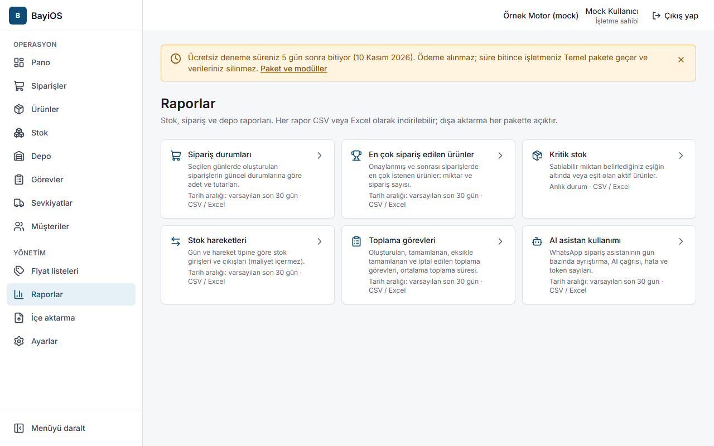
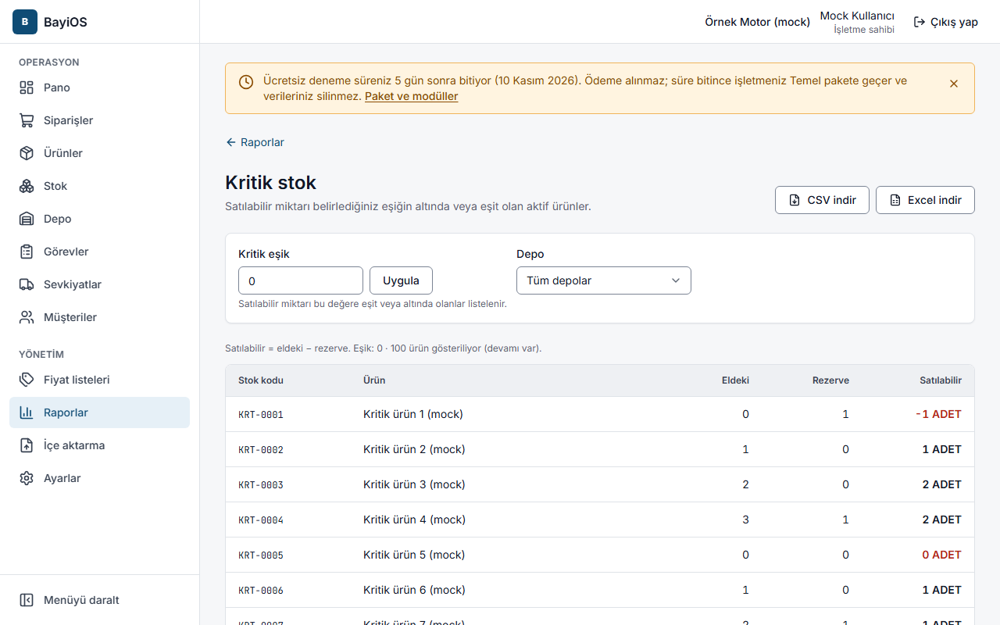
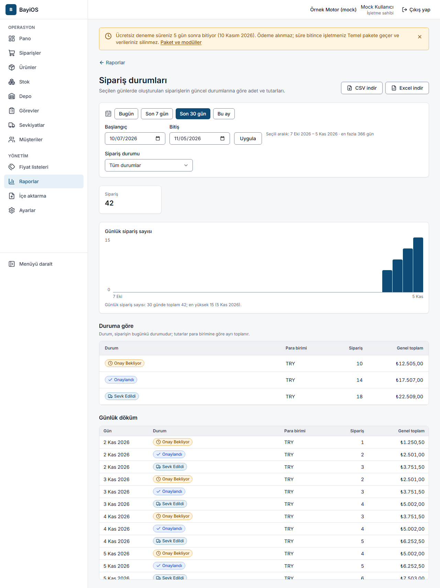

# 11. Raporlar ve dışa aktarma

## Amaç
Sipariş, stok ve depo performansını görmek; raporu Excel veya CSV olarak indirmek.
Dışa aktarma **her pakette açıktır**.

Kimler: işletme sahibi, yönetici, operasyon müdürü, izleyici. Satış personeli yalnızca sipariş raporlarını görür.
AI asistan kullanımı raporunu yalnızca işletme sahibi ve yönetici görür. Depo personeli rapor göremez.

## Raporlar (`/raporlar`)

| Rapor | Ne gösterir | Tarih aralığı |
|---|---|---|
| **Sipariş durumları** (`/raporlar/siparisler`) | Seçilen günlerde oluşturulan siparişlerin güncel durumlarına göre adet ve tutarları | Var |
| **En çok sipariş edilen ürünler** (`/raporlar/en-cok-siparis-edilenler`) | Onaylanmış ve sonrası siparişlerde en çok istenen ürünler: miktar ve sipariş sayısı | Var |
| **Kritik stok** (`/raporlar/kritik-stok`) | Satılabilir miktarı **kendi minimum stoğuna** eşit veya altında olan aktif ürünler (isterseniz tüm ürünler için tek bir sabit eşik) | Anlık durum |
| **Stok hareketleri** (`/raporlar/stok-hareketleri`) | Gün ve hareket tipine göre stok girişleri ve çıkışları (maliyet içermez) | Var |
| **Toplama görevleri** (`/raporlar/toplama-gorevleri`) | Oluşturulan, tamamlanan, eksikle tamamlanan ve iptal edilen görevler, ortalama toplama süresi | Var |
| **AI asistan kullanımı** (`/raporlar/ai-kullanimi`) | WhatsApp asistanının gün bazında ayrıştırma, AI çağrısı, hata ve token sayıları | Var |

## Adımlar
1. Menüden **Raporlar**'a girip bir rapor seçin.
2. Tarih aralığı için hazır seçeneklerden birini seçin: **Bugün**, **Son 7 gün**, **Son 30 gün** (varsayılan), **Bu ay**;
   ya da **Başlangıç** ve **Bitiş** tarihlerini girin (en fazla 366 gün).
3. Gerekirse **Depo** seçin (varsayılan: Tüm depolar).
4. Kritik stok raporu varsayılan olarak her ürünü **kendi minimum stoğuna** göre değerlendirir (satılabilir = eldeki −
   rezerve; satılabilir miktar minimum stoğa eşit veya altındaysa ürün listelenir). Minimum stok ürün düzenleme
   ekranındaki **Minimum stok** bölümünden, depoya özel eşik ürünün stok sayfasından girilir; hangi eşiğin geçerli olduğu:
   [Stok düzeltme ve minimum stok](06-stok-duzeltme-negatif-stok.md#minimum-stok-kritik-stok-eşiği).
   - **Min. stok** kolonu ürünün karşılaştırıldığı değeri gösterir (eşik yoksa "—").
   - **Eşiği olmayan, stoğu tükenmiş ürünleri de göster**: minimum stok girilmemiş ama satılabilir miktarı 0 veya altında
     olan ürünler de eklenir.
   - **Kritik eşik** kutusuna bir sayı yazıp **Uygula** derseniz tüm aktif ürünler bu sabit eşiğe göre listelenir (eski
     davranış). Kutuyu boşaltıp **Uygula** derseniz ürünlerin kendi minimum stoğuna dönülür.
   - Hiç minimum stok girilmemişse rapor "Henüz minimum stok tanımlanmadı" der ve **Ürünlere git** bağlantısını gösterir.
5. **Dışa aktar** bölümünden **CSV** veya **Excel (XLSX)** seçin; "Dosya hazırlanıyor…" sonrası dosya iner.

## Sık hatalar ve mesajlar
| Mesaj | Ne yapmalı |
|---|---|
| Başlangıç tarihi bitiş tarihinden sonra olamaz. | Tarihleri düzeltin. |
| Tarih aralığı en fazla 366 gün olabilir. | Aralığı kısaltın. |
| 0 veya daha büyük, en fazla 3 ondalıklı bir sayı girin. | **Kritik eşik** kutusundaki değeri düzeltin ya da kutuyu boşaltın. |
| Eşik 0 veya daha büyük bir sayı olmalı. | Sunucu eşiği kabul etmedi; değeri düzeltin. |
| Henüz minimum stok tanımlanmadı | Ürünlere minimum stok girin ya da sabit bir eşikle kontrol edin. |
| Saatlik dışa aktarma sınırına ulaşıldı (işletme başına saatte 10 dosya). … sonra tekrar deneyin. | Bekleyin. |
| Dosya 20.000 satır sınırını aşıyor. Tarih aralığını veya filtreleri daraltıp tekrar deneyin. | Aralığı daraltın. |
| Rolünüz yalnızca sipariş raporlarını görebilir. … | Satış personeli için normaldir. |
| Bu raporu görme yetkiniz yok | Rolünüz bu rapora izin vermiyor. |
| Seçilen depo bulunamadı. Depo filtresini temizleyip tekrar deneyin. | Depo filtresini kaldırın. |

## İpuçları
- Tutarlar yalnızca satış fiyatı görebilen rollere gösterilir.
- Azalan ürünleri erkenden görmek için ürünlere minimum stok girin; aynı değer panodaki **Kritik stok** kutusunu ve
  **Stok** listesindeki **Kritik** rozetini de besler.
- Sabit eşik, minimum stok girmeden önce hızlı bir kontrol içindir. Dışa aktarılan dosyadaki "Eşik" kolonu satırın
  karşılaştırıldığı değeri yazar.
