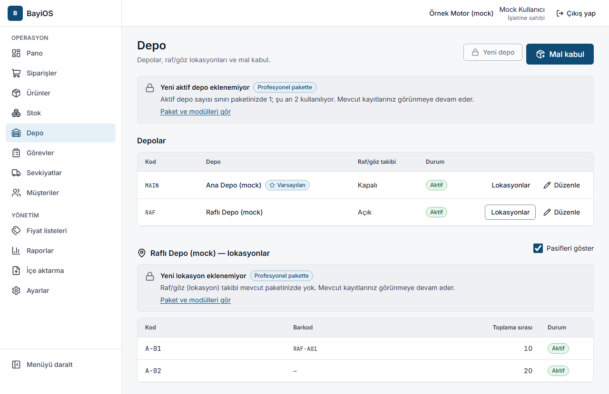
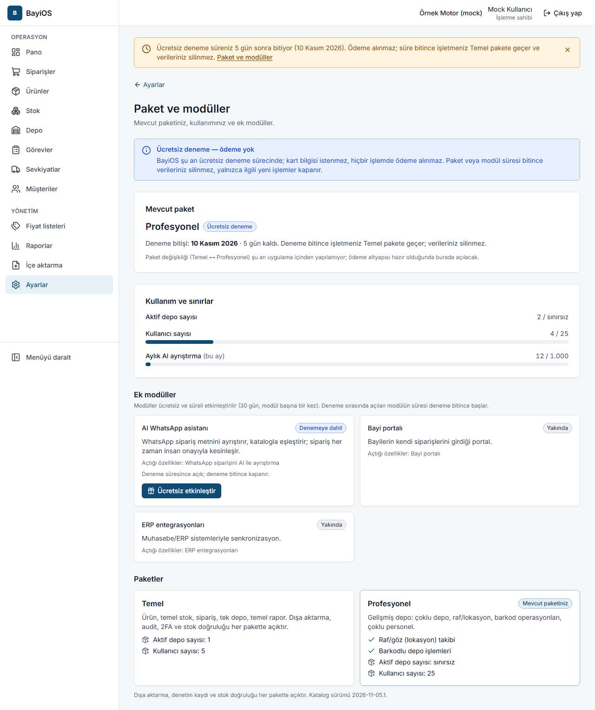

# 12. Paket, deneme süresi ve modüller

## Amaç
İşletmenizin hangi pakette olduğunu, deneme süresinin ne zaman bittiğini ve hangi ek modüllerin açık olduğunu görmek.

> **Ödeme yok.** BayiOS şu an ücretsiz deneme sürecindedir; kart bilgisi istenmez, hiçbir işlemde ödeme alınmaz.
> Süre bitince verileriniz **silinmez**, yalnızca ilgili yeni işlemler kapanır.

## Paketler
- **Profesyonel** — yeni işletmeler ücretsiz denemeye Profesyonel paket ve tüm ek modüllerle başlar (varsayılan 30 gün).
- **Temel** — deneme bitince işletme Temel pakete geçer.

Ekranda görünen sınırlar (Temel değerleri ürün sahibi kararıdır, 2026-11-09):

| | Temel | Profesyonel |
|---|---|---|
| Aktif depo sayısı | 999 | Sınırsız |
| Ürün sayısı (arşivlenmiş ürünler sayılmaz) | 999 | Sınırsız |
| Raf/göz (lokasyon) takibi | – | ✓ |
| Kullanıcı sayısı | 999 | 999 |

**AI WhatsApp asistanı** ek modülü: aylık 1.000 AI ayrıştırma.

## Deneme bitince ne olur?
- Ürün, stok hareketleri (mal kabul, düzeltme, sevkiyat), sipariş, toplama, raporlar ve dışa aktarma **tam çalışmaya devam eder**.
- Mevcut tüm depolar ve raflar görünür ve kullanılır.
- Sınırdaysanız **yeni** aktif depo veya **yeni** ürün eklenemez; **yeni** raf/lokasyon eklenemez veya düzenlenemez,
  **yeni** WhatsApp mesajı ayrıştırılamaz. Bu yerlerde kilit simgesiyle "… mevcut paketinizde yok." ve
  "Profesyonel pakette" / "AI WhatsApp asistanı modülünde" etiketi görünür.
- Daha önce ayrıştırılmış WhatsApp mesajları incelenip onaylanabilir veya reddedilebilir.
- Depo adı değiştirme, depoyu pasif yapma, raf takibini kapatma (depo boşken) her pakette açıktır.
- Depo sınırının üstünde kalsanız bile, fazla depoları boşaltmak için **stok düzeltme ve depolar arası transfer** her zaman yapılabilir; boşalan depoyu pasif yapın.

Deneme bitmesine **7 gün veya daha az** kalınca ekranın üstünde uyarı çıkar
("Ücretsiz deneme süreniz … sonra bitiyor (…). Ödeme alınmaz; …"). Bitince
"Ücretsiz deneme süreniz sona erdi; işletmeniz Temel pakette. Verileriniz silinmedi, temel işler sürüyor." yazar.
Uyarıyı **X** ile o oturum için kapatabilirsiniz.

## Adımlar — Paket ve modüller sayfası (`/ayarlar/paket`)
Görme: işletme sahibi ve yönetici. Modül açma/kapatma: yalnızca işletme sahibi.
1. **Ayarlar → Paket ve modüller**'e girin.
2. **Mevcut paket**: paket adı, durumu (Ücretsiz deneme / Etkin / Süresi doldu / İptal edildi) ve deneme bitiş tarihi.
3. **Kullanım ve sınırlar**: aktif depo, kullanıcı ve bu ayki AI ayrıştırma sayısı; sınırdaysa kırmızı görünür.
4. **Ek modüller**: her modülün durumu (Denemeye dahil, Ücretsiz deneme, Etkin, Süresi doldu, Kapatıldı, Etkinleştirilebilir, Yakında).
   - **Ücretsiz etkinleştir** — modül ücretsiz ve süreli açılır (30 gün, **modül başına bir kez**). Deneme sırasında açılan modülün süresi deneme bitince başlar.
   - **Kapat** → **Modülü kapat** — yeni işlemler kapanır, veriler silinmez; süre bitene kadar yeniden açabilirsiniz.
5. **Paketler**: Temel ve Profesyonel'in içerdiği özellikler ve sınırlar.

Şu an hazır olan ek modül yalnızca **AI WhatsApp asistanı**dır. Bayi portalı, Seri/Garanti takibi, ERP entegrasyonları,
Resmî WhatsApp otomasyonu ve Gelişmiş analitik "Yakında" olarak görünür ve açılamaz.

## Sık hatalar ve mesajlar
| Mesaj | Anlamı |
|---|---|
| Paket bilgilerini görme yetkiniz yok | Yalnızca sahip ve yönetici görebilir. |
| Bu modül henüz hazır değil; etkinleştirilemez. … | "Yakında" modüller açılamaz. |
| Bu modülün ücretsiz denemesi daha önce kullanıldı. Ücretli etkinleştirme henüz yok; ödeme alınmaz, bilgi için bizimle iletişime geçin. | Deneme hakkı bir kezdir. |
| Bu modül zaten etkin. Liste güncellendi. | İşlem gerekmez. |
| Bu modül etkin değil; kapatılacak bir şey yok. … | Denemeye dahil modüller kendiliğinden kapanır. |
| … sınırına ulaşıldı (x/y). Daha yüksek sınır Profesyonel pakette. … | Paket sınırı; mevcut verileriniz durur. |
| Paket değişikliği için işletme sahibiyle görüşün. | Sahip veya yönetici olmayanlar kilit ekranında bunu görür. |

## İpuçları
- Paket değişikliği (Temel ↔ Profesyonel) şu an uygulama içinden yapılamaz; ödeme altyapısı yoktur.
- Kullanıcı sınırı uygulanır: aktif üyeler ve açık davetler birlikte sayılır; sınır doluysa yeni davet oluşturulamaz.
  **Ayarlar → Ekip** ekranında kullanım gösterilir.
