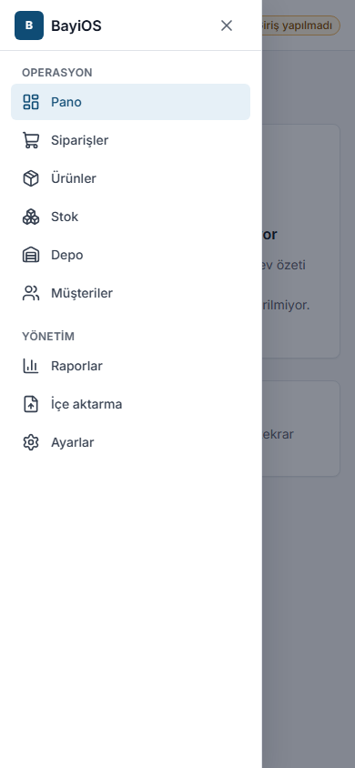

# BayiOS Kullanıcı Kılavuzu

Bu kılavuz BayiOS'u kullanan işletme sahipleri ve çalışanları içindir. Her sayfada aynı düzen var:
**Amaç**, **Adımlar**, **Sık hatalar ve mesajlar**, **İpuçları**.

> Kılavuz, BayiOS web uygulamasının bugün çalışan hâlini anlatır (pilot sürümü, Kasım 2026).
> Henüz olmayan özellikler [Bilinen sınırlamalar](bilinen-sinirlamalar.md) sayfasındadır. Bir ekranda
> "Bu modül henüz geliştiriliyor" yazıyorsa o bölüm henüz kullanıma hazır değildir.

## BayiOS'a nasıl girilir?
BayiOS internet tarayıcısında çalışır (bilgisayar, tablet veya telefon). Ayrı bir telefon uygulaması
**henüz yoktur**; depoda telefonun tarayıcısını kullanırsınız.

## Sayfalar

| # | Konu | Kimler için |
|---|---|---|
| 1 | [Hesap açma ve işletme kurulumu](01-hesap-ve-isletme-kurulumu.md) | İşletme sahibi |
| 2 | [Kullanıcı rolleri ve izinler](02-roller-ve-izinler.md) | Herkes |
| 3 | [Ürünler ve özel alanlar](03-urunler-ve-ozel-alanlar.md) | Sahip, yönetici, operasyon müdürü |
| 4 | [Excel/CSV ile toplu ürün aktarma](04-toplu-urun-aktarma.md) | Sahip, yönetici |
| 5 | [Depo, raf ve mal kabul](05-depo-raf-mal-kabul.md) | Depo ekibi, operasyon müdürü |
| 6 | [Stok düzeltme ve negatif stok](06-stok-duzeltme-negatif-stok.md) | Operasyon müdürü, yönetici |
| 7 | [Müşteriler, bayi grupları ve fiyat listeleri](07-musteriler-bayi-gruplari-fiyat-listeleri.md) | Satış, yönetici |
| 8 | [Sipariş oluşturma, onay ve stok ayırma](08-siparis-onay-rezervasyon.md) | Satış, operasyon müdürü |
| 9 | [WhatsApp siparişi](09-whatsapp-siparisi.md) | Satış |
| 10 | [Toplama, paketleme ve sevkiyat](10-toplama-paketleme-sevkiyat.md) | Depo ekibi |
| 11 | [Raporlar ve dışa aktarma](11-raporlar-ve-disa-aktarma.md) | Sahip, yönetici, müdür, izleyici |
| 12 | [Paket, deneme süresi ve modüller](12-paket-deneme-moduller.md) | İşletme sahibi |
| 13 | [Ayarlar: sipariş onayı, numara öneki, KDV](13-ayarlar.md) | Sahip, yönetici |
| 14 | [KVKK: müşteri anonimleştirme](14-kvkk-musteri-anonimlestirme.md) | Sahip, yönetici |
| 15 | [Depolar arası transfer, raf taşıma ve stok sayımı](15-transfer-sayim-raf-tasima.md) | Depo ekibi, operasyon müdürü |
| – | [Bilinen sınırlamalar](bilinen-sinirlamalar.md) | Herkes |

## Menü
Sol menüde (telefonda ☰ düğmesiyle açılan menüde) yalnızca rolünüzün açabildiği bölümler görünür:

- **Operasyon:** Pano, Siparişler, Ürünler, Stok, Depo, Görevler, Sevkiyatlar, Transferler, Sayımlar, Müşteriler
- **Yönetim:** Fiyat listeleri, Raporlar, İçe aktarma, Ayarlar

Sağ üstte **Aktif işletme** adı, birden çok işletmeniz varsa **İşletme seç** ve **Çıkış yap** bulunur.

> **Pano** rolünüze göre özet kutuları gösterir: onay bekleyen siparişler, bugünkü siparişler, kritik stok (minimum stoğun
> altındaki ürünler), görevlerim, incelenecek WhatsApp siparişleri ve paket durumu. Yalnızca yetkiniz olan kutular görünür.

## Her yerde geçerli birkaç kural
- **"Kayıt başkası tarafından değiştirildi"** uyarısı görürseniz siz düzenlerken bir başkası aynı kaydı
  kaydetmiştir. **Yeniden yükle** düğmesine basın, değişikliğinizi tekrar yapın. Hiçbir şey sessizce üzerine yazılmaz.
- **"… şu an başka bir işlem tarafından kullanılıyor"** mesajı geçicidir. BayiOS bir kez kendisi yeniden dener;
  yine olmazsa birkaç saniye sonra aynı düğmeye tekrar basın. Aynı işlem iki kez kaydedilmez.
- **"Oturumunuzun süresi doldu. Lütfen yeniden giriş yapın."** görürseniz tekrar giriş yapın.
- **"Sunucuya ulaşılamadı. İnternet bağlantınızı kontrol edip tekrar deneyin."** internet bağlantısı sorunudur.
- **"Bu işlem için yetkiniz yok. Gerekirse işletme yöneticinizle görüşün."** rolünüzün bu işe izni yoktur.
