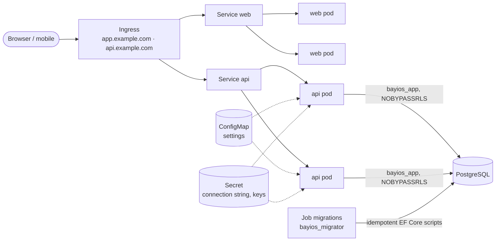

# BayiOS on Kubernetes

A Helm chart for the BayiOS API (ASP.NET Core) and web panel (Next.js), plus a throwaway `kind` setup that CI uses to
prove the chart deploys and serves traffic on every change (`.github/workflows/ci-k8s.yml`).

> [!NOTE]
> The hosted preview/production path of the project is still Fly.io (API) + Vercel (web) + Supabase
> ([`docs/operations/deploy-and-rollback.md`](../../docs/operations/deploy-and-rollback.md)). This chart is the
> Kubernetes alternative; it is tested on kind, not yet on a managed cluster. No image registry is published yet.



## Layout

| Path | What |
|---|---|
| [`helm/bayios/`](helm/bayios/) | The chart |
| [`helm/bayios/values.yaml`](helm/bayios/values.yaml) | Defaults, every value documented; **no real value** |
| [`kind/cluster.yaml`](kind/cluster.yaml) | 1 control plane + 2 workers |
| [`kind/values-kind.yaml`](kind/values-kind.yaml) | Values for kind (local PostgreSQL + migration Job on) |
| [`kind/kind.sh`](kind/kind.sh) | `up` / `smoke` / `down` / `diagnostics` — the exact steps CI runs |
| [`../../apps/web/Dockerfile`](../../apps/web/Dockerfile) | Web image (Next.js `standalone` output, non-root) |
| [`../../services/api/Dockerfile`](../../services/api/Dockerfile) | API image (chiseled .NET runtime, non-root) |

## What the chart deploys

| Component | Kind | Notes |
|---|---|---|
| API | Deployment (2 replicas) + Service + PDB | `startupProbe`/`livenessProbe` on `GET /health` (no dependencies), `readinessProbe` on `GET /health/ready` (database, settings, job queue) |
| Web | Deployment (2 replicas) + Service + PDB | probes on `GET /`; `emptyDir` for `.next/cache` because the root filesystem is read-only |
| Settings | ConfigMap per component | non-secret values from `api.config` / `web.config` |
| Secrets | Secret `<release>-api` | connection string, audit hash key, provider keys — filled at install time or via `api.secret.existingSecret` |
| PostgreSQL 17 | StatefulSet + PVC (`postgres.enabled`) | **local/CI only**; bootstrapped with the same roles as `infra/docker/initdb` |
| Migrations | Job (`migrations.enabled`) | applies `infra/ci/ef-migrations.sh` output as `bayios_migrator`, in manifest order |
| Ingress | optional | two hosts, same scheme as the Linux/Nginx setup |
| NetworkPolicy | on by default | PostgreSQL reachable only from API pods and the migration Job |

Every pod runs as non-root with `readOnlyRootFilesystem`, all capabilities dropped, `seccompProfile: RuntimeDefault`
and no service-account token; the kind namespace enforces the Pod Security **restricted** profile. Every container has
CPU/memory requests and limits.

## Configuration and secrets

The repository is public, so `values.yaml` only contains placeholders. Two supported ways to supply secrets:

1. **Chart-managed Secret** (`api.secret.create: true`): pass values at install time from your secret store, e.g.
   `helm upgrade --install ... -f secrets.yaml` where `secrets.yaml` is generated in CI and never committed.
2. **External Secret** (`api.secret.existingSecret: bayios-api`): create the Secret yourself (External Secrets
   Operator, Sealed Secrets, `kubectl create secret generic --from-env-file`). Keys are the env var names from
   [`.env.example`](../../.env.example), e.g. `ConnectionStrings__Default`.

Production database = Supabase PostgreSQL, so `postgres.enabled=false` and the API gets the `bayios_app` (NOBYPASSRLS)
connection string. Migrations in production keep running from the deploy pipeline
(`infra/deploy/apply-migrations.sh`), not from the cluster.

## Run it locally

Needs Docker, [kind](https://kind.sigs.k8s.io/), kubectl, Helm 3 and the .NET 10 SDK (for the migration scripts).

```bash
bash infra/k8s/kind/kind.sh up
```

```bash
bash infra/k8s/kind/kind.sh smoke
```

```bash
kubectl -n bayios port-forward svc/bayios-web 3000:80
```

```bash
bash infra/k8s/kind/kind.sh down
```

`up` builds `bayios-api:kind` and `bayios-web:kind`, generates the EF Core scripts, creates the cluster, loads the
images (no registry), stores the scripts in a ConfigMap and runs `helm upgrade --install --wait --wait-for-jobs`
with random PostgreSQL passwords. `smoke` checks:

- API `GET /health` → 200 and `GET /health/ready` → 200 (database reachable, schema migrated, settings valid),
- API `GET /api/v1/products` without a token → **401** (fails closed),
- web `GET /` → 200, renders the BayiOS home page and sends a `Content-Security-Policy` header,
- every container has a read-only root filesystem.

Sign-in does not work on kind (there is no Supabase Auth in the cluster; `Auth__Authority` is a placeholder), which is
intentional: the cluster proves deployment, configuration, probes and isolation, not the auth provider.

## Operations cheat sheet

```bash
kubectl -n bayios get pods -o wide
kubectl -n bayios logs deploy/bayios-api -f          # JSON lines, secrets redacted by the API
kubectl -n bayios rollout restart deploy/bayios-api
helm -n bayios history bayios
helm -n bayios rollback bayios <revision>            # previous images + settings
```
